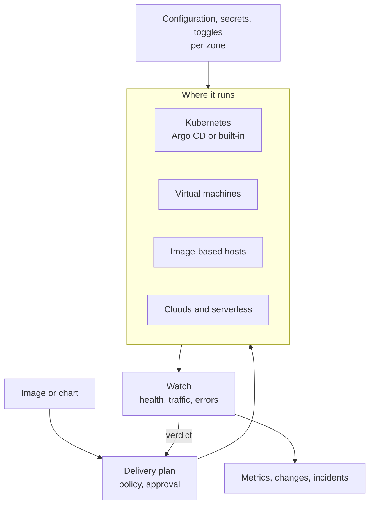

# Milestone 3: Delivery and GitOps depth

<!-- Generated by scripts/docs/build-roadmap.mjs from docs/roadmap/roadmap.json. Do not edit by hand. -->

<a href="../roadmap.html">Roadmap</a> › Milestone 3 · <a href="../roadmap-list.html">as a list</a>

Next 19 available · 2 in progress · 82 planned · 103 capabilities

See and control everything you run, whether it is an application in a cluster, a virtual machine or an image-based host, and deliver to it safely.

## What it is, and who it is for

Milestone 3 is about everything after the build. See every application and host in one place, find out why a deployment failed, roll out safely with weights and checks, run infrastructure as code with state kept for you, manage image-based hosts, and watch traffic, protection and reliability in the same views.

**Who it is for.** Teams that deploy to Kubernetes, virtual machines, machine images and clouds, and people who answer for what is running and whether it is healthy.

## What you will be able to do

- A deployment fails. Launchway says in one sentence why, shows the evidence, and offers to roll back the setting that caused it.
- You send ten percent of mobile traffic to a new version and watch errors on a map before widening it.
- You turn off a misbehaving feature with one button on a page that also shows its effect.
- A fleet of image-based hosts upgrades in batches with a check between each, and one batch pauses.
- A reviewer sees an automatically written change record with its risk and freeze status.

## How it fits together

*One plan, many targets, and a watch loop that can send a change back.*

**Builds on:** [Milestone 1: Host and run](milestone-1.md). **Leads to:** [Milestone 5: Software graph](milestone-5.md), [Milestone 8: Zero downtime](milestone-8.md), [Milestone 9: Network and traffic](milestone-9.md).

**Go deeper:** [Delivery: applications, rollouts and hosts](delivery.md) · [Live traffic, protection and reliability](traffic.md) · [The golden path](developer-experience.md) · [Built-in platform services](platform-services.md) · [Configuration as code](config-as-code.md).

## The capabilities

| Group | Capabilities | Available | In progress | Planned |
|---|---|---|---|---|
| [Applications and rollouts](#g-applications-and-rollouts) | 19 | 6 | 1 | 12 |
| [Debug a deployment, then see everything](#g-debug-a-deployment-then-see-everything) | 5 | 1 | 1 | 3 |
| [Where it deploys](#g-where-it-deploys) | 14 | 3 | 0 | 11 |
| [Infrastructure as code](#g-infrastructure-as-code) | 8 | 4 | 0 | 4 |
| [Runtime configuration](#g-runtime-configuration) | 6 | 1 | 0 | 5 |
| [Watch and protect](#g-watch-and-protect) | 10 | 0 | 0 | 10 |
| [Change and insight](#g-change-and-insight) | 7 | 0 | 0 | 7 |
| [Moving over from other delivery platforms](#g-moving-over-from-other-delivery-platforms) | 3 | 0 | 0 | 3 |
| [The golden path](#g-the-golden-path) | 13 | 0 | 0 | 13 |
| [Built-in platform services](#g-built-in-platform-services) | 9 | 0 | 0 | 9 |
| [Configuration as code and the automation control center](#g-configuration-as-code-and-the-automation-control-center) | 9 | 4 | 0 | 5 |

### Applications and rollouts {#g-applications-and-rollouts}

See and control everything you run, then deliver to it safely.

#### Argo CD in depth {#argo-cd-in-depth}

○ Planned

Application hierarchy views (app-of-apps and ApplicationSet trees) with status, sync, health, history and actions, ready health checks, and a hosted or your own Argo CD. Launchway reads each application as the deploy engine sees it, shows drift, and lets you act with the same permissions as everything else. Argo CD is first-class, never required.

**Depends on:** GitOps with Argo CD.

[Read the documentation](../guide/deployments.md) · [Area page](delivery.md)

#### Applications and ApplicationSets from the interface {#applications-and-applicationsets-from-the-interface}

○ Planned

Generate applications and sets, and compose app-of-apps, from a guided screen. The generated manifests are shown as a change you review and merge, so GitOps remains the record.

**Depends on:** Argo CD in depth.

[Area page](delivery.md)

#### Health checks set up from the interface {#health-checks-set-up-from-the-interface}

○ Planned

Write and test custom health checks for resources without editing configuration by hand. A check shows its result against live resources before you save it.

**Depends on:** Argo CD in depth.

[Area page](delivery.md)

#### Hosted or your own Argo CD {#hosted-or-your-own-argo-cd}

○ Planned

Use an Argo CD that Launchway runs for you, or connect one you already have. Both are equal in the interface. Teams that do not use Argo CD can use built-in deploys instead.

**Depends on:** Argo CD in depth.

[Area page](delivery.md)

#### Rollout control inside a run {#rollout-control-inside-a-run}

✓ Available

A pipeline watches a rollout, pauses at gates, promotes or aborts, and shows each step of the rollout as a station. Promote, abort and restart a rollout from the pipeline, and an Abort even after a rollout succeeded.

**Depends on:** Argo CD in depth.

[Read the documentation](../guide/deployments.md) · [Area page](delivery.md)

#### A single pane of glass {#a-single-pane-of-glass}

○ Planned

One fleet view of every application and every host: what runs where, its health, drift and evidence. Error rates, version, last change and owner are on one screen, and each tile opens the page that explains it.

**Depends on:** Argo CD in depth.

[Area page](delivery.md)

#### Weighted canaries and traffic control {#weighted-canaries-and-traffic-control}

○ Planned

Send a share of traffic, by client type, to a new version through the Gateway API or a service mesh, with mesh metrics as ready-made health checks. The overlay on the traffic map shows what share each version takes right now.

**Depends on:** Argo CD in depth.

[Area page](delivery.md)

#### Releases across services {#releases-across-services}

○ Planned

Ship several services as one ordered, gated release with a promotion view across Airfields. Promotion moves the same digest, never a rebuild, and every step shows who approved it.

**Depends on:** A single pane of glass.

[Area page](delivery.md)

#### Promotion across environments {#promotion-across-environments}

○ Planned

Move a version from one Airfield to the next with checks and approvals in between. The matrix shows what runs where, which places are behind, and a button to move a version.

**Depends on:** Releases across services.

[Area page](delivery.md)

#### Post-deploy watch and incidents {#post-deploy-watch-and-incidents}

○ Planned

Keep watching after release, roll back automatically, and tie incidents to the change that caused them. An incident links back to the commit, run and setting change nearest to it. The watch, the stable state and the automatic return are detailed in Milestone 8.

**Depends on:** Verification after a deploy.

[Area page](delivery.md)

#### AI analysis as an optional rollback gate {#ai-analysis-as-an-optional-rollback-gate}

○ Planned

Let a verification step use AI analysis of metrics and logs to trigger automatic Return to base, off by default and able to require a person for production. Plain threshold checks remain the default, and AI can decide only where you allow it.

**Depends on:** A built-in model gateway.

[Area page](ai.md)

#### A health proof built into verification {#a-health-proof-built-into-verification}

✓ Available

A verify step can call the service it just deployed, over its window, with no monitoring series to set up; a failure says how many requests got which answer. HTTP and TCP checks from the deploy Station, limited to the hosts and namespaces its operator lists; credentials are secret references. gRPC health checks are not built in yet.

**Depends on:** Argo CD in depth.

[Read the documentation](../guide/verification.md) · [Area page](delivery.md)

#### GitOps write-back done right {#gitops-write-back-done-right}

✓ Available

Several pipelines may write one manifest at once, a tag can sit beside its digest, and a repository Launchway hosts is written with a credential made for that one deployment, directly or by pull request. Not yet: returning to base several deployments at once by pull request.

**Depends on:** Argo CD in depth.

[Read the documentation](../guide/gitops-write-back.md) · [Area page](delivery.md)

#### Delivery notifications {#delivery-notifications}

✓ Available

An approval that waits, a failed Sortie or deployment, a Return to base and a step that waited too long are told to a signed webhook or a chat channel, with a delivery log and retries. Email, per-person muting and a Return to base review on Home are not done yet.

**Depends on:** Argo CD in depth.

[Read the documentation](../guide/notifications.md) · [Area page](delivery.md)

#### Templates with derived defaults and optional parts {#templates-with-derived-defaults-and-optional-parts}

✓ Available

A parameter's default can follow another parameter, any step kind or list entry of a template can be left out by a parameter, and launchway validate expands templates from a library directory with no server. Defaults derive only for string parameters, from string parameters. The offline command does not know which libraries or Airfields a server allows.

**Depends on:** Argo CD in depth.

[Read the documentation](../guide/libraries.md) · [Area page](delivery.md)

#### Delivery by choice {#delivery-by-choice}

○ Planned

A pipeline chooses how to deliver per Airfield: through a GitOps controller (single application or parent with children), direct chart installs, or plain manifests; progressive delivery with or without the GitOps controller. None is required. Short-lived Airfields for feature branches use direct installs; long-lived branches default to the GitOps path.

[Area page](delivery.md)

#### Progressive delivery without the GitOps controller {#progressive-delivery-without-the-gitops-controller}

○ Planned

Use the rollout controller alone, or plain chart installs, when the GitOps controller is not wanted. The rollout resource and its operator must be present; Launchway checks and says so.

[Area page](delivery.md)

#### Ordered GitOps sync, parent then child {#ordered-gitops-sync-parent-then-child}

✓ Available

An application and its values are written as two ordered commits, the values only once the cluster shows the new pin, and parents sync before children. The write-back and the ordered app-of-apps flow, with its guard, are on the main branch.

[Area page](delivery.md)

#### Drill down into everything a delivery created {#drill-down-into-everything-a-delivery-created}

◐ In progress

From a pipeline's deploy step, see the live object tree: workloads, replica sets with their role, pods, services, routes with weights, configuration and test pods; open any object for status, events, manifest and logs; watch each proof and what test traffic sent and got back. Built and tested on its own branch; it comes in the next release and is not on the main branch yet. New pods take no real traffic until they pass tests through a preview path; pause, resume, promote, abort, restart and return to base are always at hand, checked against permissions and audited.

[Area page](delivery.md)

### Debug a deployment, then see everything {#g-debug-a-deployment-then-see-everything}

Why did it fail, in one sentence, then every resource behind it.

#### Why did it fail to deploy {#why-did-it-fail-to-deploy}

✓ Available

A failed application opens with a diagnosis in one sentence, the evidence behind it and one recommended action. A failed deploy states its cause in one sentence with the evidence; a crash-looping pod fails the step with its own last words, and a stuck sync is named and ended (the last two are on the main branch).

**Depends on:** Argo CD in depth.

[Read the documentation](../guide/deployments.md) · [Area page](delivery.md)

#### A timeline of changes and symptoms {#a-timeline-of-changes-and-symptoms}

○ Planned

Changes, new copies starting, alerts and health on a single time line, with what changed since it last worked. A comparison with the last working version covers image, settings and manifests.

**Depends on:** Why did it fail to deploy.

[Area page](delivery.md)

#### Everything deployed {#everything-deployed}

○ Planned

The whole resource tree: workloads, pods, containers, services, routes, settings, volumes, jobs and custom resources. Each node has overview, events, manifest with desired against live, and logs. Secrets show by name only.

**Depends on:** Why did it fail to deploy.

[Area page](delivery.md)

#### Logs where you need them {#logs-where-you-need-them}

○ Planned

Container logs now and from before the last restart, with search, follow, a time range and jump to the first error. Restarts, exit codes and resource use sit beside the log.

**Depends on:** Everything deployed.

[Area page](delivery.md)

#### Fix actions with their consequence {#fix-actions-with-their-consequence}

◐ In progress

Roll a setting back, retry an update or open the failing pod, each saying in words what will happen. Every action is a guided change that can be undone and is audited. Today the server reports which actions can work, so no button is offered that cannot.

**Depends on:** Why did it fail to deploy.

[Area page](delivery.md)

### Where it deploys {#g-where-it-deploys}

Clusters, virtual machines, machine images, clouds and serverless.

#### Built-in Helm and Kubernetes deploys {#built-in-helm-and-kubernetes-deploys}

○ Planned

Deploy and roll back without Argo CD; Argo stays first class for long-lived Airfields. The deploy is a typed step with a plan, a diff, health checks and a Return to base to the last good release.

**Depends on:** Container images.

[Area page](delivery.md)

#### Preview environments {#preview-environments}

○ Planned

Every pull request or branch gets its own environment and address, tested and cleaned up on merge. The pull request page shows the address and the verification result.

**Depends on:** Built-in Helm and Kubernetes deploys.

[Area page](delivery.md)

#### VM deploys {#vm-deploys}

✓ Available

Roll a change across virtual machines in batches over SSH, with verification between batches. Hosts appear next to applications on the fleet page, with what runs on each.

[Area page](delivery.md)

#### Machine images with Packer {#machine-images-with-packer}

○ Planned

Bake machine images in a pipeline and roll them through instance groups. Images have contents, scan results and signatures like container images.

[Area page](delivery.md)

#### Image-based hosts {#image-based-hosts}

✓ Available

Machines that are really images (built on bootc), built, signed, upgraded and returned to base like container images, with host setup done at first boot. Staged upgrades, reboots in batches and a go-back button use the same runway as an application rollout.

**Depends on:** Machine images with Packer.

[Area page](delivery.md)

#### First boot owned by Launchway {#first-boot-owned-by-launchway}

○ Planned

The first-boot unit applies host name, network, keys and zone, and may run a configuration playbook once before the host takes traffic. Running a playbook on a host that is already serving traffic stays refused, because that is what brings drift back.

**Depends on:** Image-based hosts.

[Area page](delivery.md)

#### Configuration at build time {#configuration-at-build-time}

○ Planned

Ansible and image builders work together at build time to prepare images. What belongs in the image is baked, and what must differ per host is applied at first boot.

**Depends on:** Image-based hosts.

[Area page](delivery.md)

#### An infrastructure stack designer {#an-infrastructure-stack-designer}

○ Planned

Compose image, build and configuration blocks visually and have them turned into pipelines. The picture and the generated files stay in step, and the result is reviewable in Git.

**Depends on:** A drawing canvas and diagrams.

[Area page](delivery.md)

#### Image as a service for enterprise Linux teams {#image-as-a-service-for-enterprise-linux-teams}

○ Planned

Watch base images and advisories, rebuild, re-sign, re-scan and roll out across zones with verification. You can ask whether every production host runs an approved, signed and scanned image patched inside its deadline, and get a yes or a list.

**Depends on:** Image-based hosts.

[Area page](delivery.md)

#### Hosts and machine images in the interface {#hosts-and-machine-images-in-the-interface}

○ Planned

A catalog of images with contents and base, and a hosts page showing version, staged upgrade, drift and last seen. A host page draws first boot as a short line, with boot history and logs.

**Depends on:** Image-based hosts.

[Area page](delivery.md)

#### Cloud targets: AWS, Google Cloud and Azure {#cloud-targets-aws-google-cloud-and-azure}

○ Planned

Deploy to the three major clouds with their own features, with no stored cloud keys. Each target uses short-lived identity from the pipeline step.

**Depends on:** Cloud sign-in per step.

[Area page](delivery.md)

#### Serverless and managed instance groups {#serverless-and-managed-instance-groups}

○ Planned

Functions, container services and managed instance groups as deploy targets. Rollouts, health checks and Returns to base follow the same model as on Kubernetes.

**Depends on:** Cloud targets: AWS, Google Cloud and Azure.

[Area page](delivery.md)

#### Every cloud and on-premises, within the limits of the environment {#every-cloud-and-on-premises-within-the-limits-of-the-environment}

○ Planned

The same behavior on the major clouds, on-premises hypervisors, bare metal and sites with no internet. Before acting, Launchway discovers what the Airfield allows (quotas, permissions, network reach, services, approved images and regions) and works inside it. Anything that cannot be done there is said plainly before it is attempted.

[Area page](delivery.md)

#### Delivery to machines over SSH {#delivery-to-machines-over-ssh}

✓ Available

Roll a fleet in place with pinned host keys, audited commands and draining, and roll image-based hosts by digest with a staged reboot and automatic Return to base on a failed health check. Also boots a new operating-system image in a throwaway virtual machine as a test.

[Area page](delivery.md)

### Infrastructure as code {#g-infrastructure-as-code}

State, plans and checks you can trust.

#### Terraform and OpenTofu {#terraform-and-opentofu}

✓ Available

Reviewed plans, applies that run only the reviewed plan, state kept and locked inside Launchway, and drift detection. Users never wonder where state goes, and Launchway guides them to good practice by default.

[Area page](config-as-code.md)

#### State and locking built in {#state-and-locking-built-in}

✓ Available

Terraform and OpenTofu state is stored, versioned, encrypted and locked inside Launchway, with access rules. The HTTP backend with locks, 50 sealed versions with who, when and which run, Return to base, and run-scoped credentials; the API, command line and MCP server show no value. Not yet: diff between versions, import wizard, the S3 way, per-environment mapping.

**Depends on:** Terraform and OpenTofu.

[Area page](platform-services.md)

#### Ansible {#ansible}

✓ Available

Typed steps with per-host results and a check mode before apply. Results show per host, with the check result shown before anything is changed.

[Area page](config-as-code.md)

#### Chef {#chef}

○ Planned

A real step with per-node results where Chef reports them, check mode before apply, and templates. Later and by choice: a real step with per-node results where Chef reports them, a check before apply, and tests as checks.

[Area page](config-as-code.md)

#### Packer builds as a first-class step {#packer-builds-as-a-first-class-step}

○ Planned

Run image builds with their results, logs and Cargo attached to the Sortie. Output images go to the Depot or the image store with provenance.

[Area page](delivery.md)

#### Adopt a machine that already exists {#adopt-a-machine-that-already-exists}

○ Planned

Scan a running system read-only, understand its configuration, generate the playbooks that describe it as a pull request, prove them with a no-change check, then manage it. Nothing is changed on the machine until you approve.

[Area page](delivery.md)

#### Convert a server to an image-based system {#convert-a-server-to-an-image-based-system}

○ Planned

A guided path from a conventionally installed server to an image-based one that is built, tested and returned to base like a container image. Needs the adopt step first.

[Area page](delivery.md)

#### Configuration as code, first slice {#configuration-as-code-first-slice}

✓ Available

Ansible run reports, plan reports and a built-in state backend for OpenTofu, with runs that show hosts by plays, drift and plan. This is the first slice: a built-in state backend for OpenTofu, plan and Ansible reports, and drift per host.

[Area page](delivery.md)

### Runtime configuration {#g-runtime-configuration}

Settings, keys and toggles managed together, per zone and Airfield.

#### Feature toggles {#feature-toggles}

✓ Available

A built-in toggle service that applications and agents read through the OpenFeature standard, per Airfield, with percentages and rules. It speaks an open protocol, so existing applications can read it with no Launchway library. How toggles join the zero-downtime model is in Milestone 8.

[Area page](platform-services.md)

#### Configuration, keys and toggles per zone {#configuration-keys-and-toggles-per-zone}

○ Planned

Manage settings and secrets together per zone and Airfield, for virtual machines and Kubernetes alike. A zone is a named place and failure domain such as a region or a cluster. The nearest owner wins unless a higher level has enforced the value.

[Area page](traffic.md)

#### Routing by client attributes {#routing-by-client-attributes}

○ Planned

Decide which version a request gets from who sent it, such as a share of mobile clients, inside the application or at the network. The effective exposure of route share times toggle share is always shown.

**Depends on:** Switches.

[Area page](traffic.md)

#### A guided change for every lever {#a-guided-change-for-every-lever}

○ Planned

Preview, policy check, approval where required, applied and audited, with an undo, for toggles, weights and limits. Moving a lever to its safe state is never gated, and moving away from it always is.

**Depends on:** Switches.

[Area page](traffic.md)

#### Secrets with an external store {#secrets-with-an-external-store}

○ Planned

Read secrets from more external stores, such as the cloud providers’ own secret services. Vault, OpenBao, files and the Airfield already work. The store stays authoritative and values never reach the control plane.

**Depends on:** Secrets that stay with Stations.

[Area page](traffic.md)

#### Service mesh support including VMs {#service-mesh-support-including-vms}

○ Planned

Traffic, identity and policy for services on a mesh, and for virtual machines that join it. Machines outside the mesh still appear on the map as declared.

**Depends on:** Weighted Pathfinders and traffic control.

[Area page](traffic.md)

### Watch and protect {#g-watch-and-protect}

See traffic, protect it, and know whether each service is meeting its target.

#### A live traffic map {#a-live-traffic-map}

○ Planned

See how traffic flows between services, workloads and virtual machines, with rates, errors and latency. Each connection says whether it was observed, declared or not observed, and no number is ever made up for one that is not observed.

**Depends on:** Service mesh support including VMs.

[Area page](traffic.md)

#### Diagnose along a flow {#diagnose-along-a-flow}

○ Planned

From a red connection, a one-sentence diagnosis, the failing requests, the pod, the change that caused it and the logs. You go from symptom to cause without changing tools.

**Depends on:** A live traffic map.

[Area page](traffic.md)

#### Replay the last hours {#replay-the-last-hours}

○ Planned

A time slider that replays the last twelve hours of the map with incidents and rollouts marked. Useful for what changed when errors began.

**Depends on:** A live traffic map.

[Area page](traffic.md)

#### Inject delays and errors safely {#inject-delays-and-errors-safely}

○ Planned

Add a delay or an error to a share of requests on a healthy connection, with a hard limit on share and time. The dialog shows who is affected, and conditions stop the test early.

**Depends on:** A live traffic map.

[Area page](traffic.md)

#### Rate limiting and traffic protection {#rate-limiting-and-traffic-protection}

○ Planned

Limits per client, route and customer, connection limits, timeouts, retries and circuit breakers, shown with how close traffic is to each. Changing one is a guided change with a preview that replays the last hour against the new value.

**Depends on:** A live traffic map.

[Area page](traffic.md)

#### Attack and abuse signals {#attack-and-abuse-signals}

○ Planned

Signs of attack or abuse as plain sentences with evidence and three actions: limit, block or ignore with a reason. Each signal says honestly where it came from.

**Depends on:** Rate limiting and traffic protection.

[Area page](traffic.md)

#### Reliability pages {#reliability-pages}

○ Planned

Services ranked by error budget, saturation and restarts, with deploys, settings, toggles and scaling marked on the charts. Cause and effect are visible on one time line.

**Depends on:** Service reliability targets.

[Area page](traffic.md)

#### Toggles in context {#toggles-in-context}

○ Planned

Which features are on where and for whom, with the effect of a toggle shown and one button to turn it off. Toggle first, roll back second, in seconds.

**Depends on:** Switches.

[Area page](traffic.md)

#### Signal sources {#signal-sources}

○ Planned

Connect metrics, logs, analytics, traces, the mesh, a firewall and the toggle service, with a test for each. Every chart names its source and links to the query.

[Area page](traffic.md)

#### Service reliability targets {#service-reliability-targets}

○ Planned

Set targets for the services you run and see whether a release is spending the budget. Targets can be imported and exported in an open format.

[Area page](traffic.md)

### Change and insight {#g-change-and-insight}

Know what changed, who approved it, and how delivery is going.

#### Change management {#change-management}

○ Planned

Automatic change records with risk scores, freezes and approvals, and optional two-way sync with an IT service tool. Works standalone, so a team without such a tool still has records.

**Depends on:** Approvals and protected Airfields.

[Area page](delivery.md)

#### Connections to ServiceNow and Jira Service Management {#connections-to-servicenow-and-jira-service-management}

○ Planned

Create and update change records in ServiceNow or Jira Service Management and take their approval back. Optional and equal to the built-in records.

**Depends on:** Change management.

[Area page](delivery.md)

#### Delivery metrics and executive dashboards {#delivery-metrics-and-executive-dashboards}

○ Planned

Deployment frequency, lead time, change failure rate and time to restore, with drill-down to the Sorties behind each number. Graphs are meant for people who do not use Launchway daily.

[Area page](delivery.md)

#### Test intelligence and flow insights {#test-intelligence-and-flow-insights}

○ Planned

Find slow and flaky tests, bottlenecks in review and idle time in delivery. Suggestions are shown with the evidence.

**Depends on:** Delivery metrics and executive dashboards.

[Area page](delivery.md)

#### Policy rules in an open language {#policy-rules-in-an-open-language}

○ Planned

Write extra policy rules in an open policy language alongside the built-in rules. Rules run at the same decision point and are shown in the verdict.

**Depends on:** Policy gates.

[Area page](delivery.md)

#### Portfolio bill of materials {#portfolio-bill-of-materials}

○ Planned

A bill of materials across every image as well as every project, with export. Searching components across projects already works. Pairs with the software graph.

**Depends on:** Findings and SBOMs per Sortie.

[Area page](delivery.md)

#### Experiments with toggles {#experiments-with-toggles}

○ Planned

Compare outcomes between users with a toggle on and off. Results join delivery data, so you see effect and cost.

**Depends on:** Switches.

[Area page](traffic.md)

### Moving over from other delivery platforms {#g-moving-over-from-other-delivery-platforms}

Importers and proof for teams that already have a delivery platform.

#### Importers for other delivery platforms {#importers-for-other-delivery-platforms}

○ Planned

Convert pipelines, services and Airfields from other delivery and GitOps platforms, with a report of what needs a person. The report is honest about gaps.

#### Published proof points {#published-proof-points}

○ Planned

Measured comparisons of footprint, speed and capabilities that anyone can reproduce. Methods and results are published.

#### Enterprise readiness checklist {#enterprise-readiness-checklist}

○ Planned

Answers to the questions an enterprise reviewer asks, with a support bundle and an evidence page. Close the gaps that gate adoption.

### The golden path {#g-the-golden-path}

A developer describes what an application is in a short file, or in nothing at all; the platform team says how things are delivered once; Launchway does the rest and records the evidence.

#### A small workload description {#a-small-workload-description}

○ Planned

A short file in the repository says what an application is: how it listens, its health check, its backing services and the names of its secrets. Detection can fill it in. Launchway derives the pipeline, checks and rollout plan from it.

[Area page](developer-experience.md)

#### Import from and export to Score {#import-from-and-export-to-score}

○ Planned

The workload description reads and writes the open Score specification, so you are never locked in. First landing: Kubernetes with Argo CD.

[Area page](developer-experience.md)

#### Landings chosen per environment {#landings-chosen-per-environment}

○ Planned

The platform team chooses where each Airfield lands, and the same description is delivered there. Kubernetes first.

[Area page](developer-experience.md)

#### Virtual machine and bootable-container landings {#virtual-machine-and-bootable-container-landings}

○ Planned

The same description can land as a package or machine image on virtual machines, or on a fleet of bootable-container hosts. Second phase.

[Area page](developer-experience.md)

#### Serverless and managed container landings {#serverless-and-managed-container-landings}

○ Planned

The same description can land as a function or a managed container service. Later phase.

[Area page](developer-experience.md)

#### Show what was generated, and eject {#show-what-was-generated-and-eject}

○ Planned

Everything Launchway generates can be shown, and a team can take ownership of the generated files for one landing. Never a black box and never a silent rewrite of your repository.

[Area page](developer-experience.md)

#### Automatic change records {#automatic-change-records}

○ Planned

Every delivery becomes a change record with its evidence, without anyone filling in a form. Facts come from the pipeline, the proofs and the approvals.

[Area page](developer-experience.md)

#### Standard, normal and emergency changes {#standard-normal-and-emergency-changes}

○ Planned

A repeatable low-risk change is approved by a rule; a normal change goes to the right people with the evidence; an emergency change acts first and is reviewed after. Risk is computed from facts and shown with its reasoning.

[Area page](developer-experience.md)

#### Separation of duties {#separation-of-duties}

○ Planned

The author of a change is never its only approver, and nobody approves a rule that applies to them. An unavailable action says why.

[Area page](developer-experience.md)

#### Freezes and a release calendar {#freezes-and-a-release-calendar}

○ Planned

A hold blocks approval and the production step for a time, while work continues up to it, and a calendar shows windows and scheduled changes. Emergency changes use their own path.

[Area page](developer-experience.md)

#### An external change system, optional {#an-external-change-system-optional}

○ Planned

Change records can be sent to and approved in an external change management system through an adapter. The built-in changes area works with no adapter.

[Area page](developer-experience.md)

#### A security review only when the facts warrant it {#a-security-review-only-when-the-facts-warrant-it}

○ Planned

A lightweight review is triggered by facts such as a new public route or a new kind of data, not on every change. Continuous checks run on every change regardless.

[Area page](developer-experience.md)

#### Golden path health for the platform team {#golden-path-health-for-the-platform-team}

○ Planned

See how many deliveries follow the path, where developers leave it and which standard stops the most. A view for the platform owner.

[Area page](developer-experience.md)

### Built-in platform services {#g-built-in-platform-services}

Four things that sit next to your pipelines are built in and optional: object storage, Terraform and OpenTofu state, a managed cache and Switches. Each can be swapped for the product you already run.

#### S3-compatible object storage {#s3-compatible-object-storage}

○ Planned

A small S3-compatible front door on the storage Launchway already has, speaking the part of S3 that Terraform, Depots, backup tools and build caches use. Promised for Launchway’s own data and your pipelines. For production application data you connect your own bucket, or bundle a managed server.

[Area page](platform-services.md)

#### Short-lived storage credentials {#short-lived-storage-credentials}

○ Planned

A step proves its identity and gets a temporary key, so a pipeline never holds a stored storage key. Part of the first phase.

[Area page](platform-services.md)

#### Versioning, lifecycle and events for storage {#versioning-lifecycle-and-events-for-storage}

○ Planned

Keep versions, expire objects by rule and send events when objects change. Second phase.

[Area page](platform-services.md)

#### State you can read safely {#state-you-can-read-safely}

○ Planned

Terraform and OpenTofu state is shown as a difference with secrets masked and never as raw text, with history and Return to base. Second phase, after state and locking.

**Depends on:** State and locking built in.

[Area page](platform-services.md)

#### A managed cache as a backing service {#a-managed-cache-as-a-backing-service}

○ Planned

Give an application a cache in an Airfield: a managed Valkey, installed through GitOps, with its credentials in the vault. Launchway is not a database vendor, and says so. PostgreSQL covers Launchway’s own needs.

[Area page](platform-services.md)

#### Give this app a backing service {#give-this-app-a-backing-service}

○ Planned

The same pattern provisions a cache, a database, a Holding pattern or object storage for an application and wires it in as a connection. Third phase.

[Area page](platform-services.md)

#### Toggle providers for the main languages {#toggle-providers-for-the-main-languages}

○ Planned

Thin OpenFeature providers for Go, Java, JavaScript and TypeScript, Python and .NET read toggles from Launchway. Rules evaluate inside the application, so personal data never leaves it.

[Area page](platform-services.md)

#### Toggles keep working when Launchway is down {#toggles-keep-working-when-launchway-is-down}

○ Planned

Providers keep the last known values and verify signed rules, so an outage never flips a feature. Also evaluation counts for hygiene.

[Area page](platform-services.md)

#### Bring your own backend {#bring-your-own-backend}

○ Planned

Each platform service has a built-in default and a popular backend you can use instead, without losing data. What you install: Launchway, and PostgreSQL for production.

[Area page](platform-services.md)

### Configuration as code and the automation control center {#g-configuration-as-code-and-the-automation-control-center}

Everything that configures a system is code in Git, reviewed like code, applied from a plan, and watched for drift.

#### A configuration change is a plan {#a-configuration-change-is-a-plan}

✓ Available

A dry run is its first proof, people give go or no-go on the reviewed plan, Launchway applies exactly what was reviewed, and the way back is the previous version. For OpenTofu the plan file is applied exactly. For Ansible the reviewed thing is the check run: the apply is not forced to match it, and the page says so.

[Area page](config-as-code.md)

#### Inventories {#inventories}

✓ Available

Hosts come from a static list first, then from clusters, clouds and other sources, with search over what is known about each. Inventory stays on your side on the hosted service.

[Area page](config-as-code.md)

#### Flight plans as job templates, with a form {#flight-plans-as-job-templates-with-a-form}

○ Planned

A stack or playbook becomes a Flight plan with a form for its inputs, a schedule, credentials and role-based access. A wizard writes the pipeline for a repository it finds.

[Area page](config-as-code.md)

#### Results for every host {#results-for-every-host}

✓ Available

See per host and per task what changed, with the tool’s own output kept alongside. Launchway keeps the tool’s own output beside a readable summary.

[Area page](config-as-code.md)

#### Drift and converge now {#drift-and-converge-now}

✓ Available

See which hosts and resources differ from their code and why, and press converge with the same clearance as any change. Drift is checked on a schedule and shown per host.

[Area page](config-as-code.md)

#### Short-lived access to hosts {#short-lived-access-to-hosts}

○ Planned

Runs use workload identity or per-run secure shell certificates, never a stored cloud key. Least privilege for hosts and secrets.

[Area page](config-as-code.md)

#### Launchway’s own settings as code, both ways {#launchway-s-own-settings-as-code-both-ways}

○ Planned

Change settings on screen or in Git; each way produces a visible, reviewable change in the other. Built on the Terraform provider.

[Area page](config-as-code.md)

#### Event-driven fixes {#event-driven-fixes}

○ Planned

An alert or a drift report can start a reviewed fix, with limits so it cannot run away. Second phase.

[Area page](config-as-code.md)

#### Other configuration tools later {#other-configuration-tools-later}

○ Planned

Agent-based tools and other infrastructure tools join through one common interface. Third phase.

[Area page](config-as-code.md)

## What done means

This milestone is done when all of these are true.

- An application, a virtual machine and an image-based host can each be deployed, verified and returned to base from the interface.
- A failed deployment shows a diagnosis, its evidence and the full resource tree with logs.
- Pathfinder weights by client type work on the gateway and on a mesh, and the map shows them.
- State for infrastructure code is stored, locked and recoverable inside Launchway.
- Toggles, settings and secrets resolve per zone with one clear rule.
- Every lever change goes through preview, policy and audit, with an undo.

## What is deliberately not in it

- The built-in Depot (Milestone 4).
- The software graph and patching loop (Milestone 5).
- Hosted-service features (Milestone 7).

---

[← Milestone 2: Pipeline power](milestone-2.md) · [Milestone 4: Registry →](milestone-4.md)
