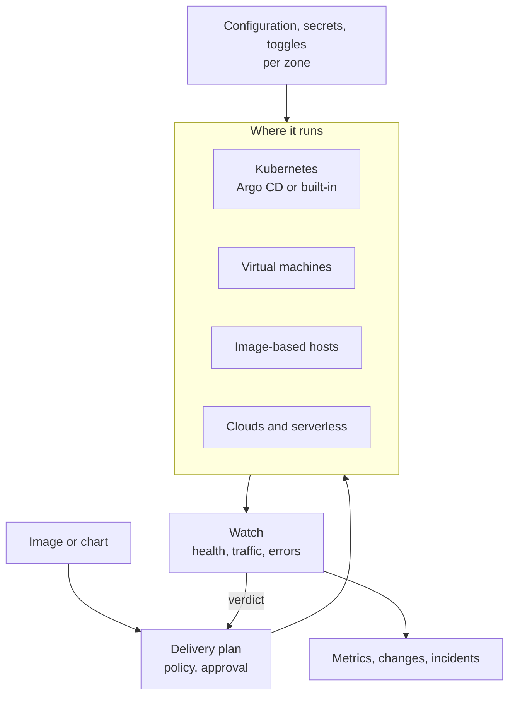

# Milestone 3: Delivery and GitOps depth

<!-- Generated by scripts/docs/build-roadmap.mjs from docs/roadmap/roadmap.json. Do not edit by hand. -->

<a href="../roadmap.html">Roadmap</a> › Milestone 3 · <a href="../roadmap-list.html">as a list</a>

Next 0 available · 0 in progress · 60 planned · 60 capabilities

See and control everything you run, whether it is an application in a cluster, a virtual machine or an image-based host, and deliver to it safely.

## What it is, and who it is for

Milestone 3 is about everything after the build. See every application and host in one place, find out why a deployment failed, roll out safely with weights and checks, run infrastructure as code with state kept for you, manage image-based hosts, and watch traffic, protection and reliability in the same views.

**Who it is for.** Teams that deploy to Kubernetes, virtual machines, machine images and clouds, and people who answer for what is running and whether it is healthy.

## What you will be able to do

- A deployment fails. Launchway says in one sentence why, shows the evidence, and offers to roll back the setting that caused it.
- You send ten percent of mobile traffic to a new version and watch errors on a map before widening it.
- You turn off a misbehaving feature with one button on a page that also shows its effect.
- A fleet of image-based hosts upgrades in batches with a check between each, and one batch pauses.
- A reviewer sees an automatically written change record with its risk and freeze status.

## How it fits together

*One plan, many targets, and a watch loop that can send a change back.*

**Builds on:** [Milestone 1: Host and run](milestone-1.md). **Leads to:** [Milestone 5: Software graph](milestone-5.md).

**Go deeper:** [Delivery: applications, rollouts and hosts](delivery.md) · [Live traffic, protection and reliability](traffic.md).

## The capabilities

| Group | Capabilities | Available | In progress | Planned |
|---|---|---|---|---|
| [Applications and rollouts](#g-applications-and-rollouts) | 11 | 0 | 0 | 11 |
| [Debug a deployment, then see everything](#g-debug-a-deployment-then-see-everything) | 5 | 0 | 0 | 5 |
| [Where it deploys](#g-where-it-deploys) | 12 | 0 | 0 | 12 |
| [Infrastructure as code](#g-infrastructure-as-code) | 6 | 0 | 0 | 6 |
| [Runtime configuration](#g-runtime-configuration) | 6 | 0 | 0 | 6 |
| [Watch and protect](#g-watch-and-protect) | 10 | 0 | 0 | 10 |
| [Change and insight](#g-change-and-insight) | 7 | 0 | 0 | 7 |
| [Moving over from other delivery platforms](#g-moving-over-from-other-delivery-platforms) | 3 | 0 | 0 | 3 |

### Applications and rollouts {#g-applications-and-rollouts}

See and control everything you run, then deliver to it safely.

#### Argo CD in depth {#argo-cd-in-depth}

○ Planned

Application hierarchy views (app-of-apps and ApplicationSet trees) with status, sync, health, history and actions, ready health checks, and a hosted or your own Argo CD. Launchway reads each application as the deploy engine sees it, shows drift, and lets you act with the same permissions as everything else. Argo CD is first-class, never required.

**Depends on:** GitOps with Argo CD.

[Read the documentation](../guide/deployments.md) · [Area page](delivery.md)

#### Applications and ApplicationSets from the interface {#applications-and-applicationsets-from-the-interface}

○ Planned

Generate applications and sets, and compose app-of-apps, from a guided screen. The generated manifests are shown as a change you review and merge, so GitOps remains the record.

**Depends on:** Argo CD in depth.

[Area page](delivery.md)

#### Health checks set up from the interface {#health-checks-set-up-from-the-interface}

○ Planned

Write and test custom health checks for resources without editing configuration by hand. A check shows its result against live resources before you save it.

**Depends on:** Argo CD in depth.

[Area page](delivery.md)

#### Hosted or your own Argo CD {#hosted-or-your-own-argo-cd}

○ Planned

Use an Argo CD that Launchway runs for you, or connect one you already have. Both are equal in the interface. Teams that do not use Argo CD can use built-in deploys instead.

**Depends on:** Argo CD in depth.

[Area page](delivery.md)

#### Rollout control inside a run {#rollout-control-inside-a-run}

○ Planned

A pipeline watches a rollout, pauses at gates, promotes or aborts, and shows each step of the rollout as a station. Verification tests run between steps, and the run keeps the evidence.

**Depends on:** Argo CD in depth.

[Area page](delivery.md)

#### A single pane of glass {#a-single-pane-of-glass}

○ Planned

One fleet view of every application and every host: what runs where, its health, drift and evidence. Error rates, version, last change and owner are on one screen, and each tile opens the page that explains it.

**Depends on:** Argo CD in depth.

[Area page](delivery.md)

#### Weighted canaries and traffic control {#weighted-canaries-and-traffic-control}

○ Planned

Send a share of traffic, by client type, to a new version through the Gateway API or a service mesh, with mesh metrics as ready-made health checks. The overlay on the traffic map shows what share each version takes right now.

**Depends on:** Argo CD in depth.

[Area page](delivery.md)

#### Releases across services {#releases-across-services}

○ Planned

Ship several services as one ordered, gated release with a promotion view across environments. Promotion moves the same digest, never a rebuild, and every step shows who approved it.

**Depends on:** A single pane of glass.

[Area page](delivery.md)

#### Promotion across environments {#promotion-across-environments}

○ Planned

Move a version from one environment to the next with checks and approvals in between. The matrix shows what runs where, which places are behind, and a button to move a version.

**Depends on:** Releases across services.

[Area page](delivery.md)

#### Post-deploy watch and incidents {#post-deploy-watch-and-incidents}

○ Planned

Keep watching after release, roll back automatically, and tie incidents to the change that caused them. An incident links back to the commit, run and setting change nearest to it.

**Depends on:** Verification after a deploy.

[Area page](delivery.md)

#### AI analysis as an optional rollback gate {#ai-analysis-as-an-optional-rollback-gate}

○ Planned

Let a verification step use AI analysis of metrics and logs to trigger automatic rollback, off by default and able to require a person for production. Plain threshold checks remain the default, and AI can decide only where you allow it.

**Depends on:** A built-in model gateway.

[Area page](ai.md)

### Debug a deployment, then see everything {#g-debug-a-deployment-then-see-everything}

Why did it fail, in one sentence, then every resource behind it.

#### Why did it fail to deploy {#why-did-it-fail-to-deploy}

○ Planned

A failed application opens with a diagnosis in one sentence, the evidence behind it and one recommended action. Each piece of evidence is a button that opens the resource where it shows: manifest, events or log. AI can help word the diagnosis, but the evidence is always facts.

**Depends on:** Argo CD in depth.

[Area page](delivery.md)

#### A timeline of changes and symptoms {#a-timeline-of-changes-and-symptoms}

○ Planned

Changes, new copies starting, alerts and health on a single time line, with what changed since it last worked. A comparison with the last working version covers image, settings and manifests.

**Depends on:** Why did it fail to deploy.

[Area page](delivery.md)

#### Everything deployed {#everything-deployed}

○ Planned

The whole resource tree: workloads, pods, containers, services, routes, settings, volumes, jobs and custom resources. Each node has overview, events, manifest with desired against live, and logs. Secrets show by name only.

**Depends on:** Why did it fail to deploy.

[Area page](delivery.md)

#### Logs where you need them {#logs-where-you-need-them}

○ Planned

Container logs now and from before the last restart, with search, follow, a time range and jump to the first error. Restarts, exit codes and resource use sit beside the log.

**Depends on:** Everything deployed.

[Area page](delivery.md)

#### Fix actions with their consequence {#fix-actions-with-their-consequence}

○ Planned

Roll a setting back, retry an update or open the failing pod, each saying in words what will happen. Every action is a guided change that can be undone and is audited.

**Depends on:** Why did it fail to deploy.

[Area page](delivery.md)

### Where it deploys {#g-where-it-deploys}

Clusters, virtual machines, machine images, clouds and serverless.

#### Built-in Helm and Kubernetes deploys {#built-in-helm-and-kubernetes-deploys}

○ Planned

Deploy and roll back without Argo CD; Argo stays first class for long-lived environments. The deploy is a typed step with a plan, a diff, health checks and a rollback to the last good release.

**Depends on:** Container images.

[Area page](delivery.md)

#### Preview environments {#preview-environments}

○ Planned

Every pull request or branch gets its own environment and address, tested and cleaned up on merge. The pull request page shows the address and the verification result.

**Depends on:** Built-in Helm and Kubernetes deploys.

[Area page](delivery.md)

#### VM deploys {#vm-deploys}

○ Planned

Roll a change across virtual machines in batches over SSH, with verification between batches. Hosts appear next to applications on the fleet page, with what runs on each.

[Area page](delivery.md)

#### Machine images with Packer {#machine-images-with-packer}

○ Planned

Bake machine images in a pipeline and roll them through instance groups. Images have contents, scan results and signatures like container images.

[Area page](delivery.md)

#### Image-based hosts {#image-based-hosts}

○ Planned

Machines that are really images (built on bootc), built, signed, upgraded and rolled back like container images, with host setup done at first boot. Staged upgrades, reboots in batches and a go-back button use the same runway as an application rollout.

**Depends on:** Machine images with Packer.

[Area page](delivery.md)

#### First boot owned by Launchway {#first-boot-owned-by-launchway}

○ Planned

The first-boot unit applies host name, network, keys and zone, and may run a configuration playbook once before the host takes traffic. Running a playbook on a host that is already serving traffic stays refused, because that is what brings drift back.

**Depends on:** Image-based hosts.

[Area page](delivery.md)

#### Configuration at build time {#configuration-at-build-time}

○ Planned

Ansible and image builders work together at build time to prepare images. What belongs in the image is baked, and what must differ per host is applied at first boot.

**Depends on:** Image-based hosts.

[Area page](delivery.md)

#### An infrastructure stack designer {#an-infrastructure-stack-designer}

○ Planned

Compose image, build and configuration blocks visually and have them turned into pipelines. The picture and the generated files stay in step, and the result is reviewable in Git.

**Depends on:** A drawing canvas and diagrams.

[Area page](delivery.md)

#### Image as a service for enterprise Linux teams {#image-as-a-service-for-enterprise-linux-teams}

○ Planned

Watch base images and advisories, rebuild, re-sign, re-scan and roll out across zones with verification. You can ask whether every production host runs an approved, signed and scanned image patched inside its deadline, and get a yes or a list.

**Depends on:** Image-based hosts.

[Area page](delivery.md)

#### Hosts and machine images in the interface {#hosts-and-machine-images-in-the-interface}

○ Planned

A catalogue of images with contents and base, and a hosts page showing version, staged upgrade, drift and last seen. A host page draws first boot as a short line, with boot history and logs.

**Depends on:** Image-based hosts.

[Area page](delivery.md)

#### Cloud targets: AWS, Google Cloud and Azure {#cloud-targets-aws-google-cloud-and-azure}

○ Planned

Deploy to the three major clouds with their own features, with no stored cloud keys. Each target uses short-lived identity from the pipeline step.

**Depends on:** Cloud sign-in per step.

[Area page](delivery.md)

#### Serverless and managed instance groups {#serverless-and-managed-instance-groups}

○ Planned

Functions, container services and managed instance groups as deploy targets. Rollouts, health checks and rollbacks follow the same model as on Kubernetes.

**Depends on:** Cloud targets: AWS, Google Cloud and Azure.

[Area page](delivery.md)

### Infrastructure as code {#g-infrastructure-as-code}

State, plans and checks you can trust.

#### Terraform and OpenTofu {#terraform-and-opentofu}

○ Planned

Reviewed plans, applies that run only the reviewed plan, state kept and locked inside Launchway, and drift detection. Users never wonder where state goes, and Launchway guides them to good practice by default.

[Area page](delivery.md)

#### State and locking built in {#state-and-locking-built-in}

○ Planned

State is stored, versioned and locked inside Launchway with access rules. Nothing external is needed, and the state remains exportable.

**Depends on:** Terraform and OpenTofu.

[Area page](delivery.md)

#### Ansible {#ansible}

○ Planned

Typed steps with per-host results and a check mode before apply. Results show per host, with the check result shown before anything is changed.

[Area page](delivery.md)

#### Chef {#chef}

○ Planned

A real step with per-node results where Chef reports them, check mode before apply, and templates. It has the same standing as Ansible, using the free build by default.

[Area page](delivery.md)

#### Database change steps {#database-change-steps}

○ Planned

Apply database schema changes as a pipeline step, with a plan and a rollback where the tool supports it. Changes pass the same gates as other deploys.

[Area page](delivery.md)

#### Packer builds as a first-class step {#packer-builds-as-a-first-class-step}

○ Planned

Run image builds with their results, logs and artifacts attached to the run. Output images go to the registry or the image store with provenance.

[Area page](delivery.md)

### Runtime configuration {#g-runtime-configuration}

Settings, keys and toggles managed together, per zone and environment.

#### Feature toggles {#feature-toggles}

○ Planned

A built-in toggle service that applications and agents read, per environment, with percentage and client-type rollouts. It speaks an open protocol, so existing applications can read it with no Launchway library.

[Area page](traffic.md)

#### Configuration, keys and toggles per zone {#configuration-keys-and-toggles-per-zone}

○ Planned

Manage settings and secrets together per zone and environment, for virtual machines and Kubernetes alike. A zone is a named place and failure domain such as a region or a cluster. The nearest owner wins unless a higher level has enforced the value.

[Area page](traffic.md)

#### Routing by client attributes {#routing-by-client-attributes}

○ Planned

Decide which version a request gets from who sent it, such as a share of mobile clients, inside the application or at the network. The effective exposure of route share times toggle share is always shown.

**Depends on:** Feature toggles.

[Area page](traffic.md)

#### A guided change for every lever {#a-guided-change-for-every-lever}

○ Planned

Preview, policy check, approval where required, applied and audited, with an undo, for toggles, weights and limits. Moving a lever to its safe state is never gated, and moving away from it always is.

**Depends on:** Feature toggles.

[Area page](traffic.md)

#### Secrets with an external store {#secrets-with-an-external-store}

○ Planned

Use an existing secret store beside the built-in one. The store stays authoritative and values never reach the control plane.

**Depends on:** Secrets that stay with runners.

[Area page](traffic.md)

#### Service mesh support including VMs {#service-mesh-support-including-vms}

○ Planned

Traffic, identity and policy for services on a mesh, and for virtual machines that join it. Machines outside the mesh still appear on the map as declared.

**Depends on:** Weighted canaries and traffic control.

[Area page](traffic.md)

### Watch and protect {#g-watch-and-protect}

See traffic, protect it, and know whether each service is meeting its target.

#### A live traffic map {#a-live-traffic-map}

○ Planned

See how traffic flows between services, workloads and virtual machines, with rates, errors and latency. Each connection says whether it was observed, declared or not observed, and no number is ever made up for one that is not observed.

**Depends on:** Service mesh support including VMs.

[Area page](traffic.md)

#### Diagnose along a flow {#diagnose-along-a-flow}

○ Planned

From a red connection, a one-sentence diagnosis, the failing requests, the pod, the change that caused it and the logs. You go from symptom to cause without changing tools.

**Depends on:** A live traffic map.

[Area page](traffic.md)

#### Replay the last hours {#replay-the-last-hours}

○ Planned

A time slider that replays the last twelve hours of the map with incidents and rollouts marked. Useful for what changed when errors began.

**Depends on:** A live traffic map.

[Area page](traffic.md)

#### Inject delays and errors safely {#inject-delays-and-errors-safely}

○ Planned

Add a delay or an error to a share of requests on a healthy connection, with a hard limit on share and time. The dialog shows who is affected, and conditions stop the test early.

**Depends on:** A live traffic map.

[Area page](traffic.md)

#### Rate limiting and traffic protection {#rate-limiting-and-traffic-protection}

○ Planned

Limits per client, route and tenant, connection limits, timeouts, retries and circuit breakers, shown with how close traffic is to each. Changing one is a guided change with a preview that replays the last hour against the new value.

**Depends on:** A live traffic map.

[Area page](traffic.md)

#### Attack and abuse signals {#attack-and-abuse-signals}

○ Planned

Signs of attack or abuse as plain sentences with evidence and three actions: limit, block or ignore with a reason. Each signal says honestly where it came from.

**Depends on:** Rate limiting and traffic protection.

[Area page](traffic.md)

#### Reliability pages {#reliability-pages}

○ Planned

Services ranked by error budget, saturation and restarts, with deploys, settings, toggles and scaling marked on the charts. Cause and effect are visible on one time line.

**Depends on:** Service reliability targets.

[Area page](traffic.md)

#### Toggles in context {#toggles-in-context}

○ Planned

Which features are on where and for whom, with the effect of a toggle shown and one button to turn it off. Toggle first, roll back second, in seconds.

**Depends on:** Feature toggles.

[Area page](traffic.md)

#### Signal sources {#signal-sources}

○ Planned

Connect metrics, logs, analytics, traces, the mesh, a firewall and the toggle service, with a test for each. Every chart names its source and links to the query.

[Area page](traffic.md)

#### Service reliability targets {#service-reliability-targets}

○ Planned

Set targets for the services you run and see whether a release is spending the budget. Targets can be imported and exported in an open format.

[Area page](traffic.md)

### Change and insight {#g-change-and-insight}

Know what changed, who approved it, and how delivery is going.

#### Change management {#change-management}

○ Planned

Automatic change records with risk scores, freezes and approvals, and optional two-way sync with an IT service tool. Works standalone, so a team without such a tool still has records.

**Depends on:** Approvals and protected environments.

[Area page](delivery.md)

#### Connections to ServiceNow and Jira Service Management {#connections-to-servicenow-and-jira-service-management}

○ Planned

Create and update change records in ServiceNow or Jira Service Management and take their approval back. Optional and equal to the built-in records.

**Depends on:** Change management.

[Area page](delivery.md)

#### Delivery metrics and executive dashboards {#delivery-metrics-and-executive-dashboards}

○ Planned

Deployment frequency, lead time, change failure rate and time to restore, with drill-down to the runs behind each number. Graphs are meant for people who do not use Launchway daily.

[Area page](delivery.md)

#### Test intelligence and flow insights {#test-intelligence-and-flow-insights}

○ Planned

Find slow and flaky tests, bottlenecks in review and idle time in delivery. Suggestions are shown with the evidence.

**Depends on:** Delivery metrics and executive dashboards.

[Area page](delivery.md)

#### Policy rules in an open language {#policy-rules-in-an-open-language}

○ Planned

Write extra policy rules in an open policy language alongside the built-in rules. Rules run at the same decision point and are shown in the verdict.

**Depends on:** Policy gates.

[Area page](delivery.md)

#### Portfolio bill of materials {#portfolio-bill-of-materials}

○ Planned

A bill of materials across every project and image, searchable by component. Pairs with the software graph.

**Depends on:** Findings and SBOMs per run.

[Area page](delivery.md)

#### Experiments with toggles {#experiments-with-toggles}

○ Planned

Compare outcomes between users with a toggle on and off. Results join delivery data, so you see effect and cost.

**Depends on:** Feature toggles.

[Area page](traffic.md)

### Moving over from other delivery platforms {#g-moving-over-from-other-delivery-platforms}

Importers and proof for teams that already have a delivery platform.

#### Importers for other delivery platforms {#importers-for-other-delivery-platforms}

○ Planned

Convert pipelines, services and environments from other delivery and GitOps platforms, with a report of what needs a person. The report is honest about gaps.

#### Published proof points {#published-proof-points}

○ Planned

Measured comparisons of footprint, speed and capabilities that anyone can reproduce. Methods and results are published.

#### Enterprise readiness checklist {#enterprise-readiness-checklist}

○ Planned

Answers to the questions an enterprise reviewer asks, with a support bundle and an evidence page. Close the gaps that gate adoption.

## What done means

This milestone is done when all of these are true.

- An application, a virtual machine and an image-based host can each be deployed, verified and rolled back from the interface.
- A failed deployment shows a diagnosis, its evidence and the full resource tree with logs.
- Canary weights by client type work on the gateway and on a mesh, and the map shows them.
- State for infrastructure code is stored, locked and recoverable inside Launchway.
- Toggles, settings and secrets resolve per zone with one clear rule.
- Every lever change goes through preview, policy and audit, with an undo.

## What is deliberately not in it

- The built-in registry (Milestone 4).
- The software graph and patching loop (Milestone 5).
- Hosted-service features (Milestone 7).

---

[← Milestone 2: Pipeline power](milestone-2.md) · [Milestone 4: Registry →](milestone-4.md)
