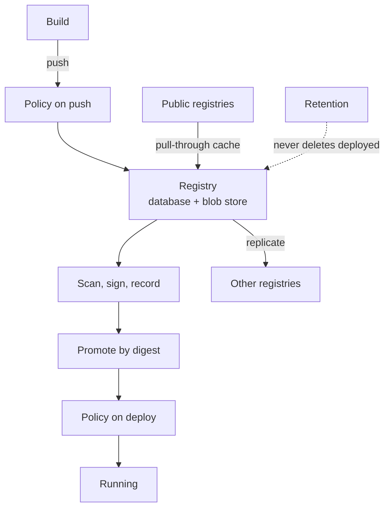

# Milestone 4: A built-in registry

<!-- Generated by scripts/docs/build-roadmap.mjs from docs/roadmap/roadmap.json. Do not edit by hand. -->

<a href="../roadmap.html">Roadmap</a> › Milestone 4 · <a href="../roadmap-list.html">as a list</a>

Later 1 available · 0 in progress · 15 planned · 16 capabilities

Images, Helm charts and other OCI artifacts stored beside the code, under the same permissions and policies.

## What it is, and who it is for

Milestone 4 adds a registry to the binary. Images, charts and other artifacts are stored in the same database and blob store as everything else, promoted by digest, cleaned up without ever deleting what is deployed, and checked by policy on the way in and on the way out. Any other registry stays equally supported.

**Who it is for.** Teams that want images and charts stored beside the code, with the same permissions, policy and audit and nothing else to run.

## What you will be able to do

- A build pushes an image; policy refuses it because it is unsigned.
- You promote the exact image tested in staging to production with no copy.
- Retention cleans old images but keeps the one a cluster is running.
- A project's packages tab shows its images and charts and where each runs.

## How it fits together

*An image from build to running, with policy at both ends.*

**Builds on:** [Milestone 1: Host and run](milestone-1.md). **Leads to:** [Milestone 5: Software graph](milestone-5.md).

**Go deeper:** [The built-in registry](registry.md).

## The capabilities

| Group | Capabilities | Available | In progress | Planned |
|---|---|---|---|---|
| [The registry](#g-the-registry) | 16 | 1 | 0 | 15 |

### The registry {#g-the-registry}

Images, charts and other artifacts stored beside the code, under the same permissions.

#### A built-in OCI registry {#a-built-in-oci-registry}

○ Planned

Store container images, Helm charts and other OCI artifacts in Launchway, passing the OCI conformance suite, with nothing else to run. It lives in the same database and blob store as everything else, so permissions, audit, quotas and retention are one model. The protocol is small and well specified, so the hard parts are cleanup, tenancy and policy.

**Depends on:** Built-in artifact storage.

[Area page](registry.md)

#### Helm charts and other artifacts as first-class {#helm-charts-and-other-artifacts-as-first-class}

○ Planned

Charts, signatures, bills of materials, attestations, operating-system images and WebAssembly modules are stored and shown properly. A chart page shows its versions, which applications use which, and the values it accepts.

**Depends on:** A built-in OCI registry.

[Area page](registry.md)

#### An image page that tells the whole story {#an-image-page-that-tells-the-whole-story}

○ Planned

Where an image runs now, tags, layers, vulnerabilities with fixes, contents, signature, provenance and the run and commit that built it. Its history is drawn as a line: built, scanned, signed, in test, in production.

**Depends on:** A built-in OCI registry.

[Area page](registry.md)

#### Promotion by digest {#promotion-by-digest}

○ Planned

Move an image from one environment to the next without copying or rebuilding it. What was tested is exactly what ships.

**Depends on:** A built-in OCI registry.

[Area page](registry.md)

#### Retention that protects what runs {#retention-that-protects-what-runs}

○ Planned

Clean up old images without ever deleting one that is deployed. The label says why each item is kept, such as kept because deployed.

**Depends on:** A built-in OCI registry.

[Area page](registry.md)

#### Policy on push and deploy {#policy-on-push-and-deploy}

○ Planned

The same policy engine checks an image when it is pushed to the built-in registry, as it already does for a push from a pipeline and for a deploy. Unsigned, unscanned or vulnerable images can be refused at either point.

**Depends on:** Policy gates.

[Area page](registry.md)

#### Pull-through cache {#pull-through-cache}

○ Planned

Cache public images and packages so builds are faster, work offline, and never serve an out-of-date copy of something that can change. Cached images are scanned and counted against quotas like any other.

**Depends on:** A built-in OCI registry.

[Area page](registry.md)

#### Image guard for sandboxed builds {#image-guard-for-sandboxed-builds}

○ Planned

Keep unchecked images away from sandboxed builds, and fetch every image through a checking proxy. Names that resolve to private addresses are refused.

**Depends on:** Pull-through cache.

[Area page](registry.md)

#### Replication with other registries {#replication-with-other-registries}

○ Planned

Copy images to and from other registries on a rule. Useful for a disaster-recovery copy or a customer-facing mirror.

**Depends on:** A built-in OCI registry.

[Area page](registry.md)

#### Per-project packages and permissions {#per-project-packages-and-permissions}

○ Planned

A packages tab in each project that is a filtered view of the registry, with per-package access. The registry and the code share one permission model.

**Depends on:** A built-in OCI registry.

[Area page](registry.md)

#### Signing and verification {#signing-and-verification}

○ Planned

Sign images on build and verify signatures on pull and deploy. Signatures and attestations are stored next to the image.

**Depends on:** A built-in OCI registry.

[Area page](registry.md)

#### More package formats {#more-package-formats}

○ Planned

Language and system packages, such as for common programming languages, with cleanup rules and quotas. Added in order of demand, with a shared storage model.

**Depends on:** A built-in OCI registry.

[Area page](registry.md)

#### Any other registry, equally {#any-other-registry-equally}

✓ Available

Pushing to any OCI registry works today and stays first class beside the built-in one. Choose per project and move later.

[Read the documentation](../guide/images.md) · [Area page](registry.md)

#### Pipelines that build, test and publish only {#pipelines-that-build-test-and-publish-only}

○ Planned

Not everything deploys: a pipeline for a library, command-line tool, image or chart ends at published and available. The run page says what was published and who uses it.

[Area page](dependency-order.md)

#### Native endpoints for package clients {#native-endpoints-for-package-clients}

○ Planned

Go and npm clients talk to Launchway directly, and Python, Maven, NuGet, Cargo and RubyGems follow. Short-lived credentials are wired in, so no stored token is needed.

[Area page](registry.md)

#### Who uses which version {#who-uses-which-version}

○ Planned

A library page shows which projects fetched which version and which are behind. Comes from publish and fetch records.

[Area page](dependency-order.md)

## What done means

This milestone is done when all of these are true.

- The OCI conformance suite passes.
- Docker, container runtimes and Helm work against it with no special setup.
- Retention never deletes an image that is deployed, proven by a test.
- Promotion by digest moves no bytes.
- A registry operation is available in the API, the command line, the agent endpoint and Terraform.

## What is deliberately not in it

- Package formats beyond the first set, which come in order of demand.
- Continuous scanning of what runs (Milestone 5).

---

[← Milestone 3: Delivery depth](milestone-3.md) · [Milestone 5: Software graph →](milestone-5.md)
