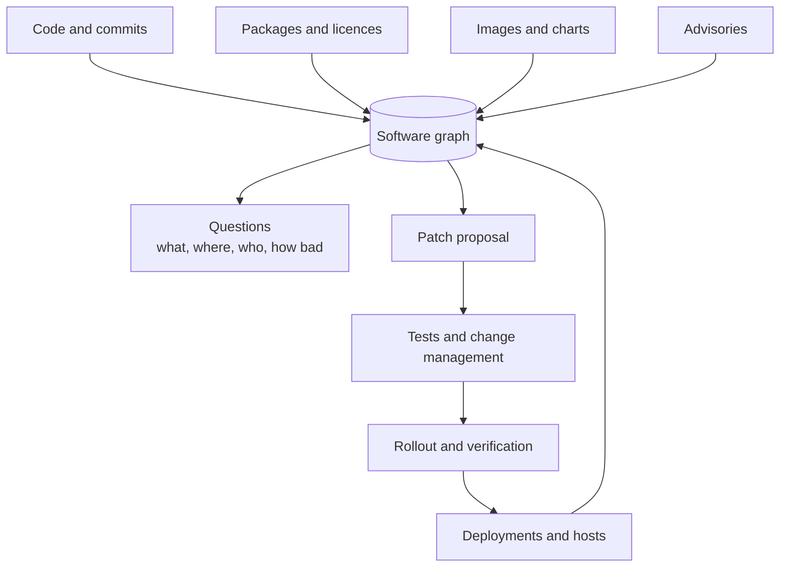

# Milestone 5: The software graph, with automated patching

<!-- Generated by scripts/docs/build-roadmap.mjs from docs/roadmap/roadmap.json. Do not edit by hand. -->

<a href="../roadmap.html">Roadmap</a> › Milestone 5 · <a href="../roadmap-list.html">as a list</a>

Later 1 available · 0 in progress · 14 planned · 15 capabilities

One connected picture of code, dependencies, images and deployments, so you always know what runs where and can fix it safely.

## What it is, and who it is for

Milestone 5 connects code, dependencies, images and deployments in one graph kept in Launchway's own database. It answers what is running, from what, containing what and is any of it vulnerable. Patching then becomes an ordinary change that goes through tests, change management and a controlled rollout.

**Who it is for.** Teams and security groups who need to know what runs where, what it is made of and how to fix it safely.

## What you will be able to do

- A new advisory arrives; Launchway lists the services affected and who owns each.
- You search for a function across every repository you can see.
- Automatic patching is switched on for one zone; a dependency update arrives as a change, passes its tests and rolls out.
- An agent asks which services use a library and gets an answer from the graph, not from reading files.

## How it fits together

*The graph is built from facts Launchway already records, keyed by what is deployed.*

**Builds on:** [Milestone 3: Delivery depth](milestone-3.md), [Milestone 4: Registry](milestone-4.md). **Leads to:** [Beyond: Beyond](beyond.md).

**Go deeper:** [Software graph and automated patching](software-graph.md).

## The capabilities

| Group | Capabilities | Available | In progress | Planned |
|---|---|---|---|---|
| [Know what you run](#g-know-what-you-run) | 10 | 1 | 0 | 9 |
| [Fix it safely](#g-fix-it-safely) | 5 | 0 | 0 | 5 |

### Know what you run {#g-know-what-you-run}

One connected picture of code, dependencies, images and deployments.

#### Findings and SBOMs per run {#findings-and-sboms-per-run}

✓ Available

The starting point already works: findings and components recorded for every run. Components are recorded as bills of materials and findings are kept with the run.

[Read the documentation](../guide/security-findings.md)

#### What is deployed where {#what-is-deployed-where}

○ Planned

Link every deployed image back to its commit, its components and its findings, including on hosts Launchway only observes. Facts are keyed by image digest and by deployment, so one query can answer across Git, the registry, scans and the deploy engine.

**Depends on:** Built-in registry.

[Area page](software-graph.md)

#### A continuous observer of what runs {#a-continuous-observer-of-what-runs}

○ Planned

Watch clusters and hosts for what is actually running, not only what was deployed. Surprises, such as an image nobody deployed, are flagged.

**Depends on:** What is deployed where.

[Area page](software-graph.md)

#### Continuous scanning of what runs {#continuous-scanning-of-what-runs}

○ Planned

Scan deployed software for new vulnerabilities and best-practice gaps, not only at build time. A new advisory re-scores everything already running.

**Depends on:** What is deployed where.

[Area page](software-graph.md)

#### Advisories, exceptions and licences {#advisories-exceptions-and-licences}

○ Planned

Record which vulnerabilities apply, import vendor statements that they do not, and check licences. A finding can be waived with a reason and an expiry.

**Depends on:** Continuous scanning of what runs.

[Area page](software-graph.md)

#### Who owns what {#who-owns-what}

○ Planned

Each component, service and repository has an owner, and findings go to that owner. Questions like which services use this library get an answer.

**Depends on:** What is deployed where.

[Area page](software-graph.md)

#### Code search across repositories {#code-search-across-repositories}

○ Planned

Search symbols and text across every repository, hosted or connected, filtered by what you may see. Results include pipelines, templates and steps.

[Area page](software-graph.md)

#### Code intelligence {#code-intelligence}

○ Planned

Definitions, references and call information, for people and for agents. Gives agents the context they need without sending whole repositories.

**Depends on:** Code search across repositories.

[Area page](software-graph.md)

#### Code knowledge for AI, with fewer tokens {#code-knowledge-for-ai-with-fewer-tokens}

○ Planned

Answer AI questions from a graph of code and deployments instead of pasting files. Fewer tokens are sent and the answers cite where they came from.

**Depends on:** Code intelligence.

[Area page](software-graph.md)

#### Blast radius of a vulnerability {#blast-radius-of-a-vulnerability}

○ Planned

From an advisory, see which deployed services and environments are affected and who owns them. The list becomes a set of proposed fixes.

**Depends on:** What is deployed where.

[Area page](software-graph.md)

### Fix it safely {#g-fix-it-safely}

Patch as a normal change, with checks and a controlled rollout.

#### Automated patching {#automated-patching}

○ Planned

Off by default and turned on per zone: updates open as changes, pass tests and change management, and roll out through Argo CD. The loop is propose, test, approve, roll out and verify, and every step is recorded.

**Depends on:** What is deployed where.

[Area page](software-graph.md)

#### Built-in dependency updates {#built-in-dependency-updates}

○ Planned

Keep common ecosystems' dependencies current, as ordinary reviewable pull requests. Updates carry their release notes and test results.

**Depends on:** Pull requests on the built-in host.

[Area page](software-graph.md)

#### Image refresh and patching of base images {#image-refresh-and-patching-of-base-images}

○ Planned

Rebuild images when their base changes and roll the new ones out. Fits into the same patching loop and its deadlines.

**Depends on:** Automated patching.

[Area page](software-graph.md)

#### AI-proposed fixes {#ai-proposed-fixes}

○ Planned

An optional helper proposes a fix or an upgrade note, flagged as AI, never merged on its own. A person approves, and everything it did is recorded.

**Depends on:** Automated patching.

[Area page](ai.md)

#### Patch deadlines and evidence {#patch-deadlines-and-evidence}

○ Planned

Track how long each vulnerability has been open and produce evidence of patching within your own deadline. The question is every production host patched in time answered with a query.

**Depends on:** Automated patching.

[Area page](software-graph.md)

## What done means

This milestone is done when all of these are true.

- For any running image Launchway can show its commit, run, components and findings.
- A new advisory re-scores running software without a rebuild.
- An automated patch reaches production only through the same gates as any change.
- Patching can be switched off per zone and is off by default.

## What is deliberately not in it

- Cost management and the developer portal (Beyond).

---

[← Milestone 4: Registry](milestone-4.md) · [Milestone 6: AI helper →](milestone-6.md)
