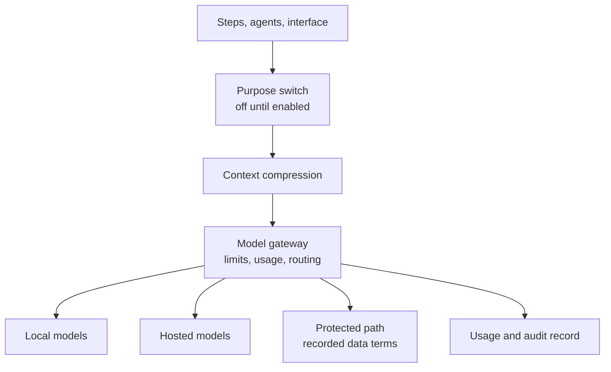

# Milestone 6: AI as an optional first-class helper

<!-- Generated by scripts/docs/build-roadmap.mjs from docs/roadmap/roadmap.json. Do not edit by hand. -->

<a href="../roadmap.html">Roadmap</a> › Milestone 6 · <a href="../roadmap-list.html">as a list</a>

Next 3 available · 2 in progress · 24 planned · 29 capabilities

AI wherever it saves effort, always optional, always off until an administrator turns a purpose on, and never able to hide a failure.

## What it is, and who it is for

Milestone 6 puts AI wherever it saves effort and keeps it entirely optional. A built-in gateway routes to any model with spending limits, local models are first-class, regulated Flights have a protected path, and a failing check can never be hidden by a model.

**Who it is for.** Anyone who wants AI help with delivery, and anyone who wants it kept out.

## What you will be able to do

- An administrator turns on AI explanations for failures only, and sets a monthly limit.
- A regulated Flight is allowed to use only models with recorded data terms.
- A step calls the gateway by model name; moving to another provider needs no pipeline change.
- You sketch a delivery and are shown a pipeline you can read and edit.

## How it fits together

*Every AI call passes the purpose switch, and every call is recorded.*

**Builds on:** [Milestone 1: Host and run](milestone-1.md). 

**Go deeper:** [AI as an optional helper](ai.md).

## The capabilities

| Group | Capabilities | Available | In progress | Planned |
|---|---|---|---|---|
| [Today](#g-today) | 2 | 2 | 0 | 0 |
| [A gateway of your own](#g-a-gateway-of-your-own) | 17 | 0 | 0 | 17 |
| [Agents that deliver](#g-agents-that-deliver) | 10 | 1 | 2 | 7 |

### Today {#g-today}

What already works.

#### Models in steps and verification {#models-in-steps-and-verification}

✓ Available

Hosted or local models in steps, with explanations of failures and verdicts that never override a failing check. Models are configured once and used by name.

[Read the documentation](../guide/ai.md)

#### Agents as users {#agents-as-users}

✓ Available

The agent endpoint gives agents the same permissions, limits and audit as any user. An agent connects with a token and the same rules as a person.

[Read the documentation](../guide/agents.md)

### A gateway of your own {#g-a-gateway-of-your-own}

One endpoint for every model, with limits and monitoring.

#### A built-in model gateway {#a-built-in-model-gateway}

○ Planned

One endpoint that routes to any hosted or self-hosted model, with usage monitoring and easy switching of providers. Applications and steps call one address and a model name. Outside gateways remain an optional integration.

**Depends on:** Models in steps and verification.

[Area page](ai.md)

#### Local and self-hosted models {#local-and-self-hosted-models}

○ Planned

Run and serve open models on your own machines and use them like any other. Useful where data cannot leave the building.

**Depends on:** A built-in model gateway.

[Area page](ai.md)

#### Provider switching and fallbacks {#provider-switching-and-fallbacks}

○ Planned

Change provider or model in one place, with fallbacks if one is down. No code changes in pipelines.

**Depends on:** A built-in model gateway.

[Area page](ai.md)

#### Usage monitoring {#usage-monitoring}

○ Planned

See usage by model, Flight and purpose, with cost. Charts feed the same dashboards as everything else.

**Depends on:** A built-in model gateway.

[Area page](ai.md)

#### Spending limits {#spending-limits}

○ Planned

Budgets in money, per model, Flight and purpose, not only in tokens. Calls stop or warn when a limit is reached.

**Depends on:** A built-in model gateway.

[Area page](ai.md)

#### AI off until a purpose is turned on {#ai-off-until-a-purpose-is-turned-on}

○ Planned

Every purpose, such as explaining failures or reviewing changes, is off until an administrator turns it on. Nothing is sent to a model by surprise.

[Area page](ai.md)

#### Context compression {#context-compression}

○ Planned

Shrink what is sent to a model without losing file paths, line numbers or error codes, with every omission marked and the saving measured. Never breaks a provider's prompt cache, and the saving is shown in money.

**Depends on:** A built-in model gateway.

[Area page](ai.md)

#### A protected path for regulated data {#a-protected-path-for-regulated-data}

○ Planned

Use only models whose data-handling terms you have recorded, so that regulated Flights never reach the wrong one. Adapters for the big cloud model services are included.

**Depends on:** A built-in model gateway.

[Area page](ai.md)

#### Models that know Launchway {#models-that-know-launchway}

○ Planned

Optional models tuned on Launchway itself, runnable locally and never trained on customer data. They answer questions about the product and write configuration.

**Depends on:** Local and self-hosted models.

[Area page](ai.md)

#### From a picture to a pipeline {#from-a-picture-to-a-pipeline}

○ Planned

Design a delivery visually and have AI help translate it into a pipeline you can read and edit. Output is a proposed change in Git, never applied unseen.

**Depends on:** A visual pipeline designer.

[Area page](ai.md)

#### AI summaries and review of changes {#ai-summaries-and-review-of-changes}

○ Planned

Optional summaries and review comments on pull requests, labelled as AI. It never approves or merges.

**Depends on:** Pull requests on the built-in host.

[Area page](ai.md)

#### AI help with failures {#ai-help-with-failures}

○ Planned

Explain why a deploy failed as well as a step, with the evidence used. Explaining a failed step already works. Always shows the facts first.

**Depends on:** Why did it fail to deploy.

[Area page](ai.md)

#### Agent guidance and an agent catalog {#agent-guidance-and-an-agent-catalog}

○ Planned

Ready-made instructions so agents know how to use Launchway, and a list of agents with their permissions. Each agent is audited like a user.

**Depends on:** Agents as users.

[Area page](ai.md)

#### The Wingman drafts a Standing order, tried on the record first {#the-wingman-drafts-a-standing-order-tried-on-the-record-first}

○ Planned

Describe a rule in a sentence; the Wingman fills the wizard, replays it on last month and explains it, and a Commander saves it. Catalog rules first; a custom condition only if custom rules are chosen; every draft starts in report mode; an agent can never save a Standing order; the record keeps the sentence, the draft and who saved it. Every rule gains a plain-words explanation.

**Depends on:** Try a rule against the record

[Area page](ai.md)

#### Instructions for the AI, set by level {#instructions-for-the-ai-set-by-level}

○ Planned

Plain-language instructions every Wingman purpose and agent at a level reads, edited only by a role and lockable from above. Kept at the Base, Wing, Squadron or Flight; add up downward; each change is a recorded difference; each AI answer records the instruction versions it was given; instructions never grant a right and a conflict with a Standing order is shown.

**Depends on:** One inheritance rule for every setting

[Area page](ai.md)

#### The Wingman in every screen {#the-wingman-in-every-screen}

○ Planned

The helper column on every page explains the page without AI and, where its purpose is on, answers questions from the record and the software graph with your permissions and its sources. It says what it could not see, never invents a number, and acts only through the API with the person's rights, recorded as by that person with the Wingman.

**Depends on:** AI off until a purpose is turned on; Code knowledge for AI, with fewer tokens.

[Area page](ai.md)

#### The Wingman fills a form, a person submits it {#the-wingman-fills-a-form-a-person-submits-it}

○ Planned

Run forms, wizards and new items can be filled by the Wingman, each value marked as proposed, and only a person presses the final button. Uses the same typed fields and server checks as any form.

**Depends on:** The Wingman in every screen.

[Area page](ai.md)

### Agents that deliver {#g-agents-that-deliver}

Documents become stories, stories become changes, and changes reach production when the gates pass, with a person in control.

#### Assign a story to an agent {#assign-a-story-to-an-agent}

◐ In progress

An agent runs on a sandboxed machine of your own, works from a story, and opens a pull request under the same rules as a person; no secrets, a budget, and a Master switch from the start. Work can be assigned to a registered agent that claims it on a lease, works under the same rules as a person and hands it back for review. Missing: the sandboxed agent machine that Launchway itself provides.

[Area page](ai.md)

#### Autonomy levels set by policy {#autonomy-levels-set-by-policy}

◐ In progress

Choose how much an agent may do, per Airfield, from suggesting to delivering; production stays at a low level until a person raises it with a written reason. Levels 1 and 2 are enforced by the server. Levels 3 and 4, which launch, can be written down but are not acted on: they are held to level 2. When they act, they pass the same Preflight, Standing orders and Overwatch as any Launch, and a production Launch always needs a person's Clearance.

[Area page](ai.md)

#### An independent reviewing agent {#an-independent-reviewing-agent}

✓ Available

Where policy allows, a separate session with a different identity and no shared context may approve listed kinds of change, with a share of changes sampled by people. Where the policy allows, another agent's structured review counts for the kinds of change the policy lists, and a share is sampled by a person. It starts with documentation and tests only.

[Area page](ai.md)

#### Spend wisely {#spend-wisely}

○ Planned

Route each task to the right model for its difficulty, use plain tools before any model, keep a share of capacity in reserve for interactive work, and show spend against limits. Context compression and caching apply here.

[Area page](ai.md)

#### One interface for developers, designers and owners {#one-interface-for-developers-designers-and-owners}

○ Planned

Assign, review and watch agent work, spend and results in one place, with the same permissions and audit trail as everything else. Bring your own agent: other agents connect through the same published points at a lower autonomy ceiling.

[Area page](ai.md)

#### Ticket to code agent {#ticket-to-code-agent}

○ Planned

An agent that takes a work item to a proposed change. A person always reviews. Moves from Beyond, because assigning a story to an agent is already in progress.

**Depends on:** Agents as users.

[Area page](ai.md)

#### Outside agent tools through the gateway {#outside-agent-tools-through-the-gateway}

○ Planned

Launchway's own AI can call tools that other systems offer over the open agent protocol, each registered as a connection with allow, ask or refuse per tool, level and purpose. Calls are made from a Station marked for AI with the credential from its own store; the server never sees it. Tool descriptions are pinned and a changed tool is refused until re-approved. Arguments follow the purpose's data rules and a call carrying a known secret is refused; results are untrusted text; every call is in the Logbook and counts against the purpose's budget.

**Depends on:** A built-in model gateway; Per-tool rules for the agent endpoint.

[Area page](ai.md)

#### A custom step written with its tests {#a-custom-step-written-with-its-tests}

○ Planned

Describe a step and the Wingman writes it as a real program with its manifest and unit tests, runs them, and proposes it in Git. Keeps logic out of YAML, within the inline-code limits, and never publishes to a library without review.

**Depends on:** A built-in model gateway.

[Area page](ai.md)

#### Checks for AI-written changes {#checks-for-ai-written-changes}

○ Planned

Typed Standing orders for pull requests by agents or marked AI-assisted: tests with code, no new dependency or permission without a person, within scope, evidence per criterion. Each reports by default; a level can make it block. Judged at the same point as every other rule.

**Depends on:** Autonomy levels set by policy.

[Area page](ai.md)

#### Per-tool rules for the agent endpoint {#per-tool-rules-for-the-agent-endpoint}

○ Planned

For each tool of the agent endpoint a level chooses allow, ask a person, or refuse, on top of what the token allows. Asking a person sends a decision card; every answer is on the record.

**Depends on:** Agents as users.

[Area page](ai.md)

## What done means

This milestone is done when all of these are true.

- With every AI purpose off, no model is ever called.
- Spending limits stop or warn before a budget is exceeded.
- Compression never removes file paths, line numbers or error codes, and marks each omission.
- A regulated Flight cannot reach a model it is not allowed to use.
- A model verdict never overrides a failing check.

## What is deliberately not in it

- Anything that decides without an explicit setting.

---

[← Milestone 5: Software graph](milestone-5.md) · [Milestone 7: Hosted service →](milestone-7.md)
