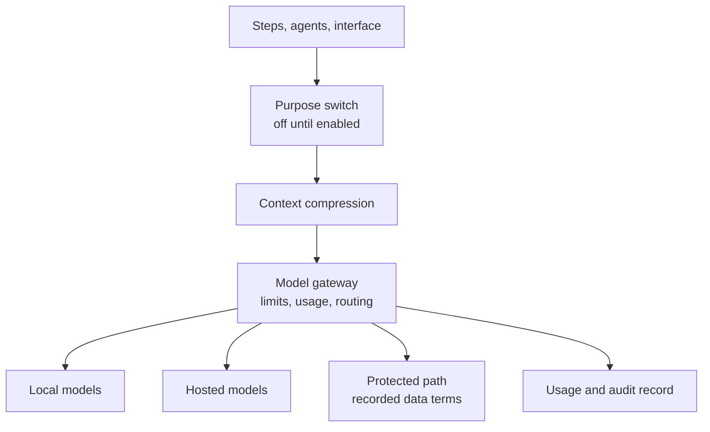

# Milestone 6: AI as an optional first-class helper

<!-- Generated by scripts/docs/build-roadmap.mjs from docs/roadmap/roadmap.json. Do not edit by hand. -->

<a href="../roadmap.html">Roadmap</a> › Milestone 6 · <a href="../roadmap-list.html">as a list</a>

Later 2 available · 0 in progress · 13 planned · 15 capabilities

AI wherever it saves effort, always optional, always off until an administrator turns a purpose on, and never able to hide a failure.

## What it is, and who it is for

Milestone 6 puts AI wherever it saves effort and keeps it entirely optional. A built-in gateway routes to any model with spending limits, local models are first-class, regulated projects have a protected path, and a failing check can never be hidden by a model.

**Who it is for.** Anyone who wants AI help with delivery, and anyone who wants it kept out.

## What you will be able to do

- An administrator turns on AI explanations for failures only, and sets a monthly limit.
- A regulated project is allowed to use only models with recorded data terms.
- A step calls the gateway by model name; moving to another provider needs no pipeline change.
- You sketch a delivery and are shown a pipeline you can read and edit.

## How it fits together

*Every AI call passes the purpose switch, and every call is recorded.*

**Builds on:** [Milestone 1: Host and run](milestone-1.md). 

**Go deeper:** [AI as an optional helper](ai.md).

## The capabilities

| Group | Capabilities | Available | In progress | Planned |
|---|---|---|---|---|
| [Today](#g-today) | 2 | 2 | 0 | 0 |
| [A gateway of your own](#g-a-gateway-of-your-own) | 13 | 0 | 0 | 13 |

### Today {#g-today}

What already works.

#### Models in steps and verification {#models-in-steps-and-verification}

✓ Available

Hosted or local models in steps, with explanations of failures and verdicts that never override a failing check. Models are configured once and used by name.

[Read the documentation](../guide/ai.md)

#### Agents as users {#agents-as-users}

✓ Available

The agent endpoint gives agents the same permissions, limits and audit as any user. An agent connects with a token and the same rules as a person.

[Read the documentation](../guide/agents.md)

### A gateway of your own {#g-a-gateway-of-your-own}

One endpoint for every model, with limits and monitoring.

#### A built-in model gateway {#a-built-in-model-gateway}

○ Planned

One endpoint that routes to any hosted or self-hosted model, with usage monitoring and easy switching of providers. Applications and steps call one address and a model name. Outside gateways remain an optional integration.

**Depends on:** Models in steps and verification.

[Area page](ai.md)

#### Local and self-hosted models {#local-and-self-hosted-models}

○ Planned

Run and serve open models on your own machines and use them like any other. Useful where data cannot leave the building.

**Depends on:** A built-in model gateway.

[Area page](ai.md)

#### Provider switching and fallbacks {#provider-switching-and-fallbacks}

○ Planned

Change provider or model in one place, with fallbacks if one is down. No code changes in pipelines.

**Depends on:** A built-in model gateway.

[Area page](ai.md)

#### Usage monitoring {#usage-monitoring}

○ Planned

See usage by model, project and purpose, with cost. Charts feed the same dashboards as everything else.

**Depends on:** A built-in model gateway.

[Area page](ai.md)

#### Spending limits {#spending-limits}

○ Planned

Budgets in money, per model, project and purpose, not only in tokens. Calls stop or warn when a limit is reached.

**Depends on:** A built-in model gateway.

[Area page](ai.md)

#### AI off until a purpose is turned on {#ai-off-until-a-purpose-is-turned-on}

○ Planned

Every purpose, such as explaining failures or reviewing changes, is off until an administrator turns it on. Nothing is sent to a model by surprise.

[Area page](ai.md)

#### Context compression {#context-compression}

○ Planned

Shrink what is sent to a model without losing file paths, line numbers or error codes, with every omission marked and the saving measured. Never breaks a provider's prompt cache, and the saving is shown in money.

**Depends on:** A built-in model gateway.

[Area page](ai.md)

#### A protected path for regulated data {#a-protected-path-for-regulated-data}

○ Planned

Use only models whose data-handling terms you have recorded, so that regulated projects never reach the wrong one. Adapters for the big cloud model services are included.

**Depends on:** A built-in model gateway.

[Area page](ai.md)

#### Models that know Launchway {#models-that-know-launchway}

○ Planned

Optional models tuned on Launchway itself, runnable locally and never trained on customer data. They answer questions about the product and write configuration.

**Depends on:** Local and self-hosted models.

[Area page](ai.md)

#### From a picture to a pipeline {#from-a-picture-to-a-pipeline}

○ Planned

Design a delivery visually and have AI help translate it into a pipeline you can read and edit. Output is a proposed change in Git, never applied unseen.

**Depends on:** A visual pipeline designer.

[Area page](ai.md)

#### AI summaries and review of changes {#ai-summaries-and-review-of-changes}

○ Planned

Optional summaries and review comments on pull requests, labelled as AI. It never approves or merges.

**Depends on:** Pull requests on the built-in host.

[Area page](ai.md)

#### AI help with failures {#ai-help-with-failures}

○ Planned

Explain why a run or deploy failed, with the evidence it used. Always shows the facts first.

**Depends on:** Why did it fail to deploy.

[Area page](ai.md)

#### Agent guidance and an agent catalogue {#agent-guidance-and-an-agent-catalogue}

○ Planned

Ready-made instructions so agents know how to use Launchway, and a list of agents with their permissions. Each agent is audited like a user.

**Depends on:** Agents as users.

[Area page](ai.md)

## What done means

This milestone is done when all of these are true.

- With every AI purpose off, no model is ever called.
- Spending limits stop or warn before a budget is exceeded.
- Compression never removes file paths, line numbers or error codes, and marks each omission.
- A regulated project cannot reach a model it is not allowed to use.
- A model verdict never overrides a failing check.

## What is deliberately not in it

- Anything that decides without an explicit setting.

---

[← Milestone 5: Software graph](milestone-5.md) · [Milestone 7: Hosted service →](milestone-7.md)
