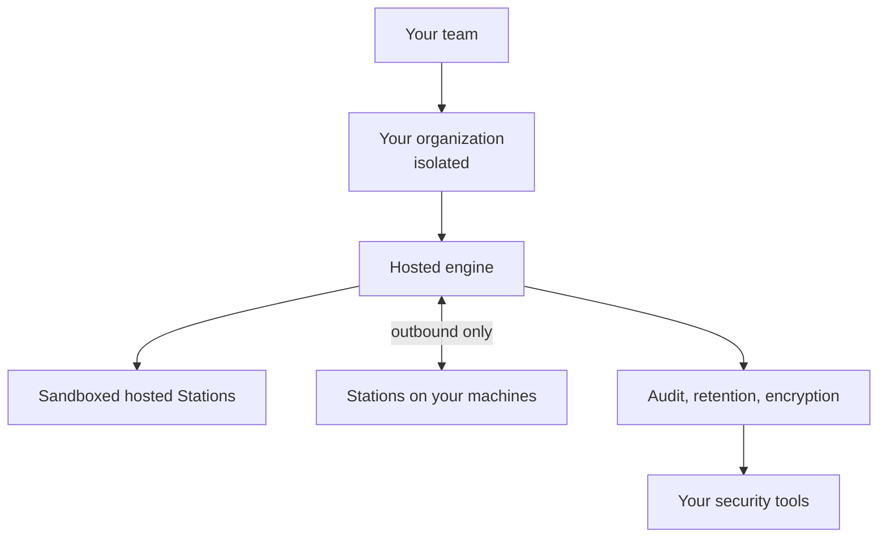

# Milestone 7: The hosted service, the public demo and enterprise controls

<!-- Generated by scripts/docs/build-roadmap.mjs from docs/roadmap/roadmap.json. Do not edit by hand. -->

<a href="../roadmap.html">Roadmap</a> › Milestone 7 · <a href="../roadmap-list.html">as a list</a>

Next 1 available · 3 in progress · 74 planned · 78 capabilities

Sign up and go, or keep your files on your own machines; hosted, hosted with your own machines, or self-hosted, with easy moves between them, and a wall around every customer’s Base.

## What it is, and who it is for

Milestone 7 lets you use Launchway without running it, and shows people the way to run it themselves when that suits them better. The first customers are small teams, so sign-up is short: an email or an existing account, a strong second factor, and a guided first Flight. Three ways to run it share one product: fully hosted, hosted with your own machines doing the work and holding the files, or self-hosted, and a team can move between them one Flight or one Base at a time. The hosted service is protected from its customers and its customers from it and from each other, and it is never a place to park files. It opens to outsiders in stages, each only after its checks pass. Plans have every feature on; what changes is a limit, and the spend limit starts at zero. The same milestone adds the identity, audit and retention controls enterprises ask for.

**Who it is for.** Start-ups, freelancers and small teams first, then enterprises and regulated teams that must keep everything on their side.

## What you will be able to do

- Two friends at two houses sign up, protect their accounts with a passkey, and have a first green build in minutes, with no network set-up on either side.
- A team that does not want its files on anyone else’s server chooses to keep them on its own machines, and both people reach them through Launchway over an encrypted relay that cannot read them.
- A team that started fully hosted moves one Flight to its own hardware with a preview first, and keeps working during the move.
- A Base nearing the hosted size limit gets plain notices and a guided move, and is never locked out of its own data.
- A regulated team enables encryption keys with rotation and a retention rule.
- An auditor exports a tamper-evident audit trail to the security tools.
- A visitor explores the public demo with realistic data.

## How it fits together

*Two ways to run steps: hosted in a sandbox, or on your own machines connected outward.*

**Builds on:** [Milestone 1: Host and run](milestone-1.md). 

**Go deeper:** [The hosted service and sandboxed runners](hosted-service.md).

## The capabilities

| Group | Capabilities | Available | In progress | Planned |
|---|---|---|---|---|
| [Hosted service and demo](#g-hosted-service-and-demo) | 9 | 0 | 0 | 9 |
| [Sign up and go](#g-sign-up-and-go) | 8 | 0 | 0 | 8 |
| [Three ways to run, and easy moves between them](#g-three-ways-to-run-and-easy-moves-between-them) | 9 | 0 | 0 | 9 |
| [A size ceiling, with notices, and nothing held hostage](#g-a-size-ceiling-with-notices-and-nothing-held-hostage) | 2 | 0 | 0 | 2 |
| [Never a place to park files](#g-never-a-place-to-park-files) | 5 | 0 | 0 | 5 |
| [Opening in stages](#g-opening-in-stages) | 4 | 0 | 0 | 4 |
| [Plans that follow your choices](#g-plans-that-follow-your-choices) | 1 | 0 | 0 | 1 |
| [A hosted service that never holds your network or secrets](#g-a-hosted-service-that-never-holds-your-network-or-secrets) | 10 | 0 | 0 | 10 |
| [A protected demonstration](#g-a-protected-demonstration) | 4 | 0 | 0 | 4 |
| [Identity, audit and compliance](#g-identity-audit-and-compliance) | 14 | 1 | 1 | 12 |
| [Your own Base, and what the service sees](#g-your-own-base-and-what-the-service-sees) | 12 | 0 | 2 | 10 |

### Hosted service and demo {#g-hosted-service-and-demo}

Use Launchway without running it, on a plan that follows your choices.

#### Hosted service {#hosted-service}

○ Planned

Launchway as a service: sign-up, quotas, usage metering, a free plan with every feature on, pay for use, and data residency. Price follows your choices, such as availability and users, and no feature is held back by plan.

**Depends on:** Organizations.

[Area page](hosted-service.md)

#### Free tier and pay for use {#free-tier-and-pay-for-use}

○ Planned

A free tier, and pay-for-use billing from the start, with no extras for basics. Usage is metered and shown before it is billed, and the spend limit starts at zero. Prices and limits are not decided yet.

**Depends on:** Hosted service.

[Area page](hosted-service.md)

#### Data residency {#data-residency}

○ Planned

Choose where your data lives. Region choices are shown at sign-up and recorded. A Base is pinned to its region at creation; its rows, stored files, logs, backups and standby copies stay there, each region being a whole installation of its own. The region is written into every evidence pack and export. Moving region is a guided, recorded move. With a Detachment, builds, secrets, logs and Cargo stay on the customer's side as well.

**Depends on:** Hosted service

[Area page](hosted-service.md)

#### Runners on your machines {#runners-on-your-machines}

○ Planned

Stations on your own servers or clusters connect out to the hosted engine, so code and secrets never leave your network. Only outbound connections are needed, and the same Station command works from a laptop. Builds are placed across a team’s machines as described in Milestone 2.

**Depends on:** Station identity and pools.

[Area page](hosted-service.md)

#### Sandboxed hosted runners {#sandboxed-hosted-runners}

○ Planned

Each step in its own isolated machine, with no route to anything but the internet and firm quotas; the same profile available to any self-hosted server. Layers of isolation back each other up, and a Master switch exists at the network.

**Depends on:** Hosted service.

[Area page](hosted-service.md)

#### Hosted capacity that can grow {#hosted-capacity-that-can-grow}

○ Planned

Everything is portable, so capacity can be added on any provider as demand justifies. Nothing is tied to one machine.

**Depends on:** Hosted service.

[Area page](hosted-service.md)

#### A public demo {#a-public-demo}

○ Planned

A safe instance on the internet with realistic data anyone can explore, read-only at first. A local demo already runs from the quick start. Try it with your own Station follows once Wing isolation exists.

**Depends on:** Organizations.

[Read the documentation](../demo.md) · [Area page](hosted-service.md)

#### Several Wings on one Base {#several-wings-on-one-base}

○ Planned

Several Wings on one installation, isolated from each other, with the level names you choose. Isolation is tested.

[Area page](hosted-service.md)

#### Roles you can scale apart, in one program {#roles-you-can-scale-apart-in-one-program}

○ Planned

Tell each server which parts of Launchway to run, so the web interface and API, the engine, the Git host, the Depot and the schedulers each grow on their own signal. Today every server runs every role. A role is a setting of the same program and version, never a separate program, and the default stays all roles. Servers that run only some roles still share one database and one record and answer their readiness check for the roles they run. A role is split out only when measured load, the blast radius of a fault or a different network reach justify it; a different release rhythm never does.

**Depends on:** Launchway's own footprint, measured.

[Area page](installing.md)

### Sign up and go {#g-sign-up-and-go}

The first customers are start-ups, freelancers and small teams, so the front door is short and safe.

#### Sign up with the least set-up {#sign-up-with-the-least-set-up}

○ Planned

One front door where anyone signs up with an email address or an existing account, proves the address, protects the account, names their Base and lands in a guided first Flight. The aim is a first green build in minutes. The same sentence is shown whether or not an address is already known, so the form reveals nothing about who has an account.

[Area page](hosted-service.md)

#### Passkeys, authenticator apps and recovery codes {#passkeys-authenticator-apps-and-recovery-codes}

○ Planned

The account is bound to something only its owner has: a passkey, preferably, or an authenticator app, with recovery codes shown once. The owner and every administrator must use one of the strong ones. Text-message codes are not offered on purpose, because they can be taken over. An email code proves an address; it is never treated as a second factor for owners. Passkeys come to the built-in accounts of every installation, self-hosted included, not only the hosted service; today built-in accounts offer authenticator codes and say passkeys are not built yet.

**Depends on:** Built-in accounts with MFA.

[Area page](hosted-service.md)

#### Recovery that is not a back door {#recovery-that-is-not-a-back-door}

○ Planned

A lost second factor is recovered through the other factors you set up, or through a waiting period with notices to every session and to the account’s email. Staff cannot reset a second factor or let anyone in, so no one can talk their way past it.

**Depends on:** Passkeys, authenticator apps and recovery codes.

[Area page](hosted-service.md)

#### Sign-up protection that respects privacy {#sign-up-protection-that-respects-privacy}

○ Planned

Rate limits, a small puzzle the browser solves and friction for throwaway addresses guard the form, with no tracking, no outside challenge service and no phone numbers. Behavior after sign-up is judged on what an account does, not who it is.

[Area page](hosted-service.md)

#### A guided first project {#a-guided-first-project}

○ Planned

Pick a starter, create or import a repository, push or edit in the browser, see a green build, and invite a teammate with one link. Everything is optional later: your own secrets manager, Depot, Stations and identity provider are offered with a wizard, never required.

**Depends on:** A built-in starter library for each language.

[Area page](hosted-service.md)

#### Protected both ways {#protected-both-ways}

○ Planned

The service is protected from its customers’ code and content, and customers are protected from the operator and from each other. Each protection has a mechanism and a test; the operator sees counts and health, never content.

[Area page](hosted-service.md)

#### Leave completely {#leave-completely}

○ Planned

Export a whole Base in an open format, then delete it: after a grace period its keys are destroyed, which makes every copy, including backups, unreadable, and a certificate says so. The export imports into a self-hosted installation, so leaving is a move, not a loss.

[Area page](hosted-service.md)

#### Addresses on one domain {#addresses-on-one-domain}

○ Planned

Each Base is a first-level name under one domain, with one wildcard record and one certificate, so nobody buys a second domain and DNS stays simple. Access to a Base is still limited to its own people.

[Area page](hosted-service.md)

### Three ways to run, and easy moves between them {#g-three-ways-to-run-and-easy-moves-between-them}

One product, three places to keep your work. Choose at sign-up, change your mind later, and nothing is held hostage.

#### Fully hosted {#fully-hosted}

○ Planned

The default: repositories, pipelines, Stations, secrets, Depot and reports all on the hosted service, with nothing to install. The honest trade is stated at sign-up: the service stores your code and secrets, in your own Base, encrypted, walled off and never readable by the vendor console.

**Depends on:** Every customer has its own Base.

[Area page](hosted-service.md)

#### Git over SSH for hosted and meeting-point modes {#git-over-ssh-for-hosted-and-meeting-point-modes}

○ Planned

Reach Git over SSH on the hosted service and in the mode where a relay meets your machines. Deferred until there are outside customers: the hosted service is HTTPS-only until then.

[Area page](hosted-service.md)

#### Hosted with your own Detachment {#hosted-with-your-own-detachment}

○ Planned

The hosted screens and coordination, with builds, secrets and deployments on your side. A Flight can move here one at a time. The Detachment only calls out, so no port is opened and no tunnel is needed.

**Depends on:** The Detachment.

[Area page](hosted-service.md)

#### Files on your own machines, through a sealed relay {#files-on-your-own-machines-through-a-sealed-relay}

○ Planned

Two people, two houses, no hosted copies: each runs one command, and both reach the files through Launchway over an end-to-end encrypted session that the relay carries but cannot read. The hosted side keeps only accounts, who is on the team, which machines are online and opaque identifiers, never a file name, commit or log. No address, tunnel or certificate is set up at either end.

**Depends on:** The Detachment.

[Area page](hosted-service.md)

#### Replicas across two machines {#replicas-across-two-machines}

○ Planned

With two machines, every repository has a full copy on each, pushes go to whichever is reachable, and they catch up with each other when both are online. Protected branches have one home at a time, a true disagreement is kept visible and never overwritten, and the product prints the honest limits, such as a sleeping laptop.

**Depends on:** Files on your own machines, through a sealed relay.

[Area page](hosted-service.md)

#### Backup and recovery on your own machines {#backup-and-recovery-on-your-own-machines}

○ Planned

The second machine is a live copy, and an optional encrypted backup goes to storage you own, with a walk-through for “my laptop died”. The hosted service says plainly that it cannot restore what it never held.

**Depends on:** Replicas across two machines.

[Area page](hosted-service.md)

#### Self-hosted, the same product {#self-hosted-the-same-product}

○ Planned

Everything on your own machines, installed with the guided installer, with the same features and the same export format. Nothing about the hosted service is needed to run it.

**Depends on:** One command, three targets.

[Area page](installing.md)

#### Guided moves between the three {#guided-moves-between-the-three}

○ Planned

Move one Flight or a whole Base, in either direction, from a button or one command, after a preview that lists what will move and what you must decide. A move mirrors first, verifies every reference and object, switches in seconds, keeps the old address redirecting and offers a Return to base window before the source is deleted. The record moves whole with its hash chain checked; Cargo and images by digest, caches not at all; Stations are never moved and are enrolled again with new join tokens; connections and Hardpoint credentials are re-granted; the switch waits for no airborne Launch; Return to base runs at the source until the switch and at the destination after.

**Depends on:** Leave completely

[Area page](hosted-service.md)

#### Secrets move without being exposed {#secrets-move-without-being-exposed}

○ Planned

Secret values are re-sealed to the destination’s key, exported under a passphrase only you know, or re-entered and rotated, so they are never in the clear on the way. You choose the way in the preview.

**Depends on:** Guided moves between the three.

[Area page](hosted-service.md)

### A size ceiling, with notices, and nothing held hostage {#g-a-size-ceiling-with-notices-and-nothing-held-hostage}

Hosting is for teams that fit; the ones that outgrow it are helped on, never locked out.

#### Size ceilings on hosted Bases {#size-ceilings-on-hosted-bases}

○ Planned

Each hosted Base has a ceiling. As it approaches, Launchway says what is growing, offers cleanup and offers the guided move, and at the ceiling only the growing kind of data stops. Reading, cloning, downloading, exporting and moving always keep working, builds on your own Stations keep running, and data is never deleted for being over a ceiling. The limits themselves are not decided yet.

**Depends on:** Guided moves between the three.

[Area page](hosted-service.md)

#### Nothing held hostage {#nothing-held-hostage}

○ Planned

Every hosted Base can be exported completely, at any time, in an open and documented format with a verifier. The export, the move and deletion are tested on every release, including the round trip back.

[Area page](hosted-service.md)

### Never a place to park files {#g-never-a-place-to-park-files}

The hosted service is for your work, not for storing arbitrary files, and it is built so it cannot become that.

#### Nothing anonymous or public {#nothing-anonymous-or-public}

○ Planned

No repository, Cargo, image, page, report or file on the hosted service can be reached without signing in as a member of that Base. There are no public Flight pages, no hosted sites and no direct download addresses. Share links are absent at first.

[Area page](hosted-service.md)

#### No general file storage {#no-general-file-storage}

○ Planned

The service holds repositories, build results and Depot images that pipelines produce, and nothing else: there is no upload-a-file feature. Per-file, per-push and total quotas, short retention for build results and upload rate limits keep even that small and bounded.

[Area page](hosted-service.md)

#### Identity checks in proportion to risk {#identity-checks-in-proportion-to-risk}

○ Planned

A verified address, a second factor and limits that start low for a new account and rise as it shows normal use. Throwaway addresses add a cool-down rather than a refusal.

[Area page](hosted-service.md)

#### Abuse reports, takedown and suspension {#abuse-reports-takedown-and-suspension}

○ Planned

A published way to report abuse, a process to act on it, suspension with an appeal, and detection that respects the promise that the operator cannot read your work. Known-bad material and unusual behavior can be noticed without reading customers’ content.

[Area page](hosted-service.md)

#### Customer files kept apart from the operator’s own systems {#customer-files-kept-apart-from-the-operator-s-own-systems}

○ Planned

Whatever outsiders store is kept on capacity separate from anything the operator runs for itself, with its own keys per Base. Where that capacity is rented is a decision still to be made and announced.

[Area page](hosted-service.md)

### Opening in stages {#g-opening-in-stages}

Outsiders are let in a step at a time, and a step opens only when every check for it and for the earlier ones is green.

#### Stage 1: invited people {#stage-1-invited-people}

○ Planned

A handful of people the operator knows use the hosted service under a short plain agreement, with their own Stations. No customer code runs on the service at this stage.

**Depends on:** Proven by tests that gate every release.

[Area page](hosted-service.md)

#### Stage 2: files on your own machines {#stage-2-files-on-your-own-machines}

○ Planned

The first public opening offers only the mode where files stay on your machines. Fully hosted is shown as coming, never as a choice that fails. It needs no customer storage, no content scanning and no Station isolation, so it can open first. An independent penetration test is required before it does.

**Depends on:** Files on your own machines, through a sealed relay.

[Area page](hosted-service.md)

#### Stage 3: fully hosted, on rented capacity {#stage-3-fully-hosted-on-rented-capacity}

○ Planned

Public sign-up with hosted storage, your own Stations and takedown tools, on capacity rented for the purpose. It requires the wall between Bases, the abuse process, the size ceilings and a second independent test.

**Depends on:** Never a place to park files.

[Area page](hosted-service.md)

#### Stage 4: hosted runners {#stage-4-hosted-runners}

○ Planned

Public sign-up with sandboxed Stations run by the service. It requires the Station isolation suite, a test that tries to escape, and abuse limits on compute.

**Depends on:** Sandboxed hosted Stations.

[Area page](hosted-service.md)

### Plans that follow your choices {#g-plans-that-follow-your-choices}

A free plan with every feature, and no surprises on the bill.

#### Every feature on, the spend limit at zero {#every-feature-on-the-spend-limit-at-zero}

○ Planned

The free plan turns every feature on. A plan changes limits, never features, and a new account’s spend limit starts at zero, so nothing can be charged until its owner raises it. Prices and numeric limits are not decided and are not published here. The limits a plan may set are the people in a Base, private repositories and their size, other storage, hosted Station minutes, the Base's size ceiling, and how the hosted side runs (shared or dedicated, one site or two). Every Base is walled off on every plan; verified domains and the dedicated shape change no feature.

**Depends on:** Hosted service

[Area page](hosted-service.md)

### A hosted service that never holds your network or secrets {#g-a-hosted-service-that-never-holds-your-network-or-secrets}

Before the first outside customer. The hosted side coordinates; a small program on your side, the Detachment, does the work.

#### The Detachment {#the-detachment}

○ Planned

One small program on your side starts your Stations, looks things up in your secret store and reads your clusters, metrics, logs and DNS. It only calls out; nothing is opened into your network. It holds your secrets, reaches your systems and sees your traffic, so the hosted side never does.

**Depends on:** Stations on your machines.

[Area page](hosted-service.md)

#### The boundary, data kind by data kind {#the-boundary-data-kind-by-data-kind}

○ Planned

A published table says what stays with you, what crosses and what the hosted side may see, such as names, states, counts and timings. Secrets, traffic, logs and code never cross by default.

**Depends on:** The Detachment.

[Area page](hosted-service.md)

#### Screens drawn from your data, not stored hosted {#screens-drawn-from-your-data-not-stored-hosted}

○ Planned

The pages you read are drawn in your browser from data fetched live from your Detachment over an encrypted channel. Even the operator of the hosted service cannot see your traffic.

**Depends on:** The Detachment.

[Area page](hosted-service.md)

#### Your logs, artifacts and audit stay with you {#your-logs-artifacts-and-audit-stay-with-you}

○ Planned

Build logs, Debriefs, Cargo and an audit trail you own are kept on your side by default; storing them hosted is a per-Wing choice with a key you hold. The hosted service keeps a separate record of what it did.

**Depends on:** The Detachment.

[Area page](hosted-service.md)

#### Least privilege grants {#least-privilege-grants}

○ Planned

You grant access to your systems from none upward, each step showing what it adds. Monitoring data is a permission, never a raw pass-through.

**Depends on:** The Detachment.

[Area page](hosted-service.md)

#### Updates you control {#updates-you-control}

○ Planned

Signed updates with a pin, a window and a Return to base; your Detachment checks the signature and your policy before accepting. The hosted side cannot make it run new code.

**Depends on:** The Detachment.

[Area page](hosted-service.md)

#### Works when the hosted service is unreachable {#works-when-the-hosted-service-is-unreachable}

○ Planned

Your Detachment keeps working for what it can, then catches up. Your Sorties are not hostage to an outage.

**Depends on:** The Detachment.

[Area page](hosted-service.md)

#### Verify the promise yourself {#verify-the-promise-yourself}

○ Planned

Ways to check the boundary: the wire format is closed, a Pathfinder test shows nothing leaks, and you can inspect what the Detachment sends. Staff cannot read anything stored hosted without your approved, time-limited session.

**Depends on:** The boundary, data kind by data kind.

[Area page](hosted-service.md)

#### Self-hosted is the same shape {#self-hosted-is-the-same-shape}

○ Planned

The same Detachment serves a self-hosted installation, so moving between them is a configuration change. Leaving is complete: export, move, destroy the hosted copy with a recorded key destruction.

**Depends on:** The Detachment.

[Area page](hosted-service.md)

#### Air-gapped and restricted networks {#air-gapped-and-restricted-networks}

○ Planned

An offline bundle and a customer-run relay for networks with no outside access. It later includes the interface served by your own Detachment. The relay is the same program in a relay role at the network's edge: it fetches and verifies signed releases, daily advisory updates, Maintenance data and allowed images, and serves them inside on one address or writes a transfer file for a carried disk. Every import is an event. Findings and the System page show the age of advisory data, and a Standing order can warn or hold Launches when it is older than a set limit.

**Depends on:** The Detachment

[Area page](hosted-service.md)

### A protected demonstration {#g-a-protected-demonstration}

Before the first outside visitor. Anyone can try every feature while the operator’s systems stay protected.

#### A demonstration world {#a-demonstration-world}

○ Planned

A visitor gets sample repositories, a simulated cluster and metrics, a rollout, a failing deployment and a moving traffic map, with nothing real behind them. It is built from the same fixtures the product’s own tests use.

**Depends on:** A public demo.

[Area page](hosted-service.md)

#### Isolated by construction {#isolated-by-construction}

○ Planned

The demonstration runs apart from everything else, runs no code a visitor brings, and has a Master switch. A visitor never gets sight of the operator’s own network.

**Depends on:** A public demo.

[Area page](hosted-service.md)

#### Easy to try, hard to abuse {#easy-to-try-hard-to-abuse}

○ Planned

Sign-up is quick, with limits and cost guards against misuse. A visitor can connect their own Detachment later.

**Depends on:** A public demo.

[Area page](hosted-service.md)

#### The whole product, safely {#the-whole-product-safely}

○ Planned

DNS, chaos, databases, virtual machines and the edge fill in after the first world, each as a fixture with a conformance test. Every feature can be seen without risk.

**Depends on:** A demonstration world.

[Area page](hosted-service.md)

### Identity, audit and compliance {#g-identity-audit-and-compliance}

The controls enterprises and regulated teams ask for.

#### Built-in accounts with MFA {#built-in-accounts-with-mfa}

✓ Available

Small teams without an identity provider still get secure sign-in with authenticator codes or passkeys. On the main branch: accounts with Argon2id password hashes, a password policy with an offline blocklist, sign-in rate limits with lockout and backoff, authenticator codes (TOTP) with recovery codes, required for administrators by default, a one-time setup code for the first administrator, invitations and resets by one-time link or by the console command launchway users reset, sessions with idle and absolute limits and sign out everywhere, and an audit entry for every sign-in event. Not built yet: passkeys (WebAuthn) and outgoing mail.

[Read the documentation](../guide/built-in-accounts.md) · [Area page](installing.md)

#### Directory groups and custom roles {#directory-groups-and-custom-roles}

○ Planned

LDAP and Active Directory groups mapped to roles at each level, leavers removed automatically, and a view of who can do what, and why. Roles are custom and permissions are clear. A custom role is a named set of actions from the server's own route table, granted at any level and per Airfield, never above the granter's rights, never silently widened by an upgrade, on every plan with no cap.

[Area page](security-trust.md)

#### Other single sign-on and provisioning {#other-single-sign-on-and-provisioning}

○ Planned

SAML sign-in and automatic user provisioning for larger companies. Works beside directory groups.

**Depends on:** Directory groups and custom roles.

#### Tamper-evident audit and SIEM export {#tamper-evident-audit-and-siem-export}

○ Planned

An audit trail nobody can quietly edit, streamed to your security tools. Entries are chained so a gap shows. This is the same chain as Tamper-evident audit trail in Milestone 12: one chain per Base over the one record, built once, with its head exportable. Streaming uses the events-out extension point: signed, numbered deliveries in the open standard event format, with retries and a delivery log.

**Depends on:** Tamper-evident audit trail; One record behind every view.

[Area page](security-trust.md)

#### Retention, legal hold and encryption at rest {#retention-legal-hold-and-encryption-at-rest}

◐ In progress

Choose how long data is kept, prove deletion, and encrypt logs and Cargo with rotating keys; encrypted by default when hosted. A hold overrides cleanup. Encryption at rest with a key held outside the database is being built now (see Milestone 12).

#### A compliance pack for PCI DSS and HIPAA {#a-compliance-pack-for-pci-dss-and-hipaa}

○ Planned

Policy templates and an evidence report that maps controls to requirements. It supports your compliance work and is not a certification. Controls are listed with evidence drawn from evidence packs, the Logbook and the separation-of-duties report; every page says Evidence support, not a certification or attestation.

**Depends on:** An evidence pack for every release

[Read the documentation](../security/controls-and-compliance.md) · [Area page](security-trust.md)

#### Zero trust throughout {#zero-trust-throughout}

○ Planned

Every service, Station and person proves identity on every call. No shared secrets between components.

#### Public and internal paths kept apart {#public-and-internal-paths-kept-apart}

○ Planned

Every HTTP path is either public or internal, and only the public ones can be reached from outside a web edge. A list of the paths that answer without a sign-in is checked by a test, so a new one cannot appear unnoticed.

#### The real client address behind a web edge {#the-real-client-address-behind-a-web-edge}

○ Planned

When Launchway sits behind a web edge or proxy, lockout and rate limits count the address of the person, not of the proxy. An address is trusted only from the proxies you name, so it cannot be forged by the caller.

#### An evidence pack for every release {#an-evidence-pack-for-every-release}

○ Planned

One signed document per release shows what was built, tested, scanned, judged, cleared, launched and watched. Produced from the record when asked for, as a page, a printable document and a machine-readable file; signed by the Base and verifiable offline.

**Depends on:** Releases with notes and evidence

[Area page](policy-and-governance.md)

#### The Logbook at every level {#the-logbook-at-every-level}

○ Planned

A Commander reads the Logbook of their own level and below, without being an administrator of the Base. Sign-ins, tokens, monitoring queries and vendor actions need a second, higher permission.

**Depends on:** Directory groups and custom roles

[Area page](policy-and-governance.md)

#### Reads recorded where they matter {#reads-recorded-where-they-matter}

○ Planned

Opening evidence, reading the Logbook, resolving a secret reference and every monitoring query are recorded. Reads are recorded by reference, never with the value read.

[Area page](policy-and-governance.md)

#### Read-only access for auditors, granted for a time {#read-only-access-for-auditors-granted-for-a-time}

○ Planned

An Observer with the evidence permission reads and exports evidence for a scope until the grant ends. No new role; every page opened and every export is in the Logbook of the scope.

**Depends on:** The Logbook at every level

[Area page](policy-and-governance.md)

#### Setting changes recorded as a difference {#setting-changes-recorded-as-a-difference}

○ Planned

Every setting change is kept with what each field was before and after, for every kind of setting. Secrets appear only as version references; the difference is part of the event the setting-change point judged; changes from files link to their commit; the Logbook shows it and the export carries before and after; put back makes a new judged change.

**Depends on:** Audit lines for every sensitive action

[Area page](security-trust.md)

### Your own Base, and what the service sees {#g-your-own-base-and-what-the-service-sees}

On the hosted product every customer has its own complete Base. The service operator sees the service, never your work, and you choose what to send when you need help.

#### Every customer has its own Base {#every-customer-has-its-own-base}

◐ In progress

A customer’s top level is its own complete, private Base, and the highest thing that customer can see or name. Stage 1 is on the main branch: Bases, accounts and memberships exist, every table is registered with its owner, and a switch for several Bases is off and refused for now. Missing: turning on a second Base, which needs the later stages.

[Area page](hosted-service.md)

#### The operator’s own Base is walled off {#the-operator-s-own-base-is-walled-off}

○ Planned

The service operator’s own Base is a separate Base that no customer or demonstration visitor can see, list, search or guess. Nothing flows down from it: shared starters and libraries are published by the product, public by nature.

[Area page](hosted-service.md)

#### Nothing crosses between Bases {#nothing-crosses-between-bases}

◐ In progress

No interface, search, graph, Ramp, cache, Depot path, webhook or metric crosses a Base, and “not found” looks the same as “not allowed”. Only the identity tables are walled so far, and tests guard that no new table is added without an owner. Missing: the rest of the data, which is registered as pending its stage.

[Area page](hosted-service.md)

#### Proven by tests that gate every release {#proven-by-tests-that-gate-every-release}

○ Planned

A suite tries every list, search, lookup, count, error, export and agent tool from one Base against another’s data. No outside customer is admitted until it passes.

[Area page](hosted-service.md)

#### A vendor console, separate from any Base {#a-vendor-console-separate-from-any-base}

○ Planned

The service operator sees how many Bases exist, plans, usage trends, resource use and the health of the hosted side, and never repositories, Flight recorders, secrets, findings or traffic. It can suspend a Base, change a plan or publish a service notice.

[Area page](hosted-service.md)

#### A separate sign-in for the vendor {#a-separate-sign-in-for-the-vendor}

○ Planned

Vendor access is a different identity entered on purpose, with strong authentication, a stated reason and a session that ends by itself. An everyday account can never hold a vendor role.

[Area page](hosted-service.md)

#### Everything the vendor does shows in your Logbook {#everything-the-vendor-does-shows-in-your-logbook}

○ Planned

Every vendor action that touches your Base appears in your Base’s own Logbook, with who, why and when. You can see what was done to your Base without asking.

[Area page](hosted-service.md)

#### Support tickets from inside your Base {#support-tickets-from-inside-your-base}

○ Planned

Open a ticket with a category and severity from your Base, or by email if the product is unreachable. The service operator lists tickets across Bases with their status and response clocks.

[Area page](hosted-service.md)

#### Support bundles you choose and preview {#support-bundles-you-choose-and-preview}

○ Planned

You pick from a checklist what goes in, secrets are removed, and you see a preview of exactly what will be sent before sending. Encrypted to the support team, kept for a stated time, and you can withdraw it.

[Area page](hosted-service.md)

#### A break-glass session you approve {#a-break-glass-session-you-approve}

○ Planned

If a bundle is not enough, you can grant a time-limited, read-only-by-default session for one problem, watch it live and end it at any moment. Every session is recorded where you can see it.

[Area page](hosted-service.md)

#### The same bundle for self-hosted installations {#the-same-bundle-for-self-hosted-installations}

○ Planned

Self-hosted installations use the same command and send the file by their own channel, and an air-gapped customer can read it first. The same checklist, redaction and preview apply.

[Area page](hosted-service.md)

#### Proven in development, then production {#proven-in-development-then-production}

○ Planned

Every release runs in a development installation first, and only builds that passed are promoted to the production one, which is also the hosted product. Production has encryption at rest, tested backups and at least two server replicas.

[Area page](hosted-service.md)

## What done means

This milestone is done when all of these are true.

- Wings cannot see each other, proven by a test.
- A step in a sandbox cannot reach anything but the internet.
- Usage is metered and shown before it is billed.
- Audit entries are chained and exportable.
- The compliance pack lists each control with its evidence.
- Someone can sign up, protect the account, and run a first build in a few minutes, using only a browser and one command.
- Every move between the three ways to run is previewed, verified and reversible for a stated time, and ends with the source cleanly deleted only when the owner confirms.
- Nothing on the hosted service is public or anonymous, and the tests that prove it run on every release.

## What is deliberately not in it

- Any claim of certification.
- Prices and numeric limits for plans; those are not decided and are not published here.

---

[← Milestone 6: AI helper](milestone-6.md) · [Milestone 8: Zero downtime →](milestone-8.md)
