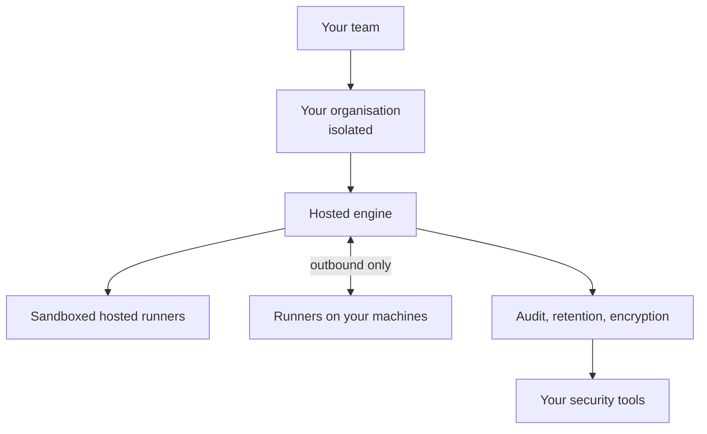

# Milestone 7: The hosted service, the public demo and enterprise controls

<!-- Generated by scripts/docs/build-roadmap.mjs from docs/roadmap/roadmap.json. Do not edit by hand. -->

<a href="../roadmap.html">Roadmap</a> › Milestone 7 · <a href="../roadmap-list.html">as a list</a>

Later 0 available · 0 in progress · 15 planned · 15 capabilities

Use Launchway without running it, on a plan that follows your choices, with the controls enterprises and regulated teams ask for.

## What it is, and who it is for

Milestone 7 lets you use Launchway without running it. Organisations are isolated, runners on your machines connect out, hosted steps run in isolated machines, and a public demo is available. The same milestone adds the identity, audit and retention controls enterprises ask for.

**Who it is for.** Teams that want Launchway as a service, evaluators who want to try it, and enterprises and regulated teams that need strong identity, audit and compliance.

## What you will be able to do

- You sign up, connect a runner on your own cluster and run a pipeline without any of your code leaving your network.
- A regulated team enables encryption keys with rotation and a retention rule.
- An auditor exports a tamper-evident audit trail to the security tools.
- A visitor explores the public demo with realistic data.

## How it fits together

*Two ways to run steps: hosted in a sandbox, or on your own machines connected outward.*

**Builds on:** [Milestone 1: Host and run](milestone-1.md). 

**Go deeper:** [The hosted service and sandboxed runners](hosted-service.md).

## The capabilities

| Group | Capabilities | Available | In progress | Planned |
|---|---|---|---|---|
| [Hosted service and demo](#g-hosted-service-and-demo) | 8 | 0 | 0 | 8 |
| [Identity, audit and compliance](#g-identity-audit-and-compliance) | 7 | 0 | 0 | 7 |

### Hosted service and demo {#g-hosted-service-and-demo}

Use Launchway without running it, on a plan that follows your choices.

#### Hosted service {#hosted-service}

○ Planned

Launchway as a service: sign-up, quotas, usage metering, a free tier, pay for use, every option on every plan, and data residency. Price follows your choices, such as availability and users, and no feature is held back by plan.

**Depends on:** Organisations.

[Area page](hosted-service.md)

#### Free tier and pay for use {#free-tier-and-pay-for-use}

○ Planned

A free tier, and pay-for-use billing from the start, with no extras for basics. Usage is metered and shown before it is billed.

**Depends on:** Hosted service.

[Area page](hosted-service.md)

#### Data residency {#data-residency}

○ Planned

Choose where your data lives. Region choices are shown at sign-up and recorded.

**Depends on:** Hosted service.

[Area page](hosted-service.md)

#### Runners on your machines {#runners-on-your-machines}

○ Planned

Runners on your own servers or clusters connect out to the hosted engine, so code and secrets never leave your network. Only outbound connections are needed.

**Depends on:** Runner identity and pools.

[Area page](hosted-service.md)

#### Sandboxed hosted runners {#sandboxed-hosted-runners}

○ Planned

Each step in its own isolated machine, with no route to anything but the internet and firm quotas; the same profile available to any self-hosted server. Layers of isolation back each other up, and a kill switch exists at the network.

**Depends on:** Hosted service.

[Area page](hosted-service.md)

#### Hosted capacity that can grow {#hosted-capacity-that-can-grow}

○ Planned

Everything is portable, so capacity can be added on any provider as demand justifies. Nothing is tied to one machine.

**Depends on:** Hosted service.

[Area page](hosted-service.md)

#### A public demo {#a-public-demo}

○ Planned

A safe instance on the internet with realistic data anyone can explore, read-only at first. A local demo already runs from the quick start. Try it with your own runner follows once organisation isolation exists.

**Depends on:** Organisations.

[Read the documentation](../demo.md) · [Area page](hosted-service.md)

#### Organisations {#organisations}

○ Planned

Several organisations on one installation, isolated from each other, with the level names you choose. Isolation is tested.

[Area page](hosted-service.md)

### Identity, audit and compliance {#g-identity-audit-and-compliance}

The controls enterprises and regulated teams ask for.

#### Built-in accounts with MFA {#built-in-accounts-with-mfa}

○ Planned

Small teams without an identity provider still get secure sign-in with authenticator codes or passkeys. Recovery codes and session management are included.

#### Directory groups and custom roles {#directory-groups-and-custom-roles}

○ Planned

LDAP and Active Directory groups mapped to roles at each level, leavers removed automatically, and a view of who can do what, and why. Roles are custom and permissions are clear.

#### Other single sign-on and provisioning {#other-single-sign-on-and-provisioning}

○ Planned

SAML sign-in and automatic user provisioning for larger companies. Works beside directory groups.

**Depends on:** Directory groups and custom roles.

#### Tamper-evident audit and SIEM export {#tamper-evident-audit-and-siem-export}

○ Planned

An audit trail nobody can quietly edit, streamed to your security tools. Entries are chained so a gap shows.

#### Retention, legal hold and encryption at rest {#retention-legal-hold-and-encryption-at-rest}

○ Planned

Choose how long data is kept, prove deletion, and encrypt logs and artifacts with rotating keys; encrypted by default when hosted. A hold overrides cleanup.

#### A compliance pack for PCI DSS and HIPAA {#a-compliance-pack-for-pci-dss-and-hipaa}

○ Planned

Policy templates and an evidence report that maps controls to requirements. It supports your compliance work and is not a certification. Controls are listed with evidence.

[Read the documentation](../security/controls-and-compliance.md)

#### Zero trust throughout {#zero-trust-throughout}

○ Planned

Every service, runner and person proves identity on every call. No shared secrets between components.

## What done means

This milestone is done when all of these are true.

- Organisations cannot see each other, proven by a test.
- A step in a sandbox cannot reach anything but the internet.
- Usage is metered and shown before it is billed.
- Audit entries are chained and exportable.
- The compliance pack lists each control with its evidence.

## What is deliberately not in it

- Any claim of certification.

---

[← Milestone 6: AI helper](milestone-6.md) · [Beyond: Beyond →](beyond.md)
