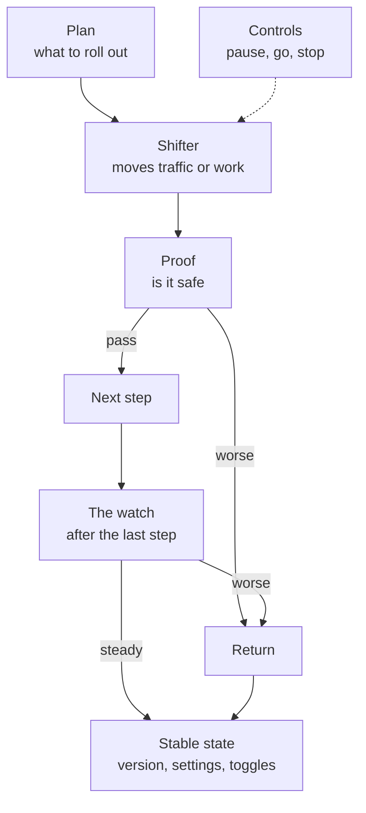

# Milestone 8: Zero-downtime delivery for anything, with Argo CD as a first-class citizen

<!-- Generated by scripts/docs/build-roadmap.mjs from docs/roadmap/roadmap.json. Do not edit by hand. -->

<a href="../roadmap.html">Roadmap</a> › Milestone 8 · <a href="../roadmap-list.html">as a list</a>

Next 1 available · 4 in progress · 43 planned · 48 capabilities

Every deployment, whatever it is made of, brings the new version up beside the old one, proves it, moves traffic or work over in steps you can see and control, keeps watching afterward and returns to the last good state by itself if things get worse.

## What it is, and who it is for

Milestone 8 gives delivery one model for everything: a plan, a mover that shifts traffic or work, proofs that say whether it is safe, controls you can press, and a record of the last stable state. The same model serves web services on Kubernetes, virtual machines behind a load balancer, serverless functions, queue workers and scheduled jobs. Argo CD becomes a first-class part of it: every application and its whole tree in one place, a plain sentence saying why something failed, and safe control. Everything is on by default and your team stays in charge; Launchway proposes changes and never rewrites your application.

**Who it is for.** Enterprises that cannot afford to be hurt by a release yet want to deploy continuously, and any team that wants to see what is deployed and why something failed.

## What you will be able to do

- You describe a service in a few plain questions and get a plan with a picture. It is rehearsed in a safe environment, and written to Git for review.
- A release reaches 5 percent of users, then 25, and each step shows the traffic you intended next to the traffic that actually arrived.
- Thirty minutes after a release has reached everyone, error rates climb. Launchway sees it, returns to the last stable state, and the Logbook says who and what decided.
- You switch on a feature toggle, errors rise, and Launchway switches it back off and tells you which toggle it was.
- You open one page and see every Argo CD application, its parent and children, and a sentence saying why one of them cannot sync.
- A rollout command that cannot work is never offered as a button.

## How it fits together

*One journey for every kind of deployment. Only the shifter changes: a traffic split, a load balancer pool, a queue reader or a function alias.*

**Builds on:** [Milestone 3: Delivery depth](milestone-3.md). **Leads to:** [Milestone 10: Databases](milestone-10.md), [Milestone 11: Kubernetes and VMs](milestone-11.md).

**Go deeper:** [Zero-downtime delivery](zero-downtime.md) · [How the build is ordered](build-order.md).

## The capabilities

| Group | Capabilities | Available | In progress | Planned |
|---|---|---|---|---|
| [One model for every deployment](#g-one-model-for-every-deployment) | 8 | 0 | 1 | 7 |
| [Rollouts: every strategy, with an assistant](#g-rollouts-every-strategy-with-an-assistant) | 5 | 0 | 0 | 5 |
| [Guarded after the deploy, and back to stable by itself](#g-guarded-after-the-deploy-and-back-to-stable-by-itself) | 5 | 1 | 0 | 4 |
| [Levers: toggles, configuration and secrets](#g-levers-toggles-configuration-and-secrets) | 6 | 0 | 3 | 3 |
| [Hosts, serverless and other workloads](#g-hosts-serverless-and-other-workloads) | 8 | 0 | 0 | 8 |
| [Argo CD, first class](#g-argo-cd-first-class) | 9 | 0 | 0 | 9 |
| [Prove it: chaos, performance and temporary capacity](#g-prove-it-chaos-performance-and-temporary-capacity) | 7 | 0 | 0 | 7 |

### One model for every deployment {#g-one-model-for-every-deployment}

First phase. A plan, a shifter, a proof, controls and a stable state, the same for every kind of workload.

#### Delivery plans {#delivery-plans}

○ Planned

Describe how a release rolls out as a plan kept in Git: the steps, how much at each, what to check and how careful to be. You will be able to read a plan as a picture, review it like code, and reuse a standard plan from your organization.

**Depends on:** Rollout control inside a run.

[Area page](zero-downtime.md)

#### Shifters {#shifters}

○ Planned

The part of a plan that moves traffic or work to the new version: a traffic split, a load balancer pool, a queue reader or a function alias. One interface lets every kind of workload take the same journey and show the same controls.

**Depends on:** Delivery plans.

[Area page](zero-downtime.md)

#### Proofs {#proofs}

○ Planned

Checks that say whether a step is safe: metrics, test transactions, network health and database health, each with a verdict in a sentence. A proof says not enough data rather than pass when a signal is too thin to judge.

**Depends on:** Delivery plans; guarded queries for monitoring data.

[Area page](zero-downtime.md)

#### Guarded queries for monitoring data {#guarded-queries-for-monitoring-data}

◐ In progress

Questions put to a metrics or log store pass through a guarded layer that limits what can be asked and how much comes back. Today the layer is being built. The rule is that monitoring data is a permission you grant and never a raw pass-through, and every proof and watch stands on it.

[Area page](zero-downtime.md)

#### The stable state {#the-stable-state}

○ Planned

For each environment Launchway records the version, settings, secret versions, toggles and routes that were known to work. The last good state is always one click, or one automatic decision, away.

**Depends on:** Delivery plans.

[Area page](zero-downtime.md)

#### Controls with consequences {#controls-with-consequences}

○ Planned

Go, go all the way, pause, resume, stop and go back, try again, skip a step, set the amount by hand, restart and scale. Each button says in a sentence what it will do and who may press it, and each press is recorded in the Logbook.

**Depends on:** Delivery plans.

[Area page](zero-downtime.md)

#### Safeguards on by default {#safeguards-on-by-default}

○ Planned

Every protection starts on and your team can tune or turn it off per project and environment; only a level above can require one. You stay in charge, and Launchway says plainly when a safeguard has been relaxed.

**Depends on:** Variables at levels.

[Area page](zero-downtime.md)

#### Rollout readiness scan {#rollout-readiness-scan}

○ Planned

Launchway reads your application and tells you what stands in the way of a safe rollout, with changes it proposes. You accept, edit or decline each proposal; nothing is edited silently.

**Depends on:** Delivery plans.

[Area page](zero-downtime.md)

### Rollouts: every strategy, with an assistant {#g-rollouts-every-strategy-with-an-assistant}

First phase. Complete coverage of Argo Rollouts, created, seen and controlled from one panel.

#### Every rollout strategy {#every-rollout-strategy}

○ Planned

Canary and blue-green, with all the step types, several analyses at once and experiments, created and shown in Launchway. Today Launchway reads a rollout; this makes it create and edit the files in Git, with every field accounted for.

**Depends on:** Rollout control inside a run.

[Area page](zero-downtime.md)

#### An assistant for creating a rollout {#an-assistant-for-creating-a-rollout}

○ Planned

A few plain questions (what is it, how do users reach it, how do we know it is healthy, how careful, who must clear it) produce a plan, a picture and files in Git. The proposal is rehearsed before it ever touches production.

**Depends on:** Delivery plans.

[Area page](zero-downtime.md)

#### The rollout panel {#the-rollout-panel}

○ Planned

One panel shows the line of steps, where traffic really goes next to where it is meant to go, every check as it measures, old and new side by side, and events in time order. You will be able to see “10 percent intended, 9.4 percent measured” and what changed just before.

**Depends on:** Every rollout strategy.

[Area page](zero-downtime.md)

#### Rehearsal environments {#rehearsal-environments}

○ Planned

Try a rollout in a short-lived environment with a traffic generator and injected faults before it reaches production. Rehearsal is a feature of the product, not only of its tests.

**Depends on:** An assistant for creating a rollout.

[Area page](zero-downtime.md)

#### Return to any earlier version {#return-to-any-earlier-version}

○ Planned

Choose an earlier version and return to it, with what that will change spelled out first. A return by Git revert is the default; the engine’s own history is the emergency exit.

**Depends on:** The stable state.

[Area page](zero-downtime.md)

### Guarded after the deploy, and back to stable by itself {#g-guarded-after-the-deploy-and-back-to-stable-by-itself}

First phase. The release is not finished when the last step is; the watch carries on and can return.

#### Roll back after a successful deployment {#roll-back-after-a-successful-deployment}

✓ Available

An emergency button that returns to the last stable state even after a rollout has succeeded. Available now: the control returns to the last stable state after a rollout has succeeded, with the same consequence text and Logbook entry as every other control.

**Depends on:** The stable state.

[Read the documentation](../guide/rollback-after-success.md) · [Area page](zero-downtime.md)

#### The watch {#the-watch}

○ Planned

After the last step, keep watching for a set time (30 minutes, for example) against a baseline of how the service normally behaves. The watch is the existing verification running after the final shift, with a plain “starting the return” decision if signals worsen.

**Depends on:** Proofs; the stable state.

[Area page](zero-downtime.md)

#### Automatic return to stable {#automatic-return-to-stable}

○ Planned

If error rates or other signals worsen during the watch, Launchway returns to the last stable state and says why. A cause outside the release, such as a failing dependency, is detected and does not trigger a pointless return.

**Depends on:** The watch.

[Area page](zero-downtime.md)

#### Extend, end or override the watch {#extend-end-or-override-the-watch}

○ Planned

Lengthen a watch during a risky week, end it early, or override a return, each with a reason on the record. Production may require a person other than the one who started the release.

**Depends on:** The watch.

[Area page](zero-downtime.md)

#### One timeline of what changed {#one-timeline-of-what-changed}

○ Planned

Deployments, toggles, configuration and secrets on a single timeline, so what changed before it broke has an answer. It is the first place to look when a proof fails.

**Depends on:** The watch.

[Area page](zero-downtime.md)

### Levers: toggles, configuration and secrets {#g-levers-toggles-configuration-and-secrets}

Second phase. Everything that can change behavior without a new build is versioned, rolled out and returnable.

#### A toggle service in the model {#a-toggle-service-in-the-model}

◐ In progress

Toggles are known to Launchway, shown beside deployments on an environment's timeline, and offered for reverting with a rollback. Rolling a toggle out in steps by a plan with proofs between them, and returning it with the rest of one stable-state record, are still to come.

**Depends on:** Feature toggles.

[Read the documentation](../guide/feature-toggles.md) · [Area page](zero-downtime.md)

#### Kill switches and automatic toggle-back {#kill-switches-and-automatic-toggle-back}

◐ In progress

A toggle marked as a kill switch has a safe value, and turning it to that value is never held for an approval. Switching a toggle back automatically when errors rise after a change is still to come: today the change is shown as recent and a person reverts it.

**Depends on:** The watch; a toggle service in the model.

[Read the documentation](../guide/feature-toggles.md) · [Area page](zero-downtime.md)

#### Stale-toggle hygiene {#stale-toggle-hygiene}

◐ In progress

Toggles that have served one value to everyone for a month, have not been evaluated, or are past their removal date are noted on their page, never changed. A suggested pull request that removes the check and the toggle is still to come.

**Depends on:** A toggle service in the model.

[Read the documentation](../guide/feature-toggles.md) · [Area page](zero-downtime.md)

#### Configuration and secrets as rollouts {#configuration-and-secrets-as-rollouts}

○ Planned

A change to configuration or to a secret’s version is rolled out by a plan and can be returned. Secrets stay in their store; Launchway moves the reference and the version.

**Depends on:** Secrets with an external store.

[Area page](zero-downtime.md)

#### Drift detection for settings {#drift-detection-for-settings}

○ Planned

Find configuration that differs between what is declared and what runs, and between environments. Drift is a finding with its cause, not an alarm without context.

**Depends on:** Configuration and secrets as rollouts.

[Area page](zero-downtime.md)

#### Revert the latest change {#revert-the-latest-change}

○ Planned

When something breaks, one action reverts the most recent change on the timeline, whatever kind it was. The action says what it will undo before you press it.

**Depends on:** One timeline of what changed.

[Area page](zero-downtime.md)

### Hosts, serverless and other workloads {#g-hosts-serverless-and-other-workloads}

Later phases. The same journey for virtual machines, bootable hosts, functions and workloads that are not web requests.

#### Hosts and pools {#hosts-and-pools}

○ Planned

Pools of virtual machines or hosts deployed in batches behind a load balancer, with draining first. The first load balancer supported is a popular open-source one, then one cloud balancer.

**Depends on:** Shifters.

[Area page](zero-downtime.md)

#### Test transactions to a not-yet-live host {#test-transactions-to-a-not-yet-live-host}

○ Planned

Send test requests to a new host before any user reaches it, and read the result as a proof. The host goes live only when its proofs pass.

**Depends on:** Hosts and pools.

[Area page](zero-downtime.md)

#### Fleets of bootable-image hosts {#fleets-of-bootable-image-hosts}

○ Planned

Roll a new host image across a fleet in batches with a watch and a return. It joins the image work in Milestone 3.

**Depends on:** Hosts and pools.

[Area page](zero-downtime.md)

#### Serverless and managed container services {#serverless-and-managed-container-services}

○ Planned

Shift traffic between function versions and managed services using aliases and revisions, with proofs per version. Provider interfaces are tested against emulators in the automated tests.

**Depends on:** Delivery plans.

[Area page](zero-downtime.md)

#### Queue and stream consumers {#queue-and-stream-consumers}

○ Planned

Roll out a new version of a worker that reads a queue, by moving which copies read which part, and prove it with lag. A seeded backlog tests that the new version keeps up.

**Depends on:** Hosts and pools.

[Area page](zero-downtime.md)

#### Long-lived connections and TCP {#long-lived-connections-and-tcp}

○ Planned

Drain connections that stay open for hours, and shift plain network services safely. It says honestly what cannot be made seamless.

**Depends on:** Hosts and pools.

[Area page](zero-downtime.md)

#### Scheduled and batch jobs {#scheduled-and-batch-jobs}

○ Planned

Roll out a job that must run exactly once with a hand-over rather than an overlap. The plan changes shape and the answer is a short, controlled pause, not a claim of zero.

**Depends on:** Hosts and pools.

[Area page](zero-downtime.md)

#### Safe changes to stateful services {#safe-changes-to-stateful-services}

○ Planned

Expand-then-contract steps for data, with a check that the old and new versions can both read what is written. It leans on the database work in Milestone 10.

**Depends on:** Hosts and pools.

[Area page](zero-downtime.md)

### Argo CD, first class {#g-argo-cd-first-class}

First phase for seeing and diagnosing, later for control and creating. Launchway does not replace Argo CD; it adds what no single Argo CD screen knows.

#### See every application and its tree {#see-every-application-and-its-tree}

○ Planned

All applications from root to leaf, with a problem rolled up so a parent that looks fine while its children are not stands out first. You will be able to switch between a tree, a table and a by-environment view of the same nodes.

**Depends on:** Argo CD in depth.

[Area page](delivery.md)

#### Every application in context {#every-application-in-context}

○ Planned

For each application: which change made it what it is, which run wrote that change, which version runs where and who owns it. It also lists the same service in other environments side by side.

**Depends on:** See every application and its tree.

[Area page](delivery.md)

#### A problem in one sentence {#a-problem-in-one-sentence}

○ Planned

A diagnosis such as “Argo CD cannot build this application: a link points outside its folder”, with the evidence and the next step. When the cause is unknown it says so and what access would let it see more. A catalog of known causes is tested against real incidents.

**Depends on:** See every application and its tree.

[Area page](delivery.md)

#### Every item and its logs {#every-item-and-its-logs}

○ Planned

Open any resource to see its events, manifest, desired against live, and logs including the previous container. Secrets appear by name only, and the access Launchway has is stated in a self-check.

**Depends on:** A problem in one sentence.

[Area page](delivery.md)

#### Safe sync and control {#safe-sync-and-control}

○ Planned

Sync with a preview, refresh, stop a stuck sync, run a resource action, and pause automatic sync during an incident with a banner and a reminder. A button appears only if it will work, and each press is recorded.

**Depends on:** See every application and its tree.

[Area page](delivery.md)

#### Create and change through Git {#create-and-change-through-git}

○ Planned

An assistant writes an Application, an ApplicationSet or a Project into Git and opens a pull request, showing what will be created. Nothing is changed with a click against the cluster.

**Depends on:** Pull requests on the built-in host.

[Area page](delivery.md)

#### Adopt existing applications {#adopt-existing-applications}

○ Planned

Discover the applications you already have and map them to projects and environments without changing them. Discovery is opt-in and read-only.

**Depends on:** See every application and its tree.

[Area page](delivery.md)

#### Rollouts, sync and environments in one view {#rollouts-sync-and-environments-in-one-view}

○ Planned

A joined timeline of a sync and its rollout, and a matrix of what version runs in each environment. Notification rules and Argo CD’s own notices appear in the same place.

**Depends on:** Every rollout strategy.

[Area page](delivery.md)

#### Other deployment engines {#other-deployment-engines}

○ Planned

The same panels over another GitOps engine or plain apply and Helm, through an adapter. Argo CD is never required.

**Depends on:** Safe sync and control.

[Area page](delivery.md)

### Prove it: chaos, performance and temporary capacity {#g-prove-it-chaos-performance-and-temporary-capacity}

First phase for the first runner, later for more tools. Each is a plan or a proof, so they add no new concepts.

#### Chaos experiments as plans {#chaos-experiments-as-plans}

○ Planned

A controlled, authorized experiment that injects a fault, checks that steady state holds, and restores everything afterward. Breaching a proof is the abort condition, and a fault is never left on: it expires even if Launchway itself fails.

**Depends on:** The watch.

[Area page](zero-downtime.md)

#### Chaos authorization and safety {#chaos-authorization-and-safety}

○ Planned

Experiments are off until switched on, allowed only where declared, bounded in what they can reach, and cleared by someone other than the starter. Production may require a lock from a level above.

**Depends on:** Chaos experiments as plans.

[Area page](zero-downtime.md)

#### Game days and the scorecard {#game-days-and-the-scorecard}

○ Planned

Scheduled game days, rehearsals with a fault, and a scorecard of what the system survived. Findings such as “never survived losing a replica” join the findings list.

**Depends on:** Chaos experiments as plans.

[Area page](zero-downtime.md)

#### Performance tests as proofs {#performance-tests-as-proofs}

○ Planned

Run a load test from the repository as a step and get a report with percentiles, throughput, errors and the saturation of the system under test. A built-in constant-rate runner needs no install; popular open-source load tools run as separate containers.

**Depends on:** Proofs.

[Area page](zero-downtime.md)

#### Baselines and regression detection {#baselines-and-regression-detection}

○ Planned

Compare a release with the last one and fail a promotion on a real regression, with repeats and noise handling. It says not enough data rather than pass when a test is too short or too small.

**Depends on:** Performance tests as proofs.

[Area page](zero-downtime.md)

#### Temporary capacity for tests {#temporary-capacity-for-tests}

○ Planned

Raise a namespace’s quota or a workload’s size for the length of a test, then always restore what was there. Previous values are recorded in the stable state, so a failure mid-test still restores them.

**Depends on:** Delivery plans.

[Area page](zero-downtime.md)

#### Performance gates in preflight {#performance-gates-in-preflight}

○ Planned

Require a passing performance result before a promotion to production, advisory until a level makes it required. Tests run only against environments declared for performance or not production.

**Depends on:** Baselines and regression detection.

[Area page](zero-downtime.md)

## What done means

This milestone is done when all of these are true.

- The same plan runs a progressive rollout on Kubernetes, with every Argo Rollouts strategy covered and shown.
- A seeded bad release is stopped and returned within the time the plan states, and a seeded good one is promoted, in the rehearsal environment and in the automated tests.
- After the last step, the watch returns to the last stable state when signals worsen, and a rollback after a success works from the interface, the API, the agent endpoint and the command line.
- A toggle that causes errors is switched back automatically, and a configuration or secret change can be rolled and returned by a plan.
- Every Argo CD application and its tree are visible, with a plain-language diagnosis for the common failures.
- No control is offered that cannot work, and every control says what it will do and who may press it.

## What is deliberately not in it

- Making a change that is not backward compatible safe: Launchway warns and proposes, and cannot repair the design.
- Guaranteeing full nines for a whole system from a rollout alone.
- Replacing Argo CD or copying its screens: Launchway adds context and links to the original where it shows more.
- Silently editing an application: every change is a proposal you accept, edit or decline.

---

[← Milestone 7: Hosted service](milestone-7.md) · [Milestone 9: Network and traffic →](milestone-9.md)
