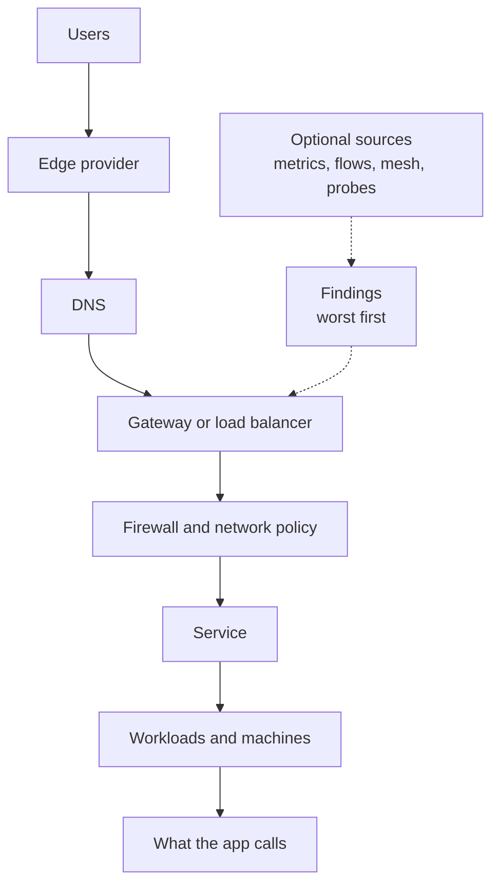

# Milestone 9: Network and traffic you can see, from the edge to the workload

<!-- Generated by scripts/docs/build-roadmap.mjs from docs/roadmap/roadmap.json. Do not edit by hand. -->

<a href="../roadmap.html">Roadmap</a> › Milestone 9 · <a href="../roadmap-list.html">as a list</a>

Next 0 available · 0 in progress · 32 planned · 32 capabilities

For every application, Launchway answers one question: can it receive and serve requests right now, from where its users are, and if not, at which step does the route break?

## What it is, and who it is for

Milestone 9 draws the route a request takes, from the edge provider through DNS, the gateway or load balancer, the firewall and the network policy to the service and its workloads, and shows the problems along it, worst first. It also learns what each application really depends on, handles several sites and failover, manages DNS records as part of a deployment, and understands service meshes, Istio most deeply. Everything is optional: Launchway sees only what you give it access to, says what it cannot see, and never captures the contents of traffic.

**Who it is for.** Operators and platform teams who today learn that the network is the problem by elimination, after an hour in four different tools.

## What you will be able to do

- Users in one region cannot reach an application. The path view shows the request reaching the gateway and stopping at a network policy, with the policy named.
- You set up a connection to a metrics store and a cluster, and a setup assistant discovers what it can see and shows what each extra permission would add.
- A deployment that needs a new name creates its DNS record, shows the difference first, and checks that every nameserver agrees afterward.
- You ask to send only some clients to a new version, and Launchway shows which routing rule will match, in a plain explanation, before you apply it.
- A site fails and traffic moves to the other one as rehearsed, with the lag and the order of events shown.

## How it fits together

*The route of a request, and where findings come from. A step with no source is drawn dotted and labeled not observed.*

**Builds on:** [Milestone 3: Delivery depth](milestone-3.md). 

**Go deeper:** [Network and traffic](network.md) · [Live traffic, protection and reliability](traffic.md).

## The capabilities

| Group | Capabilities | Available | In progress | Planned |
|---|---|---|---|---|
| [Can my application be reached?](#g-can-my-application-be-reached) | 8 | 0 | 0 | 8 |
| [Sources: bring what you already have](#g-sources-bring-what-you-already-have) | 6 | 0 | 0 | 6 |
| [Sites, failover and protection](#g-sites-failover-and-protection) | 4 | 0 | 0 | 4 |
| [DNS as part of deployment](#g-dns-as-part-of-deployment) | 6 | 0 | 0 | 6 |
| [Service meshes, Istio deepest](#g-service-meshes-istio-deepest) | 8 | 0 | 0 | 8 |

### Can my application be reached? {#g-can-my-application-be-reached}

First phase. The route, the places on it, the findings, and the proof that feeds delivery.

#### The request path {#the-request-path}

○ Planned

For any application, the chain from the edge to the workload, each step marked healthy, broken or not observed. Machines and sites appear beside Kubernetes places, and a dotted link never gets an invented number.

**Depends on:** A live traffic map.

[Area page](network.md)

#### The findings list {#the-findings-list}

○ Planned

Network problems in a plain sentence, worst first, each with its evidence and what was and could not be checked. A cause is stated only when the evidence supports one; otherwise it says cause unknown.

**Depends on:** The request path.

[Area page](network.md)

#### Dependencies learned from traffic {#dependencies-learned-from-traffic}

○ Planned

What each application really calls, and what changed with the last version. It joins what was declared with what was observed, and shows both.

**Depends on:** The request path.

[Area page](network.md)

#### A network proof for delivery {#a-network-proof-for-delivery}

○ Planned

Deliveries ask whether the new version is really receiving and answering traffic, and use the answer as a proof. It is the same answer a person opens when a proof fails.

**Depends on:** Proofs.

[Area page](network.md)

#### Probes from where users are {#probes-from-where-users-are}

○ Planned

HTTP, TCP, DNS and certificate probes from the cluster and, where you allow it, from outside. Probes show whether the problem is the application or the route.

[Area page](network.md)

#### Setup assistant and the access ladder {#setup-assistant-and-the-access-ladder}

○ Planned

An assistant discovers what it can see, and each permission you grant, from none upward, shows what it would add. Nothing is required, and the interface lists what it cannot see with “granting this would add that”.

[Area page](network.md)

#### Privacy and retention for network data {#privacy-and-retention-for-network-data}

○ Planned

Addresses, names, ports, protocols, counts and timings only, kept for a time you choose. Payloads are never captured.

[Area page](network.md)

#### Traffic per version during a Launch {#traffic-per-version-during-a-launch}

○ Planned

Radar shows requests, errors and latency from the edge to the workload for the stable and the new version separately, during a Launch and after it. Built from sources the team already has (metrics store, gateway, mesh, load balancer, edge provider), read through the guarded query layer. Where requests are not labeled by version, the view says so and proposes the label as a change. A step with no source is drawn dotted and given no number.

**Depends on:** The request path; Signal sources

[Area page](network.md)

### Sources: bring what you already have {#g-sources-bring-what-you-already-have}

Phases follow popularity. Each source is an optional adapter that widens the picture; none is required.

#### Pod networks and gateways {#pod-networks-and-gateways}

○ Planned

Read flows and routes from the popular pod network, Gateway API and Envoy-based gateways first. The generic mapping works for anything that exposes standard metrics.

**Depends on:** The request path.

[Area page](network.md)

#### Edge providers {#edge-providers}

○ Planned

Read the state of an edge provider’s protection and routing, with a read-only token scoped to what you choose. Each scope says what it adds.

**Depends on:** Sources: pod networks and gateways.

[Area page](network.md)

#### Firewalls, routers and switches {#firewalls-routers-and-switches}

○ Planned

Read exported flows, logs and rules from devices outside Kubernetes, and flag drift between what is declared and what is configured. Launchway reads and never changes a device.

**Depends on:** Pod networks and gateways.

[Area page](network.md)

#### Cloud flow logs and load balancers {#cloud-flow-logs-and-load-balancers}

○ Planned

Read the flow logs and balancers of the major clouds as sources. It shows the same path view for traffic that never touches Kubernetes.

**Depends on:** Pod networks and gateways.

[Area page](network.md)

#### Hosts and virtual machines as sources {#hosts-and-virtual-machines-as-sources}

○ Planned

A small host agent, where you allow one, reports flows from machines that are not on any mesh. A machine outside the mesh still appears on the map.

**Depends on:** Pod networks and gateways.

[Area page](network.md)

#### A store for flow history {#a-store-for-flow-history}

○ Planned

Keep flow history in a store that scales for large installations, beside the built-in default. The built-in store needs nothing extra.

**Depends on:** Pod networks and gateways.

[Area page](network.md)

### Sites, failover and protection {#g-sites-failover-and-protection}

Second and third phases. For enterprises with more than one site.

#### Sites and failover view {#sites-and-failover-view}

○ Planned

Several sites as places, with where traffic goes now, where it would go on failure, and replication lag. Failover findings say what would break.

**Depends on:** The request path.

[Area page](network.md)

#### Rehearsed failover {#rehearsed-failover}

○ Planned

Practice a site failover as an authorized, bounded exercise with a watch and a way back. Never on by default.

**Depends on:** Sites and failover view.

[Area page](network.md)

#### Protection and stability signals {#protection-and-stability-signals}

○ Planned

Rate limiting, signs of abuse and stability signals in the same view as the traffic. It shows the state of your protection service and links to it.

**Depends on:** The request path.

[Area page](network.md)

#### Fault injection in the traffic map {#fault-injection-in-the-traffic-map}

○ Planned

Inject delays and errors on one connection, with a bound and an automatic stop. It shares its safety rules with Drills.

**Depends on:** Chaos authorization and safety.

[Area page](network.md)

### DNS as part of deployment {#g-dns-as-part-of-deployment}

First read-only, then writing records a deployment owns, then shifting traffic with DNS.

#### DNS view {#dns-view}

○ Planned

Zones and records with who owns each, how they resolve from several vantage points, and whether secondary servers agree. Records changed outside Launchway show as findings.

**Depends on:** Probes from where users are.

[Area page](network.md)

#### Records a deployment owns {#records-a-deployment-owns}

○ Planned

A deployment declares the records it needs; Launchway shows the difference, asks for clearance, creates them and keeps them in step. It never touches a record it does not own, and ownership markers prevent two controllers from fighting.

**Depends on:** DNS view.

[Area page](network.md)

#### DNS servers and providers {#dns-servers-and-providers}

○ Planned

Authoritative servers, starting with PowerDNS, then standard dynamic update, then the popular cloud DNS services. Access is limited to one zone, created with least privilege.

**Depends on:** Records a deployment owns.

[Area page](network.md)

#### Cutover with a TTL strategy {#cutover-with-a-ttl-strategy}

○ Planned

Lower the record’s cache time, add the new target with a small weight, prove it, shift, then restore the cache time. Launchway states what DNS cannot promise: caches keep old answers.

**Depends on:** Records a deployment owns.

[Area page](network.md)

#### The DNS proof {#the-dns-proof}

○ Planned

A check that the answer is what was declared from each vantage point and that the secondaries agree. It joins the other proofs in a plan.

**Depends on:** Cutover with a TTL strategy.

[Area page](network.md)

#### Split-horizon and certificates {#split-horizon-and-certificates}

○ Planned

Different answers inside and outside, and a view of certificate challenge readiness next to each name. Launchway reads the certificate manager; it does not issue certificates in the first phases.

**Depends on:** DNS view.

[Area page](network.md)

### Service meshes, Istio deepest {#g-service-meshes-istio-deepest}

Phases by popularity. A mesh is a source and a shifter; “no mesh” is a supported state.

#### Mesh support matrix and readiness check {#mesh-support-matrix-and-readiness-check}

○ Planned

For each popular mesh, what Launchway can observe, shift, and check, with a readiness scan of your configuration. Mesh features switch on only when a mesh is detected and an administrator allows it.

**Depends on:** Service mesh support including VMs.

[Area page](network.md)

#### Gateway API as the default path {#gateway-api-as-the-default-path}

○ Planned

Routes and weights through the standard Gateway API, which works with or without a mesh. It is the default way to shift traffic.

**Depends on:** Mesh support matrix and readiness check.

[Area page](network.md)

#### Deep Istio understanding {#deep-istio-understanding}

○ Planned

Read virtual services, destination rules and subsets, and see in one view how a request is routed, with an explanation of which rule matches first. Sidecar and ambient modes are both read.

**Depends on:** Mesh support matrix and readiness check.

[Area page](network.md)

#### Route a subset of clients or requests {#route-a-subset-of-clients-or-requests}

○ Planned

An assistant helps send only certain clients, headers or a mirror of traffic to a new version, and previews the result before it is applied. It coexists with a running rollout without fighting over weights.

**Depends on:** Deep Istio understanding.

[Area page](network.md)

#### Per-subset proofs {#per-subset-proofs}

○ Planned

Request metrics for each subset become proofs, so a Pathfinder for one group of clients is judged on that group. It uses the same proof verdicts as everywhere else. Subsets are sticky by default, each is compared with the same kind of clients on the stable version over the same minutes, and where requests cannot be told apart the proof says so and falls back to the whole-service comparison, never to a pass. A fail in any subset returns the whole Launch with the subset named, and the page shows exposure in one number.

**Depends on:** Route a subset of clients or requests

[Area page](network.md)

#### Tetrate as a named integration {#tetrate-as-a-named-integration}

○ Planned

Read both layers of a Tetrate-managed Istio mesh, map its hierarchy to Launchway’s levels, and propose changes at the right layer. It later serves as a shifter for rollouts and across clusters.

**Depends on:** Deep Istio understanding.

[Area page](network.md)

#### Other popular meshes {#other-popular-meshes}

○ Planned

The same observing, shifting and checking for the other popular meshes in turn. Each is a separate adapter and ships when it passes the shared tests.

**Depends on:** Mesh support matrix and readiness check.

[Area page](network.md)

#### Virtual machines on a mesh {#virtual-machines-on-a-mesh}

○ Planned

Show machines that join a mesh and give instructions and a checked proposal for onboarding another. Onboarding is a runbook step, not a hidden change.

**Depends on:** Deep Istio understanding.

[Area page](network.md)

## What done means

This milestone is done when all of these are true.

- The path view shows the route for a sample application, built from sources Launchway was given, with unobserved steps clearly marked.
- The findings list detects the common failures, replayed from real incidents as tests, and states a cause only when the evidence supports one.
- DNS records owned by a deployment are created, checked and kept in step, and records it does not own are never touched.
- Istio objects are read and explained, and a route for a subset of clients can be proposed and rolled out.
- Sites and failover are shown and rehearsed.

## What is deliberately not in it

- Capturing the contents of traffic: Launchway sees addresses, names, ports, protocols, counts and timings only.
- Replacing a mesh console, a firewall console or a protection service: Launchway shows their state and links to them.
- Changing firewalls, DHCP or resolver settings, or DNS records Launchway does not own.
- Issuing certificates itself in the first phases; it reads the certificate manager and shows the challenge state.

---

[← Milestone 8: Zero downtime](milestone-8.md) · [Milestone 10: Databases →](milestone-10.md)
