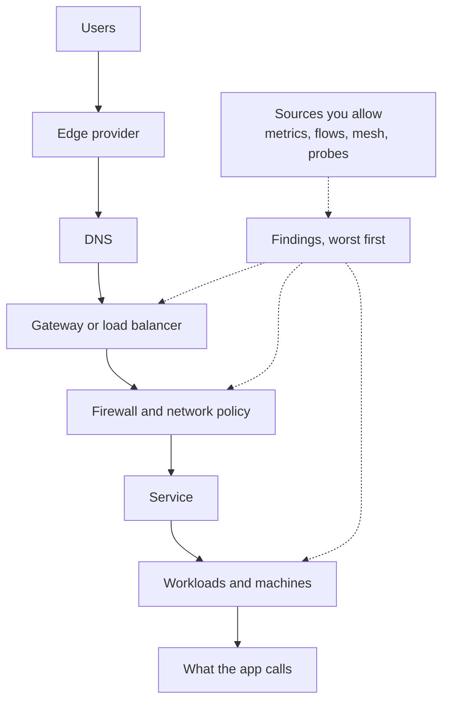
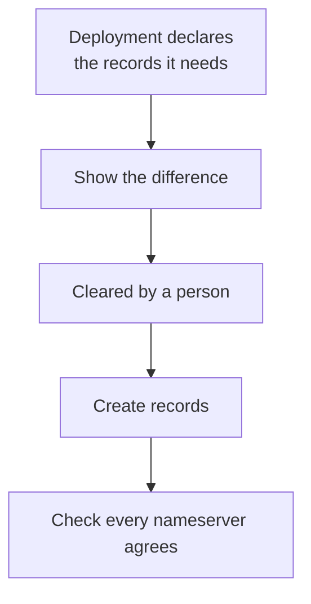
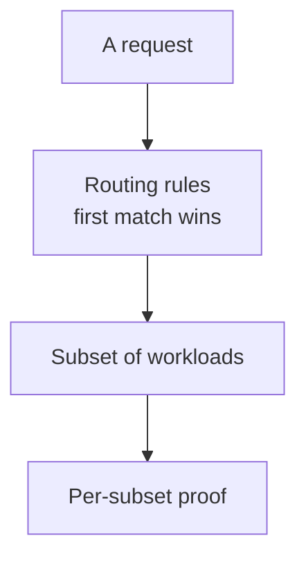

# Network and traffic

<a href="../roadmap.html">Roadmap</a> › Areas › Network and traffic · <a href="../roadmap-list.html">as a list</a>

For every application: can it receive and serve requests right now, and if not, at which step does the route break? **Status:** planned, in [Milestone 9](milestone-9.md). The live traffic map and protection views are in [Milestone 3](traffic.md).

## The path of a request, and where findings come from

Each step is marked healthy, broken or not observed. Findings come from the sources you have given Launchway access to, and a step with no source is dotted and labeled, never given an invented number.

## What it sees, and what it never does

Launchway sees addresses, names, ports, protocols, counts and timings. It never captures what the traffic contains. Everything is optional: with no source it still draws the route you declared, and every extra permission shows what it would add.

## DNS as part of a deployment

Launchway writes only records a deployment declares and owns, through a connection limited to one zone, and never changes firewalls, DHCP, resolver settings or records it does not own.

## Service meshes

Istio is read most deeply: its routing rules are explained so you can see which one matches first, and a route for a subset of clients is previewed before it is applied. A mesh managed by Tetrate is read at both of its layers.

Go back to the [Roadmap](../public/roadmap.html).
