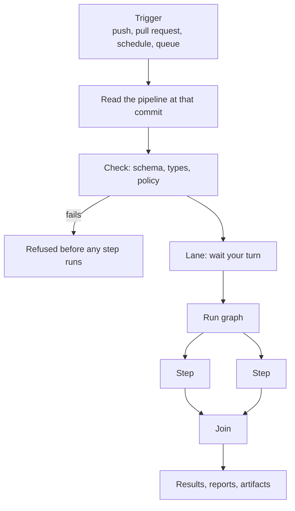
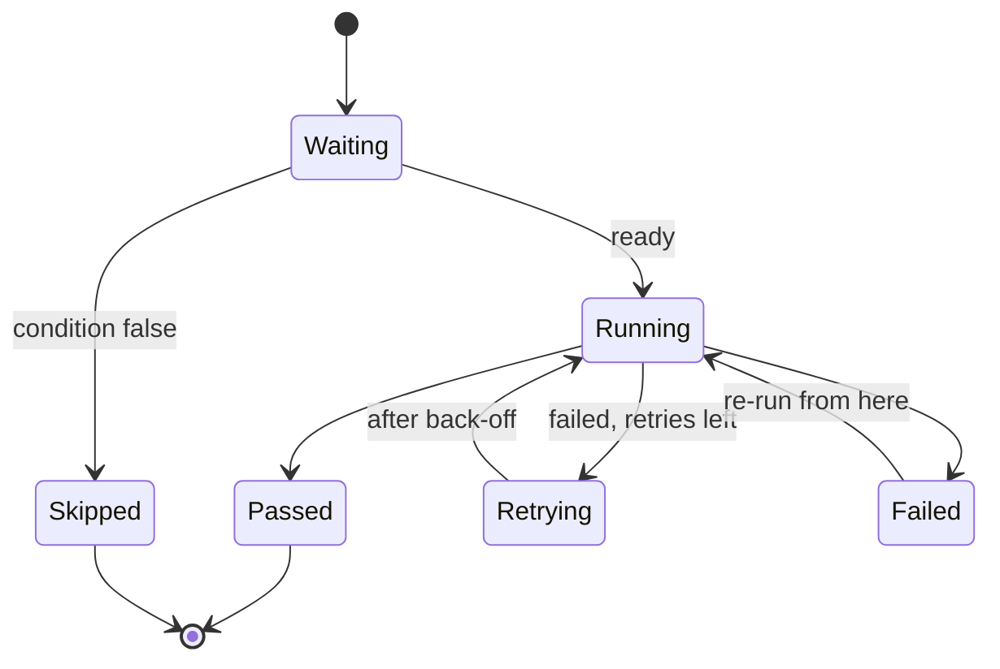
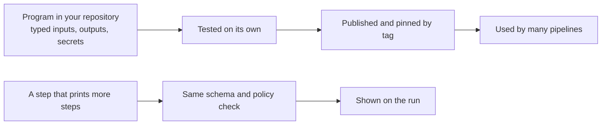

# Pipelines and flow control

<a href="../roadmap.html">Roadmap</a> › Areas › Pipelines · <a href="../roadmap-list.html">as a list</a>

Pipelines live in Git next to the code they build. Launchway reads the pipeline at the commit a run is for. Flow control, caches and many triggers are **available today** (see the [pipeline reference](../reference/pipeline.md)); custom steps, generated pipelines, expressions, matrices and visual design are planned in [Milestone 1](milestone-1.md#g-pipelines-that-match-what-teams-expect-from-hosted-ci) and [Milestone 2](milestone-2.md).

## How a run is planned and ordered

Everything that can be checked is checked before the run, including generated steps and references to outputs. A run in a lane waits for the one ahead.

## The life of a step

Re-running from a step gives it exactly what it was given before, so a fix does not mean starting over.

## Custom and generated steps

A template is an interface and code is what runs. Because expressions have no loops and no side effects, a pipeline can always be checked without running it.

## Where each idea is listed

[Flow control, caches and matrices](milestone-1.md#g-pipelines-that-match-what-teams-expect-from-hosted-ci), [custom steps and generated pipelines](milestone-2.md#g-write-pipelines-your-way), [visual design](milestone-2.md#g-design-visually), and [moving off an automation server](milestone-2.md#g-move-off-a-self-hosted-automation-server).

Go back to the [Roadmap](../public/roadmap.html).
