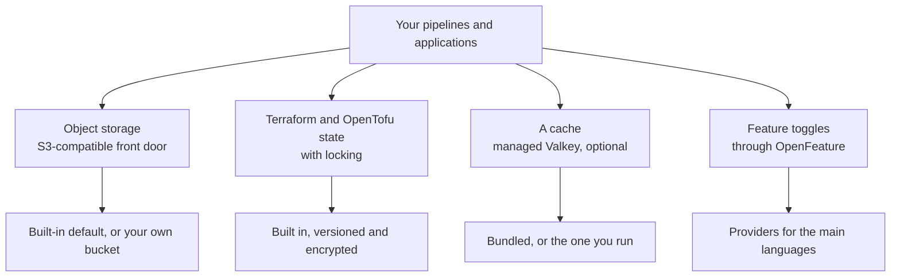

# Platform services

<a href="../roadmap.html">Roadmap</a> › Areas › Platform services · <a href="../roadmap-list.html">as a list</a>

Four things that sit next to your pipelines, built in and optional. **Status:** planned, in [Milestone 3](milestone-3.md). What you install is Launchway, and PostgreSQL for production.

## Four services, each swappable

Each service has a built-in default and a popular backend you can use instead, without losing data.

## What each one is

- **Object storage** speaks the part of S3 that Terraform, Depots (registries), backup tools and build caches use, with short-lived credentials from a step’s identity. It is promised for Launchway’s own data and your pipelines. For production application data you connect your own bucket or bundle a managed server.
- **State** uses the standard HTTP backend with locking, so a step needs no backend setup. It is encrypted, versioned and never shown raw.
- **A cache** is not built into Launchway. An application can be given a managed Valkey as a backing service, installed through GitOps.
- **Switches (feature toggles)** use the OpenFeature standard. Rules evaluate in the application, so toggles keep working when Launchway is down and personal data never leaves it.

Go back to the [Roadmap](../public/roadmap.html).
