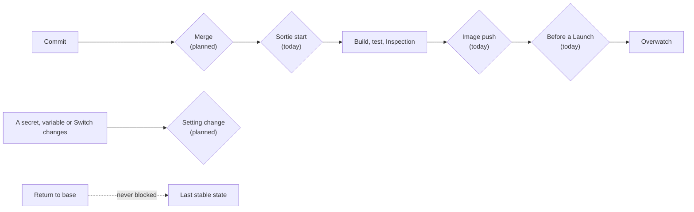
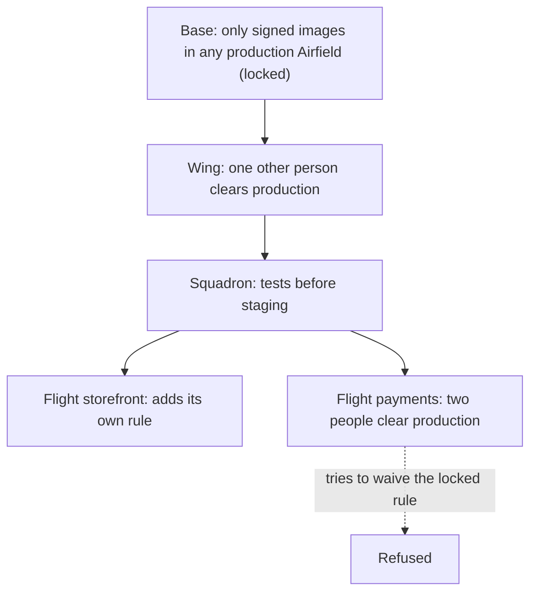

# Standing orders, Clearance and evidence

<a href="../roadmap.html">Roadmap</a> › Areas › Standing orders, Clearance and evidence · <a href="../roadmap-list.html">as a list</a>

Before a change merges, a Sortie (run) starts, an image is pushed or a Launch leaves the ground, Launchway judges it against the same Standing orders (policies and repository standards), asks the right people for Clearance (approval), and refuses to launch during a Hold (freeze), while Return to base (rollback) always stays open. **Status:** Standing orders judged when a Sortie starts, when an image is pushed and before a Launch, with waivers that expire, Clearances and Holds, are **available today** (see [Standing orders](../guide/standing-orders.md) and [policies](../guide/policies.md)); the merge point, the setting-change point and evidence packs are planned in [Milestone 3](milestone-3.md) and [Milestone 7](milestone-7.md).

## Every point where a change is judged

Every path to production passes through these points; there is no side door. Every verdict is one of four answers (allow, warn, require a Clearance, deny), written to the record with its reasons and readable by a person.

## Set once, inherited with locks

Rules are set at the Base, Wing, Squadron or Flight. A level above can lock a rule; a level below can only add or tighten. Planned: you can try a rule against last month's record before you enforce it, and see which Launches it would have stopped.

## Evidence as a by-product

Because every verdict, Clearance and Hold is on one record, the evidence an auditor asks for already exists. Planned: one evidence pack per release, mapped to the controls of published frameworks, and a read-only view for an auditor. Launchway is not certified against any standard; it provides controls and evidence.

## What it will not do

A Standing order judges facts that are on the record; it cannot see what never reached Launchway. Return to base is never held for a rule or a Clearance.

Go back to the [Roadmap](../public/roadmap.html).
