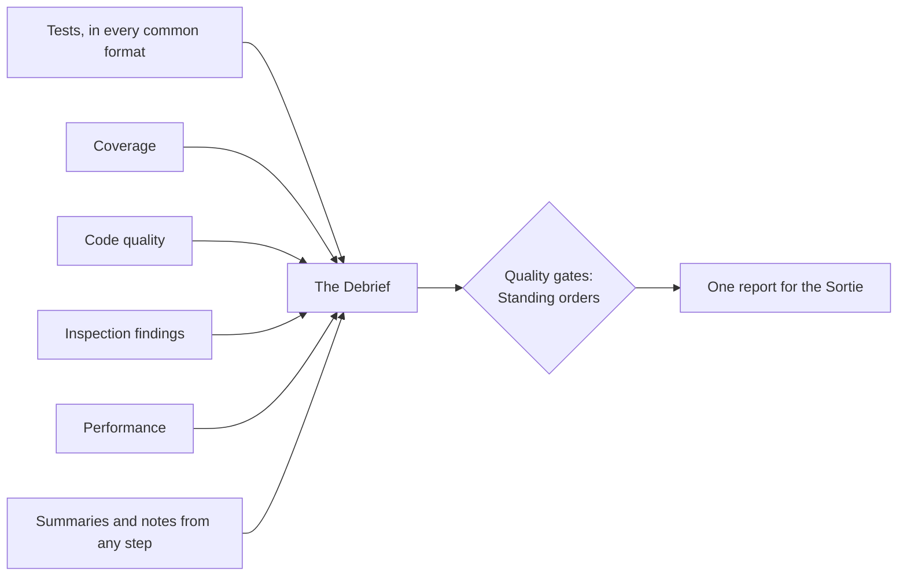
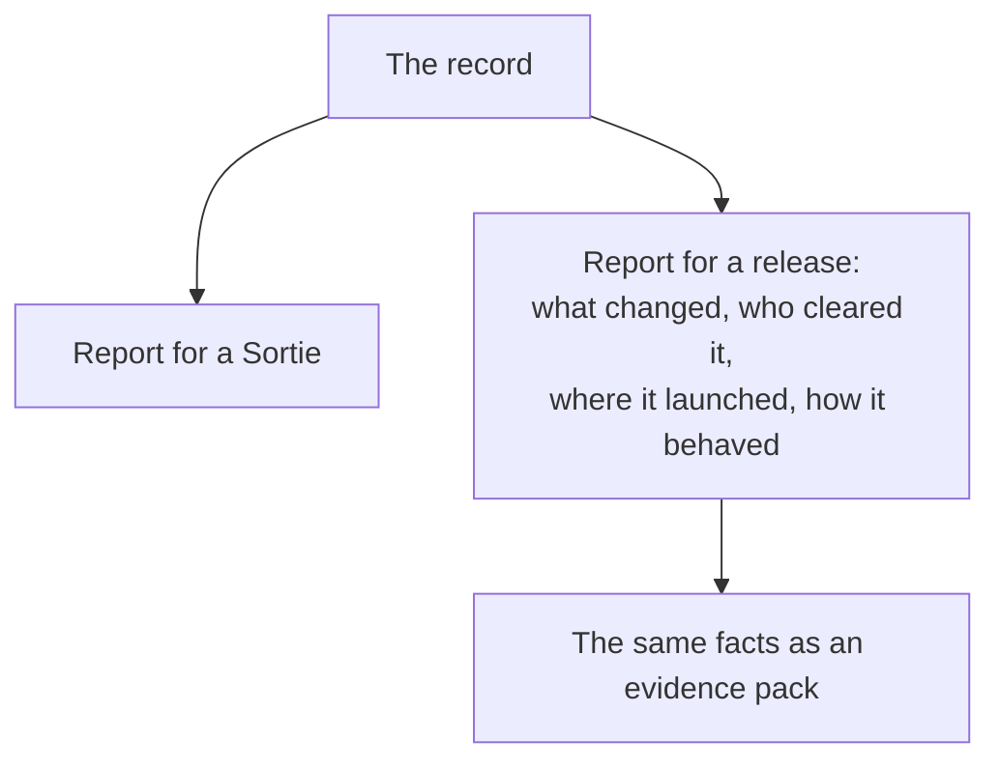

# Quality and reports

<a href="../roadmap.html">Roadmap</a> › Areas › Quality and reports · <a href="../roadmap-list.html">as a list</a>

The Debrief (test report) becomes the one place where everything known about a change's quality comes together, judged by the same Standing orders as everything else, and written out as one report for every Sortie (run) and every release. **Status:** Debriefs from 13 formats, coverage, flaky-test history and hosted HTML reports are **available today** (see [the Debrief](../guide/debrief.md) and [test results](../guide/test-reports.md)); coverage of changed lines, quality gates as Standing orders, one-file reports and trends are planned in [Milestone 2](milestone-2.md).

## What flows into the Debrief

Each source has a built-in default or a connected tool, with one in charge. Planned quality gates read like plain rules: no new failures, coverage of the lines you changed, no new severe findings, each with waivers that have an owner and an end.

## One report you want to open

Planned: each report is one self-contained file. It works offline, reads well on a phone, is accessible, can be attached to a pull request and can prove it was not edited. The release report and an auditor's evidence pack are the same facts in two views, compared with the last good release and shown over time.

## What it will not do

A report shows what was measured. Where there is not enough data it says so rather than show a flattering number, and quality figures are never a ranking of people.

Go back to the [Roadmap](../public/roadmap.html).
