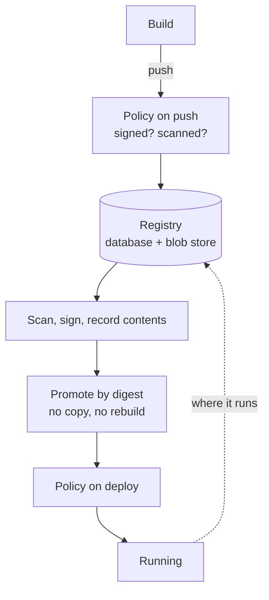
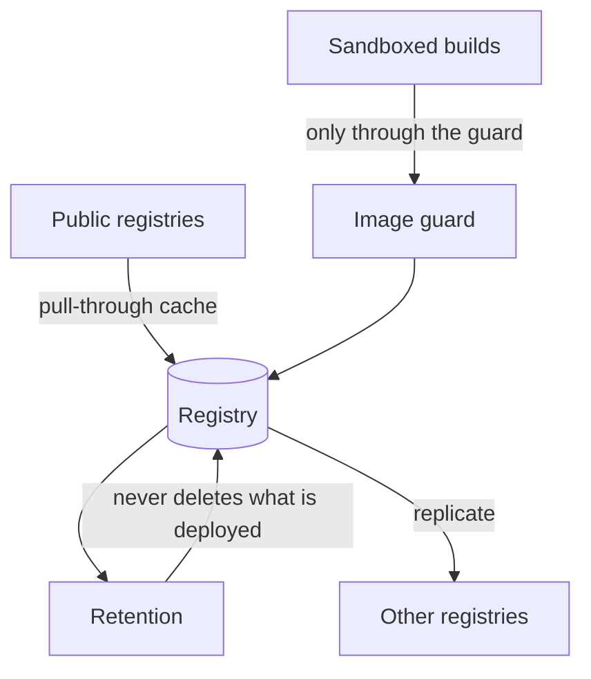

# The built-in registry

<a href="../roadmap.html">Roadmap</a> › Areas › Registry · <a href="../roadmap-list.html">as a list</a>

A registry for container images, Helm charts and other OCI artifacts, inside the same product as your code and pipelines. **Status:** in progress, in [Milestone 4](milestone-4.md). The first slice is built: the OCI protocol, private by default with the project's own roles, run credentials for pipelines, quotas, immutable tags, retention with a preview, garbage collection and an Images tab (see [the guide](../guide/registry.md)). Not built yet: the official conformance run, encryption of blobs at rest, the pull-through cache, replication, promotion by digest, policy on push and more package formats. Pushing to any other registry works and stays first-class.

## From build to running

An image page tells the whole story: where it runs now, its tags and layers, vulnerabilities with fixes, contents, signature, provenance, and the run and commit that built it.

## Keeping, caching and guarding

Retention knows what is deployed because the registry and the deployments are one model. The image guard keeps unchecked images away from sandboxed builds.

Capabilities: [Milestone 4](milestone-4.md#g-the-registry). Go back to the [Roadmap](../public/roadmap.html).
