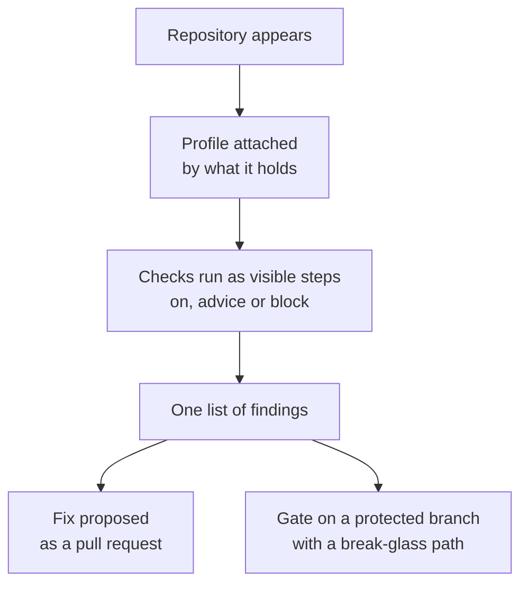

# Standards and scanning for every repository

<a href="../roadmap.html">Roadmap</a> › Areas › Standards and scanning · <a href="../roadmap-list.html">as a list</a>

The scans Launchway holds itself to are offered to every repository it hosts or builds. **Status:** in progress, in [Milestone 12](milestone-12.md): the first slice is built and tested and is not on `main` yet. Standing orders add an Inspection to every Sortie (secrets, dependency vulnerabilities, reachable Go vulnerabilities, security rules for Go and Python, licenses, a bill of materials, Dockerfiles, manifests, Kubernetes practice, shell, unsafe pipeline files), on by default, with settings by level and a file in the repository. Still to come: more ecosystems (Java and JavaScript code analysis, Rust, Ruby), fix pull requests opened from a finding, re-checking stored parts lists when an advisory appears, and adapters for commercial scanners. Launchway already runs these scans on its own code.

## From a new repository to a fix

## Everything is a switch

Each check is off, on as advice, or on as a block, at any level and per repository. The team keeps the choice unless a level above sets a minimum. A new critical or high vulnerability with a fix, or a secret, blocks a merge by default, and only new findings block.

## It keeps watching

Stored parts lists are rechecked when a new advisory is published, so Launchway can say which repositories and running versions are affected without anyone pushing a commit.

Go back to the [Roadmap](../public/roadmap.html).
