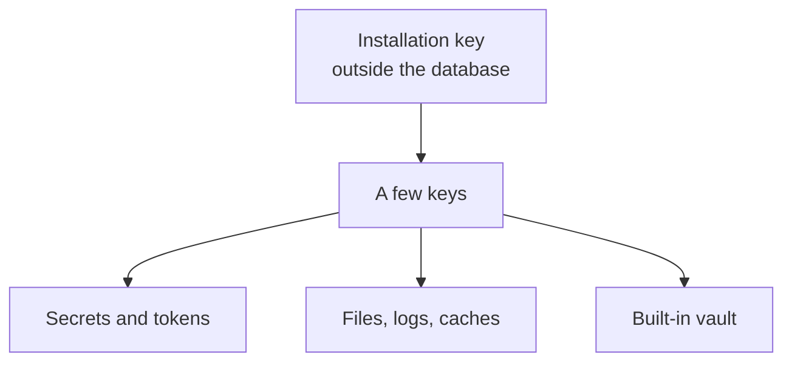

# Security and trust

<a href="../roadmap.html">Roadmap</a> › Areas › Security and trust · <a href="../roadmap-list.html">as a list</a>

Security is the first constraint on everything. **Status:** the scans and the security policy are available today; encryption at rest is in progress in [Milestone 12](milestone-12.md).

## Keys, and what they protect

A copy of the database alone is unreadable. The key comes from a source you choose: a mounted secret or passphrase by default, or a cloud key service, a vault, or hardware.

## Built in by default, a popular backend by choice

Every dependency has a built-in default so an installation needs the fewest tools, and a popular external option behind the same interface.

## Certification, in an honest order

Practices first (a public security badge, a scorecard, signed builds with provenance), then an independent audit, then an attestation of the hosted service. Launchway is not certified against any standard today, and claims only what is true that day.

Go back to the [Roadmap](../public/roadmap.html).
