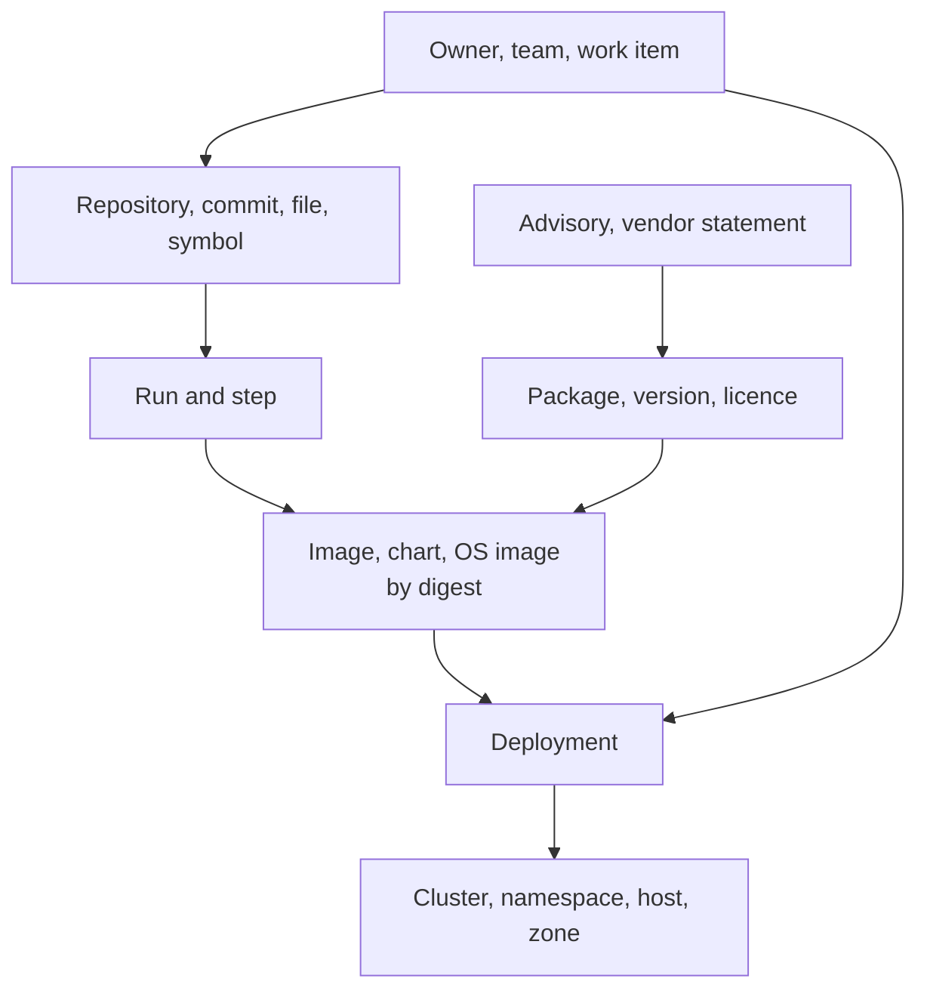
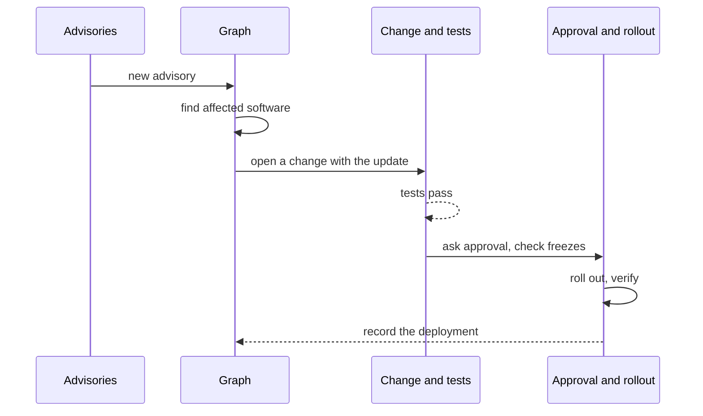

# The software graph and automated patching

<a href="../roadmap.html">Roadmap</a> › Areas › Software graph · <a href="../roadmap-list.html">as a list</a>

Launchway already records the facts needed to answer what is running, where, built from what, containing what, and is any of it vulnerable. The graph keys those facts by image digest and by deployment so one question can span code, packages, images and deployments. **Status:** findings and bills of materials per Sortie (run) are available today; the graph and patching are planned in [Milestone 5](milestone-5.md).

## What is connected

## The patching loop

Automated patching is off by default and turned on per zone. Every step is an ordinary, audited change, and a person can be required for production.

## Questions it answers

- Which services run this library, at what version, and who owns them?
- Which running image has this vulnerability, and is a fix available?
- What commit, run and image is this deployment, including on hosts Launchway only observes?
- Is every production host patched inside our own deadline?

Go back to the [Roadmap](../public/roadmap.html).
