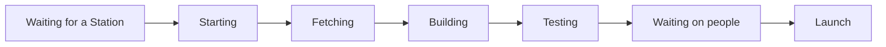
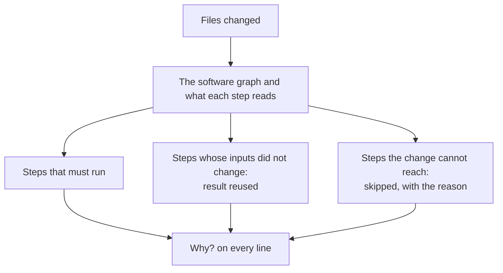

# Speed and continuous deployment

<a href="../roadmap.html">Roadmap</a> › Areas › Speed and continuous deployment · <a href="../roadmap-list.html">as a list</a>

Speed is something Launchway measures, explains and defends for every pipeline, so a change reaches production as fast as it safely can. **Status:** caches that never change a result, re-running only what failed, and flaky-test history are **available today** (see [build caches](../guide/build-caches.md) and [approvals and re-runs](../guide/approvals-and-reruns.md)); where the time goes, building only what a change affects, speed budgets and continuous deployment are planned in [Milestone 2](milestone-2.md) and [Milestone 8](milestone-8.md).

## Where the time goes

Planned: every Sortie (run) shows these parts, each measured from the record, so a slow pipeline says why it is slow.

## Only what a change can affect

Planned: Launchway works out the set from the software graph and from what each step declares it reads, shows the reason for every step it runs, reuses or skips, and lets a person widen it. A cached or reused result is only used when it cannot differ.

## A speed budget for every pipeline

Planned: every pipeline has a budget. A slowdown is reported like a failing test and traced to the change that caused it. Tests are split across Stations by how long they take, and Stations and images are warm before a Sortie needs them.

## Continuous deployment where the rules allow

Planned: a merged change goes to production with no person in the way wherever every Standing order allows it, with Overwatch (the watch after a Launch) and automatic Return to base (rollback) as the safety. A Clearance (approval) that a level above requires stays. For each manual step that remains, Launchway gathers the evidence that would show whether it can go.

## What it will not do

Speed never wins over a result: a step is skipped or reused only when it cannot change the outcome, and a Sortie says when it cannot be sure.

Go back to the [Roadmap](../public/roadmap.html).
