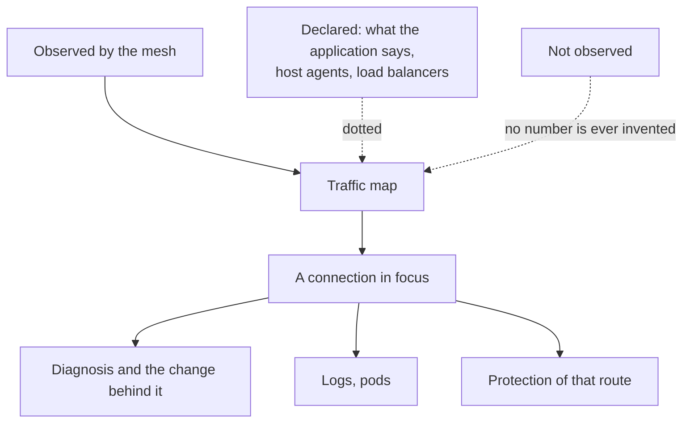
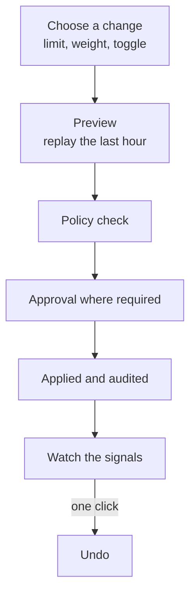

# Live traffic, protection and reliability

<a href="../roadmap.html">Roadmap</a> › Areas › Traffic · <a href="../roadmap-list.html">as a list</a>

Watch how a system behaves, protect it, and know whether it is meeting its targets, in views that link to each other. **Status:** planned, in [Milestone 3](milestone-3.md#g-watch-and-protect). Each page answers one question.

## One question each

| Page | The question | First thing it shows |
|---|---|---|
| Traffic | What really talks to what, and where does it break? | A map of services, workloads, databases and machines with rates, errors and latency |
| Protection | Is traffic protected, and is anyone attacking? | Signs of attack with evidence and one action |
| Reliability | Is each service meeting its target? | Services ranked by error budget |
| Toggles | Which features are on, for whom? | The toggle that hurts, first |
| Signal sources | Where do the numbers come from? | Each connected source and a test |

## What the map shows, and what it does not

Machines that are not on the mesh still appear. An unobserved connection has no rate or error number, because making one up would be worse than leaving it out.

## A guided change, for every lever

Retreat is never gated and advance always is: moving a lever toward its safe state is immediate and recorded; moving away from it passes policy, approval and verification.

## Protection and signals

Limits per client, route and customer, connection limits, timeouts, retries and circuit breakers are shown with how close live traffic is to each. Attack and abuse signals are sentences with evidence and three actions: limit, block, or ignore with a reason. Each signal says honestly whether it was detected by Launchway or shown from a connected firewall. Fault injection is available only on a healthy observed connection, with hard limits on share and time.

Go back to the [Roadmap](../public/roadmap.html).
