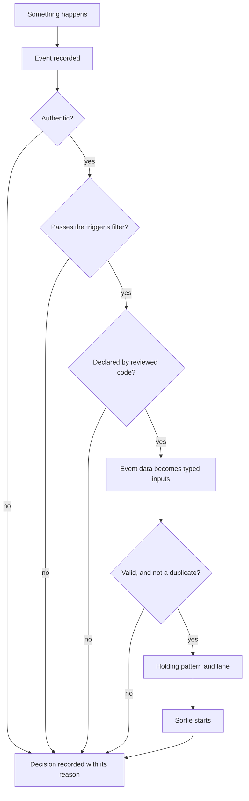
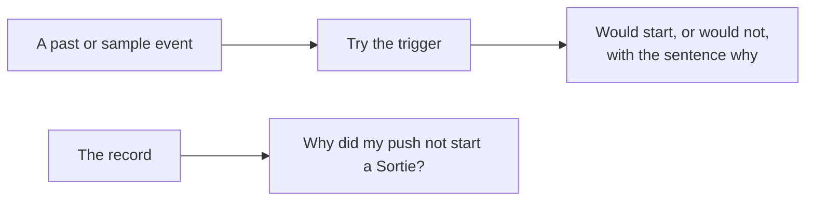

# Triggers

<a href="../roadmap.html">Roadmap</a> › Areas › Triggers · <a href="../roadmap-list.html">as a list</a>

Something happens; Launchway decides in the open whether it starts a Sortie (run), which pipeline at which commit and with which values, and writes down why, every time. **Status:** pushes, pull requests, tags, path filters, Patrols (schedules), webhooks, event sources and triggers on the results of other pipelines are **available today** (see [triggers](../guide/triggers.md) and [result triggers](../guide/result-triggers.md)); one filter language, trying a trigger before it fires and the full record of every decision are planned in [Milestone 2](milestone-2.md).

## From "something happened" to "a Sortie started"

Every kind of event takes the same path. Only reviewed code can arm a trigger: a pull request cannot switch triggers on for itself, and forks and automation accounts start restricted Sorties.

## Declared beside the pipeline

Triggers live in the pipeline file under `on:`, in Git, so they are reviewed like any other change. Planned: each trigger can carry a condition in the same expression language the pipeline uses inside `${{ }}`, every moment of a pull request's life can start a Sortie, and a person who may write can start one by typing a command in a comment. Secrets and permissions for incoming endpoints stay in the product, never in the file.

## Tried before, explained after

Planned: you can try a trigger against a real past event before you merge it, and ask afterwards why an event did or did not start a Sortie. The triggers page says, for each connected code host, whether events arrive by webhook or by polling and how long a push took to become a Sortie. Launchway's own events go out to other systems in one open standard event format.

## What it will not do

A trigger cannot see secrets it was not given, and it never starts a Sortie from code nobody reviewed. When a code host does not send an event, Launchway can only notice by polling, and says so.

Go back to the [Roadmap](../public/roadmap.html).
