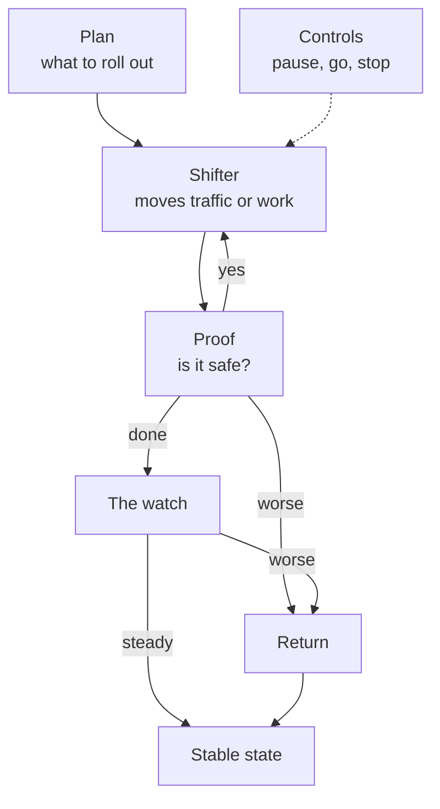
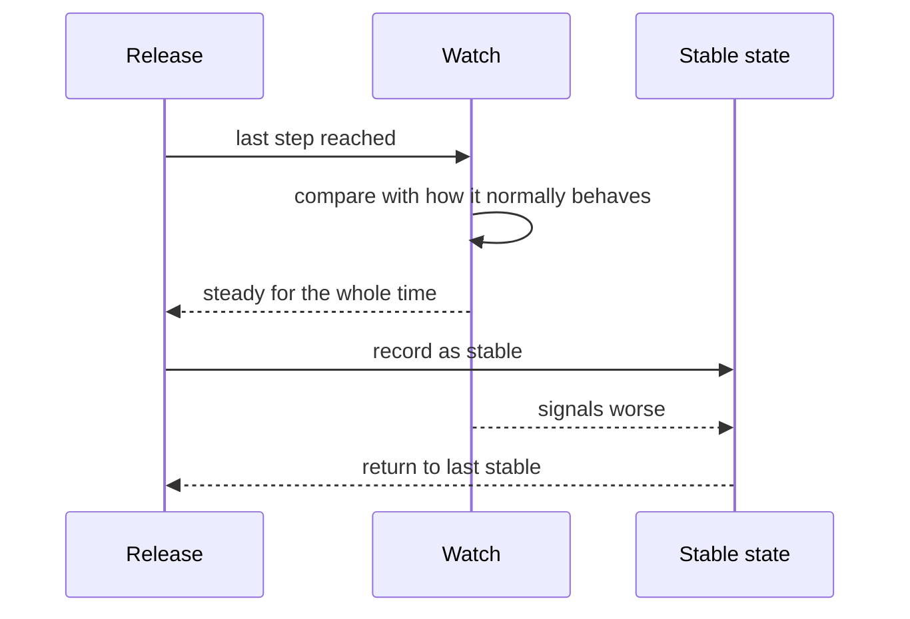
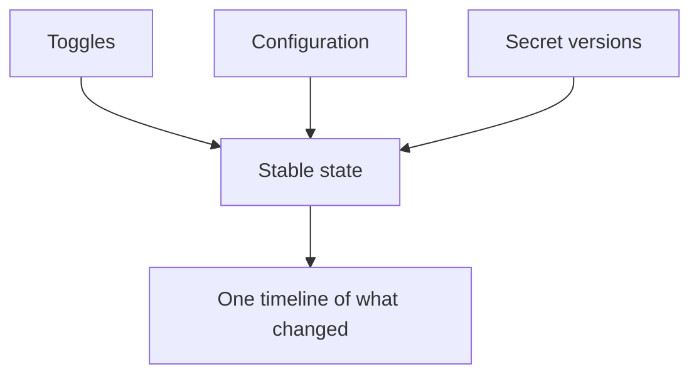

# Zero-downtime delivery

<a href="../roadmap.html">Roadmap</a> › Areas › Zero-downtime delivery · <a href="../roadmap-list.html">as a list</a>

Every deployment is the same journey: bring the new version up beside the old one, prove it, move traffic or work over in steps you can see and control, and keep the way back open until you are sure. **Status:** planned, in [Milestone 8](milestone-8.md). Today Launchway reads rollouts, watches them, and a failed command says so; the pieces below are built on that.

## One model for every deployment

A web shop on Kubernetes, a service on four virtual machines, a Holding pattern (queue) worker and a nightly job all use this picture. Only the shifter changes: a traffic split, a load balancer pool, which copies read the Holding pattern, or a function alias.

## The watch after a deployment

The watch carries on for a time you choose. If error rates or other signals worsen, Launchway returns to the last stable state. A toggle that caused the errors is switched back first.

## Levers that change behavior without a build

Toggles, configuration and secret versions are rolled out and returned like a release, and appear on one timeline.

## What it will not do

Launchway cannot make a change that is not backward compatible safe, and a rollout alone cannot give a whole system full nines. A proof is only as good as its signal: when there is too little data it says not enough data rather than pass. DNS cannot shift traffic quickly or exactly. Some work cannot overlap, and for that the honest answer is a short controlled pause.

Go back to the [Roadmap](../public/roadmap.html).
