# Supply chain

The features that help you know what went into what you deliver, and stop what should not reach
production. For security reviewers and platform engineers.

```mermaid
flowchart LR
  Src["Commit, recorded with the run"] --> Lib["Library templates, pinned to a commit"]
  Lib --> Build["Image step: rootless BuildKit"]
  Build --> Scan["Vulnerability scan with a policy"]
  Scan --> SBOM["CycloneDX SBOM"]
  SBOM --> Prov["SLSA provenance"]
  Prov --> Sign["cosign-compatible signature"]
  Sign --> Push["Push by digest, per push rules"]
  Push --> Gate["Policy gate before deploying"]
  Gate --> Deploy["Deployment pinned by digest"]
```



## Available today

| Feature | What it gives you | Where |
|---|---|---|
| Recorded inputs | Each Sortie (run) records its commit, pipeline text, library commits, inputs and starter. Each step attempt records its image, script and Airfield (environment), with where each value came from. Secrets are recorded by reference only. | [Approvals and re-runs](../guide/approvals-and-reruns.md#re-running-from-a-step-and-what-each-step-was-given) |
| Pinned libraries | Templates and scripts come from one Git commit, recorded with the Sortie. A policy can require tags or commits. | [Shared libraries](../guide/libraries.md) |
| Image builds | Rootless BuildKit, apart from the steps; build secrets reach only `RUN --mount=type=secret`. | [Container images](../guide/images.md) |
| Inspections (vulnerability scans) | Trivy, pinned, run on exactly what was built; `mode: enforce` fails the step before anything is pushed. | [Container images](../guide/images.md) |
| SBOMs | CycloneDX SBOMs from image steps or any tool, summarized and searchable by component. | [Security findings and SBOMs](../guide/security-findings.md) |
| Findings | SARIF from any scanner; new, still there or fixed across runs; secrets that scanners find are never stored. | [Security findings and SBOMs](../guide/security-findings.md) |
| Provenance | in-toto statements with SLSA provenance v1 predicates: Launchway's own and the builder's. | [Container images](../guide/images.md) |
| Signing | Signatures of images, provenance and SBOMs in the form cosign verifies, with the Station's own key. Nothing is sent to a public transparency log. | [Container images](../guide/images.md) |
| Push rules | Nothing is pushed without a rule naming the project and the repository. Pull requests and drafts never push. | [Container images](../guide/images.md) |
| Digest pinning | Deploy steps can write `repository@sha256:...`, which nobody can move. | [Deployments](../guide/deployments.md) |
| Policy gates | Require tests, findings below a severity, an SBOM, images built, signed and scanned by the Sortie, approvals, pinned libraries, images by digest from named Depots (registries). | [Policies](../guide/policies.md) |
| Launchway releases | Reproducible binaries, packages and charts with CycloneDX SBOMs, signed checksums and SLSA provenance; signed server and Station (runner) images with SBOM and provenance attestations. | [Verifying downloads](verify-downloads.md) |

Verify a signature and provenance made by an image step:

```sh
cosign verify --key cosign.pub --insecure-ignore-tlog harbor.example.com/team/shop@sha256:…
cosign verify-attestation --key cosign.pub --insecure-ignore-tlog --type slsaprovenance1 harbor.example.com/team/shop@sha256:…
```

## Limits

- Builds are not hermetic: a Dockerfile can download anything, and earlier steps can change the
  workspace. The provenance says so.
- Signatures are recorded, not verified again at deploy time.
- Image steps sign with the Station's own key, not a keyless identity. The release workflow uses
  keyless Sigstore signing for Launchway's own releases; local and air-gapped release builds use a
  key file, as image steps do.

## Libraries of Git over SSH

The built-in SSH server for Git ([Git over SSH](../guide/git-over-ssh.md)) uses one library,
`golang.org/x/crypto/ssh`, from the Go project's `x/crypto` module (BSD 3-Clause license), linked into
the `launchway` binary. There is no separate SSH server in the image or the chart, and no shell: the
server runs only `git-upload-pack`, `git-receive-pack` and `git-upload-archive`. The module is already
a dependency of Launchway; it is pinned in `go.mod` and checked by `govulncheck` with the others.

## In progress and planned

More supply-chain controls are on the [roadmap](../roadmap-list.md), each with its status.
Verification checks after a deployment are available: see
[Verifying a deployment](../guide/verification.md).
