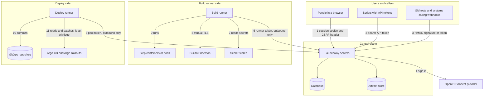

# Trust model and threats

What each part of Launchway is trusted with, what is checked where, which threats the design
addresses, and where the limits are today. For security reviewers and operators.

Launchway is early software. This page describes the main branch as it is, including its current
limits, and says what is being changed.

## The parts and the boundaries between them

| # | Crossing | What is checked |
|---|---|---|
| 1 | Browser to server | Session from OpenID Connect sign-in (PKCE, state, nonce, ID token signature, issuer, audience, expiry). Sessions are random 256-bit values stored only as SHA-256 hashes. Changes need the `X-Launchway-CSRF` header and a matching `Origin`. Pages cannot be framed by other sites. |
| 2 | Scripts to server | API tokens that always expire, stored as SHA-256 hashes, optionally limited to a role and to projects. 20 failed attempts a minute from one address are refused with `429`. |
| 3 | Webhooks | Git host signatures (`X-Hub-Signature-256`, `X-Gitea-Signature`, `X-Forgejo-Signature`, `X-Gitlab-Token`); run triggers by HMAC with a timestamp (replay refused) or a token. Every caller that fails gets the same `404`, and is recorded. |
| 4 | Server to identity provider | Any OpenID Connect provider through discovery. Roles come from the groups it reports. |
| 5 | Build runner to server | The shared runner token. Runners connect out; the server never connects to a runner. |
| 6 | Deploy runner to server | A runner pool token, at least 32 characters, valid only for the pool's deploy targets. The shared runner token cannot take deploy work or report a deployment healthy. |
| 7 | Runner to secret stores | The runner's own credentials (Vault or OpenBao token or Kubernetes auth). Allow-lists of projects and keys per store, checked on the runner. |
| 8 | Runner to BuildKit | Mutual TLS. The daemon is rootless, in a namespace of its own. |
| 9 | Runner to steps | On Kubernetes, step pods run as a non-root user with no privileges, so the namespace can enforce Pod Security `restricted`. Pipelines cannot change this. |
| 10, 11 | Deploy runner to Git and cluster | Its own Git credential, limited to the files the configuration lists per project. In the cluster: read access to the named Applications, Rollouts and AnalysisRuns, and a patch limited by admission policies to a sync request, the refresh annotation and, if allowed, rollout promote, abort and retry. Nothing on pods or secrets. |

## What each part holds

| Part | Holds | Never holds |
|---|---|---|
| Servers and database | Runs and their events, masked logs, test results, findings (without secret values or code snippets), SBOM summaries, the audit trail, hashes of sessions and tokens, Git mirrors of projects and libraries | Secret values from secret stores, registry or cluster credentials, session ids or API tokens in clear |
| Build runner | Its runner token, its secret store credentials, registry credentials, its signing key, the workspace of the runs it executes | Cluster credentials for deployments |
| Deploy runner | Its pool token, the GitOps repository credential, its Kubernetes identity | Scripts: it never runs one |

## Threats the design addresses

| Threat | What Launchway does |
|---|---|
| A stolen database copy reveals secrets | Secret values never reach the server. Sessions and tokens are stored as hashes. |
| A pull request's code reads secrets | Steps of pull-request runs and draft runs may not declare secrets unless the project allows it; image builds of pull requests never push and never get push credentials. |
| A pipeline author bypasses checks | Policies live in the server's configuration or a Git repository pinned by tag, never in the pipeline file. Runner settings (restricted pods, registries, push rules) are never the pipeline's. |
| A pipeline makes the server fetch from anywhere | A pipeline can name only libraries the server lists; it can never give an address. |
| One person deploys their own unreviewed change | With sign-in, the person who started a run cannot approve it by default; protected environments stop them promoting or waiving its gate. |
| A deployment is reported healthy when it is not | Only observations from a deploy runner serving the target count; stale or missing observations never pass. |
| Someone quietly changes history | The audit trail is only added to; run events are only appended. |
| A server crash leaves a half-made decision | Decisions and what they allow are written in one database transaction. |

## Current limits, and what is changing

> [!IMPORTANT]
> These are the known limits of the main branch. Plan your installation around them.

- **Build runners share one token.** Every build runner holds the same runner token, and any
  build runner can take any project's step. A runner names itself, and the server does not bind
  a run's steps to an authenticated runner identity. **Being changed:** per-runner identity with
  join tokens, and runner-side allow-lists of which projects a runner serves, are
  [in progress](../roadmap-list.md). Until then, treat every build runner as able to see the
  work of every project, and give secret stores allow-lists.
- **A runner trusts its server.** A runner does what the server it connects to asks, within the
  runner's own configuration; its allow-lists trust the project name the server gives.
  Connect runners only to servers you operate, over HTTPS.
- **The `auto` executor falls back to the host.** On a machine with neither Podman nor Docker,
  steps run directly on the machine as the runner's user. Set `executor:` explicitly on shared
  runners.
- **Git credentials in repository addresses are stored.** A credential written into a project's
  `repo:` address travels with the run's events and to runners. Give servers and runners Git
  credentials through Git settings in their environment (`GIT_CONFIG_*`) instead.
- **API tokens keep the groups of the last sign-in.** Launchway cannot see that someone left the
  identity provider. Revoke their tokens when they leave.
- **Signatures are not verified at deploy time.** Image steps sign images and policies can require
  that a deployed image was signed by an image step of the same run, but a deploy step does not
  verify a signature against a key. Keyless signing is designed, not built.
- **Policies judge what steps report.** A step that writes a fake test report satisfies a test
  rule as far as the report goes. Keep scanning and testing steps in shared templates that
  `required_templates` asks for.
- **People with direct access** to the cluster, the GitOps repository or the registry can change
  what runs without Launchway.
- **Any signed-in viewer** can list the runners.
- **There is no organisation (tenant) separation** inside one installation. Run one installation
  per organisation that must not see another's work.

## What next

- [Hardening checklist](hardening.md).
- [Controls and compliance](controls-and-compliance.md).
- [Reporting a vulnerability](reporting.md).
