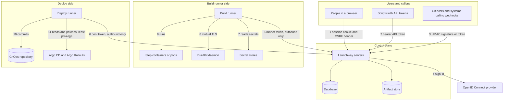

# Trust model and threats

What each part of Launchway is trusted with, what is checked where, which threats the design
addresses, and where the limits are today. For security reviewers and operators.

Launchway is early software. This page describes the main branch as it is, including its current
limits, and says what is being changed.

## The parts and the boundaries between them

| # | Crossing | What is checked |
|---|---|---|
| 1 | Browser to server | Session from OpenID Connect sign-in (PKCE, state, nonce, ID token signature, issuer, audience, expiry). Sessions are random 256-bit values stored only as SHA-256 hashes. Changes need the `X-Launchway-CSRF` header and a matching `Origin`. Pages cannot be framed by other sites. |
| 2 | Scripts to server | API tokens that always expire, stored as SHA-256 hashes, optionally limited to a role and to projects. 20 failed attempts a minute from one address are refused with `429`. |
| 3 | Webhooks | Git host signatures (`X-Hub-Signature-256`, `X-Gitea-Signature`, `X-Forgejo-Signature`, `X-Gitlab-Token`); run triggers by HMAC with a timestamp (replay refused) or a token. Every caller that fails gets the same `404`, and is recorded. |
| 4 | Server to identity provider | Any OpenID Connect provider through discovery. Roles come from the groups it reports. |
| 5 | Build Station (runner) to server | The shared Station token. Stations connect out; the server never connects to a Station. |
| 6 | Deploy Station to server | A Flight line (Station (runner) pool) token, at least 32 characters, valid only for the pool's deploy targets. The shared Station token cannot take deploy work or report a deployment healthy. |
| 7 | Station to secret stores | The Station's own credentials (Vault or OpenBao token or Kubernetes auth). Allow-lists of projects and keys per store, checked on the Station. |
| 8 | Station to BuildKit | Mutual TLS. The daemon is rootless, in a namespace of its own. |
| 9 | Station to steps | On Kubernetes, step pods run as a non-root user with no privileges, so the namespace can enforce Pod Security `restricted`. Pipelines cannot change this. |
| 10, 11 | Deploy Station to Git and cluster | Its own Git credential, limited to the files the configuration lists per project. In the cluster: read access to the named Applications, Rollouts and AnalysisRuns, and a patch limited by admission policies to a sync request, the refresh annotation and, if allowed, rollout promote, abort and retry. Nothing on pods or secrets. |

## What each part holds

| Part | Holds | Never holds |
|---|---|---|
| Servers and database | Runs and their events, masked logs, test results, findings (without secret values or code snippets), SBOM summaries, the Logbook, hashes of sessions and tokens, Git mirrors of projects and libraries | Secret values from secret stores, Depot (registry) or cluster credentials, session ids or API tokens in clear |
| Build Station | Its Station token, its secret store credentials, Depot credentials, its signing key, the workspace of the runs it executes | Cluster credentials for deployments |
| Deploy Station | Its pool token, the GitOps repository credential, its Kubernetes identity | Scripts: it never runs one |

## Threats the design addresses

| Threat | What Launchway does |
|---|---|
| A stolen database copy reveals secrets | Secret values never reach the server. Sessions and tokens are stored as hashes. |
| A pull request's code reads secrets | Steps of pull-request runs and draft runs may not declare secrets unless the project allows it; image builds of pull requests never push and never get push credentials. |
| A pipeline author bypasses checks | Policies live in the server's configuration or a Git repository pinned by tag, never in the pipeline file. Station settings (restricted pods, Depots, push rules) are never the pipeline's. |
| A pipeline makes the server fetch from anywhere | A pipeline can name only libraries the server lists; it can never give an address. |
| One person deploys their own unreviewed change | With sign-in, the person who started a Sortie (run) cannot approve it by default; protected Airfields (environments) stop them promoting or waiving its gate. |
| A deployment is reported healthy when it is not | Only observations from a deploy Station serving the target count; stale or missing observations never pass. |
| Someone quietly changes history | The Logbook is only added to; run events are only appended. |
| A server crash leaves a half-made decision | Decisions and what they allow are written in one database transaction. |

## Current limits, and what is changing

> [!IMPORTANT]
> These are the known limits of the main branch. Plan your installation around them.

- **Stations on the shared token have no identity.** A Station enrolled with a join token has its
  own key, its steps' leases are bound to it, it serves only the projects of its pool, and it can
  limit what it accepts with `accept:`; see
  [Stations on other machines and clusters](../guide/runner-identity.md). A Station that still uses
  the shared Station token (or a deploy pool's token) gives no identity: the server cannot tell
  such Stations apart, trusts the Station ID each one gives, and anyone who has the token can take
  that pool's work. Enrol such Stations and set `require_identity: true` on their pool. Until
  then, treat every Station on the shared token as able to see the work of every project the
  pool serves, and give secret stores allow-lists.
- **A Station trusts its server.** A Station does what the server it connects to asks, within the
  Station's own configuration; its allow-lists trust the project name the server gives.
  Connect Stations only to servers you operate, over HTTPS.
- **The `auto` executor falls back to the host.** On a machine with neither Podman nor Docker,
  steps run directly on the machine as the Station's user. Set `executor:` explicitly on shared
  Stations.
- **Git credentials in repository addresses are stored.** A credential written into a project's
  `repo:` address travels with the Sortie's events and to Stations. Give servers and Stations Git
  credentials through Git settings in their Airfield (`GIT_CONFIG_*`) instead.
- **API tokens keep the groups of the last sign-in.** Launchway cannot see that someone left the
  identity provider. Revoke their tokens when they leave.
- **Signatures are not verified at deploy time.** Image steps sign images and policies can require
  that a deployed image was signed by an image step of the same Sortie, but a deploy step does not
  verify a signature against a key. Keyless signing is designed, not built.
- **Policies judge what steps report.** A step that writes a fake Debrief (test report) satisfies a test
  rule as far as the report goes. Keep scanning and testing steps in shared templates that
  `required_templates` asks for.
- **People with direct access** to the cluster, the GitOps repository or the Depot can change
  what runs without Launchway.
- **Any signed-in viewer** can list the Stations.
- **There is no separation between Wings** inside one installation. Run one installation
  for each company that must not see another's work.

## What next

- [Hardening checklist](hardening.md).
- [Controls and compliance](controls-and-compliance.md).
- [Reporting a vulnerability](reporting.md).
