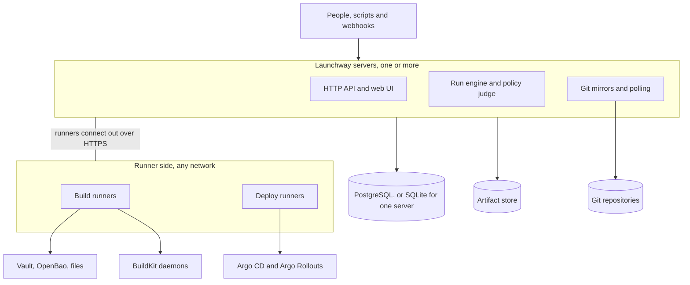
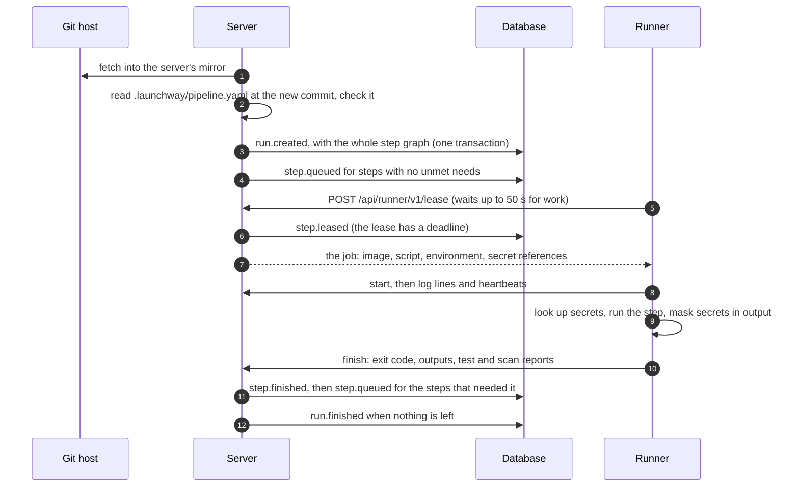
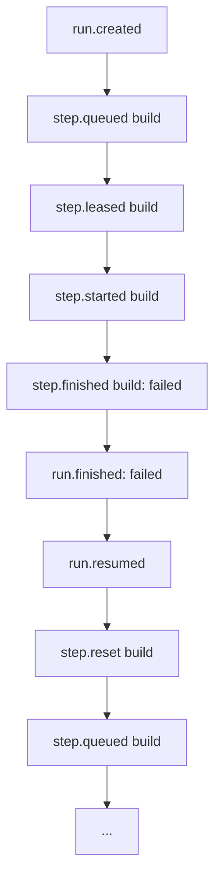
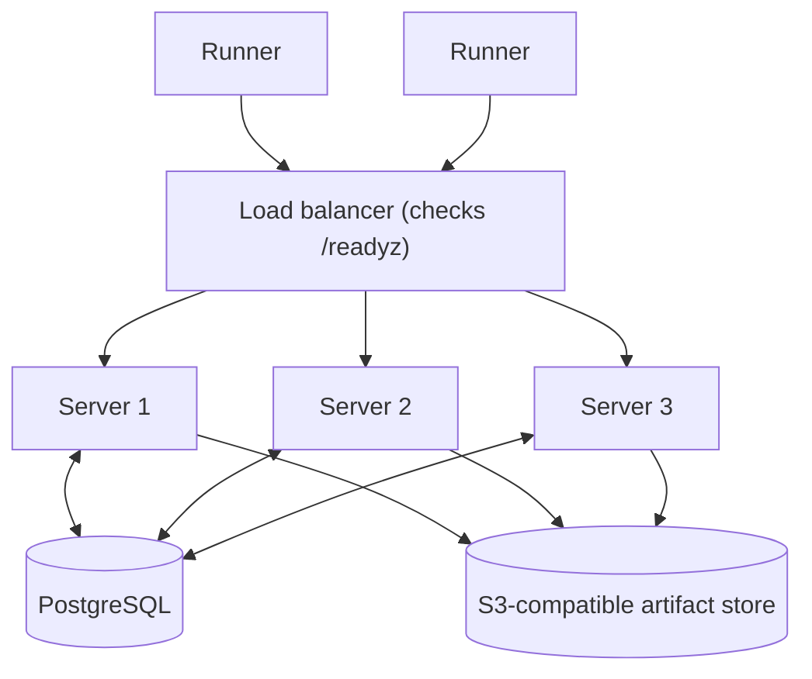
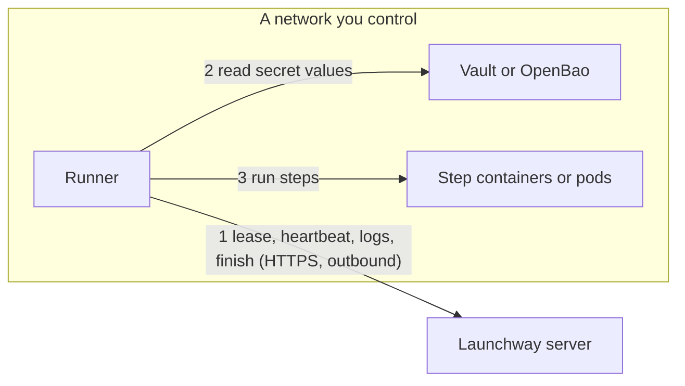
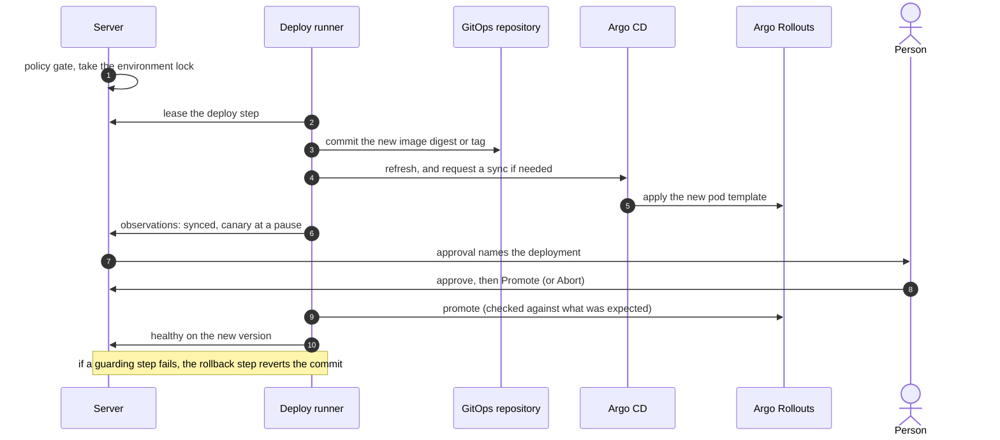
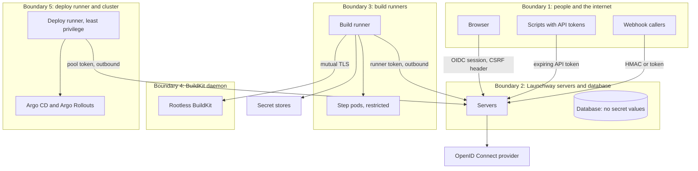

# Architecture

How Launchway is put together: its parts, how a Sortie (run) moves through them, how several servers share
the work, how Stations (runners) connect, how a deployment is carried out, and where the trust boundaries
are. For operators, security reviewers and curious developers.

## The parts

| Part | What it does |
|---|---|
| Server | One program, `launchway server`: the web UI, the HTTP API, the Sortie engine, Git polling, schedules, the policy judge and, unless turned off, a built-in Station. |
| Database | Holds everything durable: each Flight's state, runs as events, logs, test results, findings, approvals, sessions (as hashes), the Logbook. PostgreSQL for several servers; an embedded SQLite file for one. |
| Cargo (artifact) store | Files steps keep: a directory for one server, or S3-compatible object storage shared by several. |
| Station | `launchway runner`: takes steps from a server and runs them in Podman or Docker containers, Kubernetes pods, or on its own machine. Looks up secrets itself. |
| Deploy Station | A Station with a `deploy:` section, in or near a cluster: writes to the GitOps repository and talks to Argo CD and Argo Rollouts with its own identity. Never runs a script. |
| BuildKit daemon | Builds container images for image steps, rootless, in a namespace or machine of its own. The Station is its client over mutual TLS. |

The code is described package by package in [How Launchway is built](../contributing/codebase.md).

## The life of a Sortie {#the-life-of-a-run}

- A Sortie records everything it was started with: the commit, the pipeline text, the library
  commits, the inputs, and who or what started it.
- A step whose Station stops sending heartbeats for the lease period (90 seconds by default; a heartbeat goes every 15 seconds, so a slow server costs the step nothing) is
  marked lost and queued again; a step is never recorded as finished twice.
- All of a Sortie's steps go to the Station that took its first step, because it keeps the Sortie's
  workspace. On Kubernetes each step then runs in a pod of its own, made when the step starts and removed
  when it ends: the Station fills the pod from its copy of the workspace and reads the files back before
  the pod goes, so the step namespace's quota is held only while a step runs and every step has the limits of its
  own container. If that Station disappears for three lease periods, another Station takes the Sortie over in a fresh
  checkout.

## The event-sourced engine

Launchway does not keep a Sortie's state in memory. Every change is appended to the Sortie's event log
in the database, and the state is rebuilt from the events whenever it is needed.

What this gives you:

- **Crash safety.** A server can stop at any moment. The next server to look reads the events and
  carries on; nothing that finished Sorties twice.
- **Resume and re-run.** A failed Sortie can resume from the step that failed, keeping what
  succeeded. A finished Sortie can be re-run from any step, reusing earlier results.
- **A record you can audit.** The events say what happened, in order, with times. Policy decisions
  are events too, with the facts they were based on, so a decision can be checked later.

Every event type is listed in [Events and audit actions](../reference/events.md).

## High availability

- **No leader.** Every server can do everything. Decisions that must happen once (starting a Sortie
  for a push, firing a schedule, taking a lease, deciding an approval, a policy gate) are made in
  a database transaction, so exactly one server wins.
- **Servers wake each other** with PostgreSQL `LISTEN/NOTIFY`: a step queued on one server wakes
  Stations waiting on another, and a browser connected to any server sees live updates.
- **Sessions and tokens live in the database**, so a browser or script can reach any server.
- **Upgrades are rolling.** Two versions share the database during an upgrade, and the schema is
  designed so that returning to base keeps working; see
  [Writing a migration](../development/migrations.md) and
  [Backup, restore, upgrade](../howto/backup-restore-upgrade.md).

Details: [Running several servers](../guide/high-availability.md) and
[Install on Kubernetes](../howto/install-kubernetes.md).

## How Stations connect {#how-runners-connect}

- **Stations only connect outbound.** The server never opens a connection to a Station, so a Station
  can sit behind a firewall or NAT, in another cluster or another cloud.
- **The server sends references, not secrets.** A step says `{ store: vault, key: ci/npm, field:
  token }`; the Station reads the value in its own network, gives it to the step, and replaces it
  with `***` in the log.
- **Stations have identities.** A Station enrolled with a join token holds its own key, its steps'
  leases are bound to it, and it takes only work of the Flights its **pool** serves; its own
  `accept:` section limits further what it will run. A Station still on the shared Station token has
  no identity, so enrol Stations and require identity on their pools. Deploy work needs a pool
  token and is limited to that pool's targets. See
  [Stations on other machines and clusters](../guide/runner-identity.md) and the
  [trust model](../security/trust-model.md).

## Delivery with GitOps and rollout control

- Deployments are **GitOps**: the deploy Station commits the new version to a Git repository that
  Argo CD watches. It never runs scripts, and the servers hold no cluster credentials.
- **"Deployed" means observed healthy**: Argo CD synced the commit, the resources are healthy, and
  the rollout's stable version is the new one. Missing or stale observations never count as a pass.
- **Promote, abort and retry** are commands a person gives on the Sortie page, or a `kind: rollout`
  step gives; each records what it expects, so a stale click does nothing.
- **Return to base (rollback)** reverts the deployment's commit (optionally aborting the rollout first) and waits
  until the previous version is healthy.

Details: [Deployments](../guide/deployments.md) and the
[deploy tutorial](../tutorials/deploy-with-approval.md).

## Trust boundaries

What crosses each boundary, what is checked there, and the current limits are on the
[Trust model](../security/trust-model.md) page.

## What next

- [Quick start](quick-start.md): run it.
- [Install on Kubernetes](../howto/install-kubernetes.md): run it for a team.
- [Trust model](../security/trust-model.md): what each part is trusted with.
