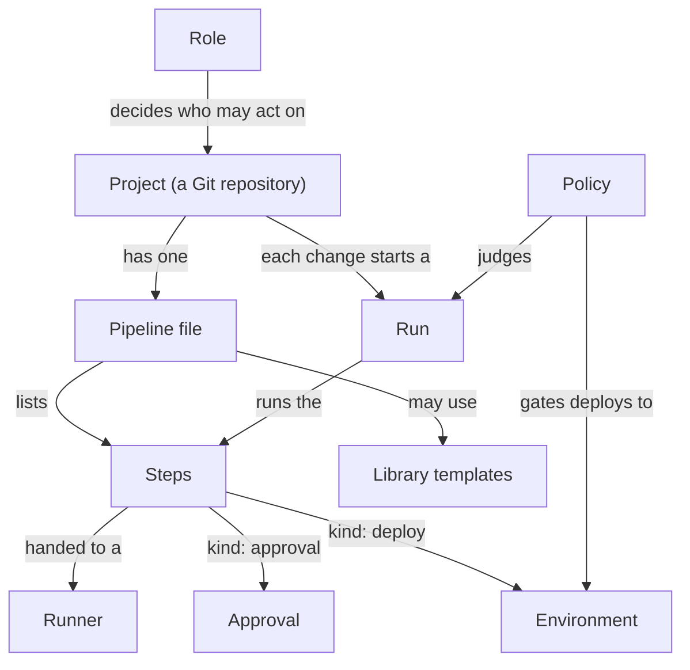
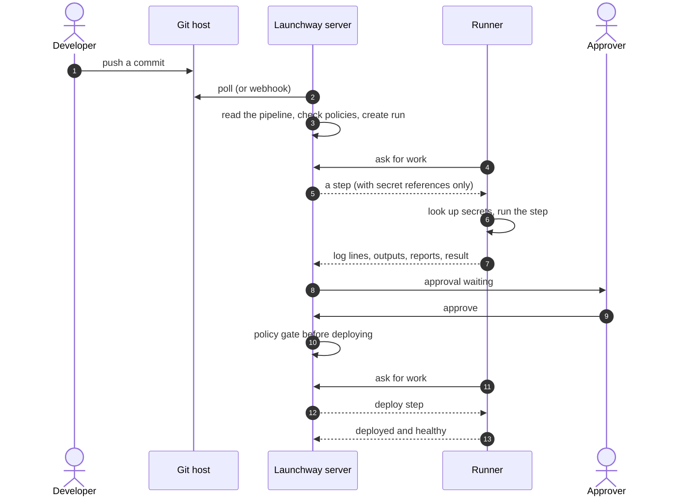

# Concepts

The words Launchway uses, what each one means, and how they relate. Read this once before the
tutorials; the [glossary](../glossary.md) has every term in alphabetical order.

## The concept map



## Flight (codebase) {#project}

A **Flight** is one Git repository that Launchway watches. The server's configuration lists the
Flights, with their repository address and the branch to treat as the default. Launchway polls
each repository for new commits and pull requests, and can be told to look at once by a webhook.
Every Flight has a name made of lower-case letters, digits and hyphens.

## Pipeline

A **pipeline** is the file `.launchway/pipeline.yaml` in a Flight's repository. It says when the
pipeline runs (on pushes to some branches, on pull requests, on a schedule, by a webhook or by
hand) and which steps to run. Git is the only place a pipeline is kept: the web editor reads it
from a branch and saves it back as a commit. A pipeline is checked before anything runs, and
mistakes are reported with their line numbers. See [Pipelines](../guide/pipelines.md) and the
[pipeline reference](../reference/pipeline.md).

```yaml
pipeline: my-service
on:
  push: { branches: [main] }
steps:
  test:
    image: golang:1.27
    run: go test ./...
```

## Run

A **run** is one execution of a pipeline, at one commit. Runs have a number per Flight (#1, #2,
...). A Sortie (run) is started by a push, a pull request, a schedule, a webhook, a person, or a person
trying unsaved text (a **draft run**). Every change to a Sortie is stored as an
[event](../reference/events.md), so a Sortie survives a server crash and can be **resumed** from the
step that failed, or **re-run** from any step.

## Step

A **step** is one unit of work in a Sortie. Most steps run a shell script in a container image.
Steps say which other steps they **need**; steps whose needs are met run in parallel. A step can
pass small values (**outputs**) to the steps that need it, keep files (**Cargo (artifacts)**), and report
test results, security findings and software bills of materials. Special kinds of step build
container images (`kind: image`), wait for a person (`kind: approval`), deploy (`kind: deploy`),
roll back (`kind: rollback`), control a Pathfinder (canary) rollout (`kind: rollout`), verify a deployment from its
metrics and logs (`kind: verify`) or ask a configured AI model a question (`kind: ai`).

## Station (runner) {#runner}

A **Station** is the program that does the work of steps. It connects out to the server, asks for
work, runs each step in a container, a Kubernetes pod or directly on its machine, streams the log
back and reports the result. The server has a built-in Station; more Stations can run on other
machines or clusters. Stations look up secrets themselves, so secret values never reach the server.
A **deploy Station** is a Station with a `deploy:` section that does deploy work for a
**Ramp (Station (runner) pool)**. A Station enrolled with a **join token** has an identity of its own and takes only
the work of its pool's Flights. See [Connect a Station](../howto/connect-runner.md) and
[Stations on other machines and clusters](../guide/runner-identity.md).

## Airfield (environment) {#environment}

An **Airfield** is a place a Flight deploys to, such as `staging` or `prod`, named in the
server's configuration with the deploy target that serves it and the Flights allowed to deploy
there. Each service has one lock per Airfield, so only one deployment happens at a time, and
the **Airfields** page shows what version runs where. An Airfield can be **protected**, so
the person who started a Sortie cannot promote it there. See [Deployments](../guide/deployments.md).

## Library

A **library** is a Git repository of pipeline **templates** and the scripts they run. A pipeline
names a library and a version (a Git tag, branch or commit) and uses a template as if it were one
step; the Sortie records the exact commit used. Libraries let a platform team give many Flights the
same build, scan or release steps. See [Shared libraries](../guide/libraries.md).

## Policy

A **policy** is a rule set an organization sets for every pipeline, which the pipeline's authors
cannot switch off: for example "a deployment to prod needs passing tests, a scan with nothing worse
than medium, and an approval by someone else". Policies live in the server's configuration or in a
Git repository pinned by tag. Each policy is **enforced** (it stops the step) or **reported** (it
only warns). A **waiver** lets one rule pass for a Flight for a limited time, with a reason. See
[Policies](../guide/policies.md).

## Approval

An **approval** is a step that pauses the Sortie until a person approves or rejects it. Pending
approvals are listed on the **Approvals** page. With sign-in on, the person who started a Sortie
cannot approve it themselves, by default. See [Approvals and re-runs](../guide/approvals-and-reruns.md).

## Roles and access

People sign in with the organization's OpenID Connect provider. Each person gets a **role** on
each Flight: **viewer** (see), **operator** (start, cancel, approve, save pipelines) or **admin**
(also read the Logbook and waive policy rules). Roles come from groups in the identity
provider. Scripts use **API tokens** that expire. See [Sign-in and access](../guide/access.md) and
[Roles and permissions](../reference/roles.md).

## How the pieces meet in one Sortie {#how-the-pieces-meet-in-one-run}



## What next

- [Architecture](architecture.md): how these pieces are built.
- [First pipeline in 10 minutes](../tutorials/first-pipeline.md).
