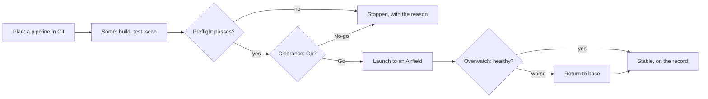

# What Launchway is

This page explains Launchway in plain language: what it does, how a change travels through it,
where it can put software, and how far along it is. It is written for anyone, including readers who
do not write code. Everything marked **planned** is designed but not built yet.

## In three sentences

Launchway launches applications into the future: one place to host your code, build it, test it,
scan it and launch it to wherever it runs, on servers you control or, later, as a hosted service. It
aims to be complete without being complicated: one model, one way to do each thing, every
capability with a built-in default, and every safeguard on from the start. Every Sortie (run),
decision and Clearance (approval) is written to one durable record, so you can always say what was
delivered, how it was checked and who said Go.

## A change is a flight

Every change takes the same journey. You plan it as a [pipeline](../glossary.md#pipeline) kept with
your code. Launchway checks it before take-off with Preflight (checks). The people who must agree
give it Clearance with a Go. It is launched to an Airfield (environment). Overwatch (the watch after
a Launch) judges it against live traffic and metrics, and if things get worse it comes back with
Return to base (rollback), which is always open.

Each moment writes what it decided, and why, to one record. The Logbook (audit trail), the
Debrief (run summary), the metrics and the evidence for an auditor are all read from that same record.

## How it is built: seven layers

| Layer | What it holds | Today |
|---|---|---|
| 1. The foundation | One program and a database, plus Git. The levels Base, Wing, Squadron and Flight carry permissions, variables and rules downward, with locks. Secrets are resolved on the Station (runner), never seen by the server. | Available |
| 2. The record | One append-only event record behind every page, report and piece of evidence. | Available; every decision with its reasons is planned |
| 3. Flight plans | Pipelines, typed inputs and outputs, reuse through libraries and templates, run forms and triggers. | Available; one expression language and forms that offer choices are planned |
| 4. Flight operations | Stations take steps from Ramps (pools of Stations); caches only make things faster; Cargo (artifacts) and the Depot (registry) hold what was built. | Available |
| 5. Launch | One model for every kind of place software runs, with Overwatch and Return to base. | In part; see below |
| 6. Command | Standing orders (policies), Clearances, Holds (freezes) and the Logbook. | Available; more judging points and evidence packs are planned |
| 7. Mission support | Switches, the software graph, Maintenance (dependency updates), work tracking, the Wingman (helper) and agents. | Many available; each is optional |

Around all seven, every way in is the same way in: the web interface with a wizard for each task, the
HTTP API, the command line, the agent endpoint and Terraform.

## Where software can be launched

The plan is one launch model for every kind of place software runs: a release identified by its
digest, launched with a chosen strategy, watched during and after the Launch, with zero downtime and
a way back that is never blocked. How far each kind of place is today:

| Where it runs | Today | Planned |
|---|---|---|
| Kubernetes | **Available.** GitOps with Argo CD, Pathfinder (canary) rollouts a person or a step can steer, verification after a Launch, and [Return to base even after success](../guide/rollback-after-success.md). See [deployments](../guide/deployments.md) and [verification](../guide/verification.md). | Traffic moved by Launchway itself in weighted steps; one model shared with every other target. |
| Virtual machines and physical servers | **In progress.** Batches of hosts drained from a load balancer, changed, checked and admitted, and returned on a failed check, are built and tested, and run today from the command line on a Station. | The server schedules them inside a Sortie, with the Airfield lock, Clearance, Standing orders and the record; fleets held in the product. |
| Image-based hosts | **In progress.** Switching a host to a new image by digest, staging, rebooting in batches and going back are built and tested in code. | Scheduled by the server, a host list, and a record of which host booted which digest. |
| Serverless | **Planned.** | Functions and managed container services, on your own cluster or a public cloud: a version by digest, traffic moved by weights, Overwatch, and Return to base by moving the weights back. |

Today, verification after a Launch reads metrics and logs, judges them with built-in statistics,
and can promote, stop or return the release; optional AI models only explain, the statistics decide.
Planned: the same watch on every kind of target, carrying on after the Launch, with Return to base
by itself when signals get worse. The [zero-downtime area page](../roadmap/zero-downtime.md) shows
the model in depth.

## What Launchway is built around

- **High availability from the ground up.** Several servers share one PostgreSQL database with no
  leader. Nothing is held in a server's memory, so losing one loses no work.
- **Durable Sorties.** Every change to a Sortie is recorded as an event. A Sortie survives crashes
  and restarts, and resumes from the step that failed.
- **Stations that only connect outbound**, in any network, cluster or cloud. Steps run in
  Kubernetes pods or containers, with named toolbox containers and services sharing a workspace.
- **Sign-in with your organization's OpenID Connect provider** or built-in accounts with a second
  factor, roles per Flight (codebase), API tokens for scripts, and an audit trail of every change.
- **Secrets that never reach the server.** Pipelines hold references; the Station fetches values
  from Vault or OpenBao just before a step and masks them in output.
- **Policies an organization sets for every pipeline**, such as "nothing reaches production
  without passing tests, a clean scan and a second person's Go", with waivers that expire.
- **Stations with identities.** Stations enroll with join tokens and their own keys, serve only the
  Flights of their Ramp, and set their own limits on what they accept.
- **Cargo and Debriefs that work out of the box**, in 13 formats, with coverage and hosted HTML
  reports.
- **Pipelines you can check and start anywhere**, with line-numbered errors before anything starts,
  and shared pipelines kept as Git repositories pinned by tag, branch or commit.

## Who uses it

| Reader | What Launchway gives them | Start here |
|---|---|---|
| Developer | A pipeline file next to the code, Sorties that explain their failures, test and scan results in one place | [Developer path](../paths/developer.md) |
| Operator or platform engineer | One service for many teams, on servers or Kubernetes, with Stations anywhere and no single point of failure | [Operator path](../paths/operator.md) |
| Security reviewer | Secrets kept off the server, signed images, policies teams cannot switch off, an audit trail | [Security reviewer path](../paths/security-reviewer.md) |
| Business or decision maker | Faster, safer releases with evidence of how each was checked | [Decision maker path](../paths/decision-maker.md) |

## How far along it is

Launchway is early software, released under the AGPL-3.0 license. What these documents describe
as available works and is tested, including with several servers and with real Kubernetes,
PostgreSQL, OpenBao, BuildKit and Argo CD. Much more is designed but not built yet. The
[roadmap](../roadmap-list.md) shows each item as **available**, **in progress** or **planned**;
nothing in these documents claims a feature that is not available. How it is designed, chapter by chapter, with
diagrams and screen designs, is in the [platform plan](../public/plan/index.html); planned work there is
labelled as planned. Decisions still open are collected as numbered [open questions](../public/plan/index.html#open). The larger areas have their own
pages, for example [inputs and forms](../roadmap/inputs-and-forms.md),
[triggers](../roadmap/triggers.md), [bringing work in](../roadmap/importing.md),
[Standing orders and evidence](../roadmap/policy-and-governance.md),
[speed and continuous deployment](../roadmap/speed.md), [branching](../roadmap/branching.md) and
[quality and reports](../roadmap/quality-and-reports.md).

There is no hosted service yet: you run Launchway yourself. Turn on [sign-in](../guide/access.md)
before anyone else can reach it.

## What next

- See it working: [Quick start](quick-start.md) or the [screenshot tour](../demo.md).
- Learn the words: [Concepts](concepts.md).
- See how it fits together: [Architecture](architecture.md).
