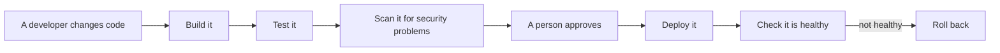

# What Launchway is

This page explains Launchway in plain language: what it does, who it is for, and how far along it
is. It is written for anyone, including readers who do not write code.

## In three sentences

Launchway is a build and delivery platform: it takes a change someone made to a program, builds
it, tests it, checks it for security problems and, when the checks and the right people agree,
puts it into service. It runs on your own computers, servers or Kubernetes clusters, so your code,
your secrets and your records stay with you. It keeps a complete record of every run and every
decision, so you can always say what was delivered, how it was checked and who approved it.

## What problem it solves

Every team that writes software needs the same chain of work after each change:

Doing this by hand is slow and error-prone. Launchway does it automatically, the same way every
time, and records each step. Teams describe the chain once, in a short file kept with their code,
called a [pipeline](../glossary.md#pipeline).

## What Launchway is built around

- **High availability from the ground up.** Several servers share one PostgreSQL database with no
  leader. Nothing is held in a server's memory, so losing one loses no work.
- **Durable runs.** Every change to a run is recorded as an event. A run survives crashes and
  restarts, and resumes from the step that failed.
- **Runners that only connect outbound**, in any network, cluster or cloud. Steps run in Kubernetes
  pods or containers, with named toolbox containers and services sharing a workspace.
- **Sign-in with your organization's OpenID Connect provider**, roles per project, API tokens for
  scripts, and an audit trail of every change.
- **Secrets that never reach the server.** Pipelines hold references; the runner fetches values
  from Vault or OpenBao just before a step and masks them in output.
- **A delivery model, not only builds:** approvals, environments with one deployment at a time,
  GitOps deployments through Argo CD, canary rollouts that a person or a step can promote, abort
  or retry, and rollback by reverting the change.
- **Policies an organization sets for every pipeline**, such as "nothing reaches production
  without passing tests, a clean scan and a second person's approval", with waivers that expire.
- **Verification after a deploy.** A step reads metrics and logs from Prometheus, Loki and other
  sources, judges them with built-in statistics, and can promote, abort or roll back. Optional AI
  models only explain; the statistics decide.
- **Runners with identities.** Runners enrol with join tokens and their own keys, serve only the
  projects of their pool, and set their own limits on what they accept.
- **Artifacts and test reports that work out of the box.** Artifacts are kept in the database
  with nothing else to run; test reports come in 13 formats, with coverage and hosted HTML reports.
- **An endpoint for AI agents** (MCP), with the same rights and audit trail as any token.
- **Pipelines you can check and run anywhere**, with line-numbered errors before anything starts.
- **Shared pipelines as Git repositories.** Templates and the scripts they run live in one
  repository, released with Git tags; pipelines pin a tag, branch or commit, and every run records
  the commit it used.

## Who uses it

| Reader | What Launchway gives them | Start here |
|---|---|---|
| Developer | A pipeline file next to the code, runs that explain their failures, test and scan results in one place | [Developer path](../paths/developer.md) |
| Operator or platform engineer | One service for many teams, on servers or Kubernetes, with runners anywhere and no single point of failure | [Operator path](../paths/operator.md) |
| Security reviewer | Secrets kept off the server, signed images, policies teams cannot switch off, an audit trail | [Security reviewer path](../paths/security-reviewer.md) |
| Business or decision maker | Faster, safer releases with evidence of how each was checked | [Decision maker path](../paths/decision-maker.md) |

## How far along it is

Launchway is early software, released under the AGPL-3.0 license. What these documents describe
as available works and is tested, including with several servers and with real Kubernetes,
PostgreSQL, OpenBao, BuildKit and Argo CD. Much more is designed but not built yet. The
[roadmap](../roadmap-list.md) shows each item as **available**, **in progress** or **planned**;
nothing in these documents claims a feature that is not available.

There is no hosted service: you run Launchway yourself. Turn on [sign-in](../guide/access.md)
before anyone else can reach it.

## What next

- See it working: [Quick start](quick-start.md) or the [screenshot tour](../demo.md).
- Learn the words: [Concepts](concepts.md).
- See how it fits together: [Architecture](architecture.md).
