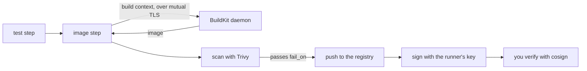

# Build, scan, sign and push a container image

Build a container image from a Dockerfile with a pipeline, scan it for known vulnerabilities, push
it to a Depot (registry), sign it, and check the signature yourself with cosign. For developers who have
run a [first pipeline](first-pipeline.md) and now want images their team can trust.

> **Verified** on 2026-11-19 against commit f717337: every command below, in order, on Linux
> (Fedora) with rootless Podman 5, from a fresh clone, with other port numbers. **Not verified:**
> Docker instead of Podman, macOS and Windows, a Depot with TLS, BuildKit on Kubernetes.

Everything runs on your own machine: a BuildKit daemon and a Depot in containers, and a
Launchway server with its built-in Station (runner). It takes about 45 minutes, most of it reading.



## What you need

- Linux with **rootless Podman** (the BuildKit daemon runs as a Podman container on the host's
  network). Docker may work with the same flags; it was not tried.
- Launchway built from source at `~/launchway`: follow [Install on a laptop](../howto/install-laptop.md).
  This page assumes the binary is at `~/launchway/bin/launchway`.
- `git`, `openssl` and `curl`. `htpasswd` (package `httpd-tools` or `apache2-utils`) is optional;
  step 4 shows a container instead.
- Free local ports 8080 (Launchway), 1234 (BuildKit) and 5000 (the Depot).
- Internet access the first time: BuildKit pulls `alpine`, and the scanner downloads its
  vulnerability database (about 1 minute).

New words: an **image step** is a step with `kind: image`; a **builder** is a BuildKit daemon the
Station sends builds to; see the [glossary](../glossary.md).

```sh
export PATH="$HOME/launchway/bin:$PATH"
cp -r ~/launchway/examples/tutorials/build-and-sign-image ~/image-tutorial
cd ~/image-tutorial
ls
```

```text
app  buildkitd.toml  images.yaml  launchway.yaml  secrets.yaml
```

Every command below runs in `~/image-tutorial` unless it says otherwise.

## 1 Look at the app

`app/` is the repository you build. Its `Dockerfile`:

```text
# A tiny program: it prints a greeting and the version it was built as.
FROM docker.io/library/alpine:3.22
ARG VERSION=dev
COPY greeting.txt /app/greeting.txt
RUN echo "$VERSION" > /app/version.txt
USER 1000:1000
CMD ["sh", "-c", "cat /app/greeting.txt; echo \"version $(cat /app/version.txt)\""]
```

Make it a Git repository, because the server builds commits:

```sh
cd app
git init -b main
git add -A
git commit -m "Add the hello app"
cd ..
```

## 2 Make certificates for BuildKit

The Station and the BuildKit daemon know each other by mutual TLS: the daemon accepts only clients
with a certificate your CA signed, and the Station accepts only a daemon with one. Make a CA, a
certificate for the daemon (valid for `127.0.0.1`) and one for the Station:

```sh
mkdir -p buildkit
openssl req -x509 -newkey ec -pkeyopt ec_paramgen_curve:P-256 -nodes -days 30 \
  -keyout ca.key -out buildkit/ca.crt -subj /CN=tutorial-buildkit-ca
openssl req -newkey ec -pkeyopt ec_paramgen_curve:P-256 -nodes \
  -keyout buildkit/daemon.key -out daemon.csr -subj /CN=buildkitd
printf 'subjectAltName=IP:127.0.0.1,DNS:localhost\nextendedKeyUsage=serverAuth\n' > daemon.ext
openssl x509 -req -in daemon.csr -CA buildkit/ca.crt -CAkey ca.key -CAcreateserial -days 30 \
  -out buildkit/daemon.crt -extfile daemon.ext
openssl req -newkey ec -pkeyopt ec_paramgen_curve:P-256 -nodes \
  -keyout buildkit/client.key -out client.csr -subj /CN=launchway-runner
printf 'extendedKeyUsage=clientAuth\n' > client.ext
openssl x509 -req -in client.csr -CA buildkit/ca.crt -CAkey ca.key -CAcreateserial -days 30 \
  -out buildkit/client.crt -extfile client.ext
```

The CA's key, `ca.key`, stays outside `buildkit/`, which the daemon's container sees.

## 3 Start a rootless BuildKit daemon

The daemon runs as an ordinary user (uid 1000) inside the container. It needs a seccomp profile
that allows user namespaces, which the repository ships, and a range of user IDs to map:

```sh
cp ~/launchway/deploy/buildkit/seccomp-rootless-buildkit.json buildkit/
cp buildkitd.toml buildkit/
echo "user:10000:55000" > buildkit/subid
chmod 755 buildkit
chmod 644 buildkit/daemon.key   # the daemon's user in the container must read it
podman run -d --name tutorial-buildkitd --network host \
  --security-opt seccomp=buildkit/seccomp-rootless-buildkit.json \
  --security-opt apparmor=unconfined --security-opt label=disable \
  -v ./buildkit:/certs:ro \
  -v ./buildkit/subid:/etc/subuid:ro -v ./buildkit/subid:/etc/subgid:ro \
  -v tutorial-buildkit-state:/home/user/.local/share/buildkit \
  docker.io/moby/buildkit:v0.35.0-rootless \
  --oci-worker-no-process-sandbox --config /certs/buildkitd.toml \
  --addr tcp://127.0.0.1:1234 \
  --tlscacert /certs/ca.crt --tlscert /certs/daemon.crt --tlskey /certs/daemon.key
```

After a few seconds it listens:

```sh
podman logs tutorial-buildkitd 2>&1 | grep 'running server'
```

```text
time="..." level=info msg="running server on 127.0.0.1:1234"
```

`buildkitd.toml` tells the daemon that the Depot at `127.0.0.1:5000` speaks plain HTTP, so it
can pull base images from it:

```text
[registry."127.0.0.1:5000"]
  http = true
```

> [!NOTE]
> This is the laptop version of what [deploy/buildkit](https://github.com/JK-Magic-Creations/launchway/blob/main/deploy/buildkit/README.md)
> runs on Kubernetes: a daemon of its own, apart from the step pods, with exactly the two
> relaxations rootless BuildKit needs. `chmod 644` on the daemon's key is acceptable for a
> throwaway daemon on your laptop only.

## 4 Start a Depot with a password {#4-start-a-registry-with-a-password}

Launchway pushes only with credentials, so the Depot asks for a user name and password. The
password goes in a file that the Station reads as a secret:

```sh
mkdir -p secrets registry
openssl rand -hex 16 > secrets/registry-password
htpasswd -Bbn tutorial "$(cat secrets/registry-password)" > registry/htpasswd
podman run -d --name tutorial-registry -p 127.0.0.1:5000:5000 \
  -v ./registry:/auth:ro,Z \
  -e REGISTRY_AUTH=htpasswd -e REGISTRY_AUTH_HTPASSWD_REALM=tutorial \
  -e REGISTRY_AUTH_HTPASSWD_PATH=/auth/htpasswd \
  docker.io/library/registry:2.8.3
curl -s -o /dev/null -w '%{http_code}\n' -u "tutorial:$(cat secrets/registry-password)" http://127.0.0.1:5000/v2/
```

```text
200
```

Without `htpasswd`, make the line with a container:
`podman run --rm docker.io/library/httpd:2.4 htpasswd -Bbn tutorial "$(cat secrets/registry-password)" > registry/htpasswd`.

## 5 Make a signing key

The Station signs with a cosign key pair. If you have [cosign](https://github.com/sigstore/cosign)
installed, run `cosign generate-key-pair` in `cosign/`. Otherwise use its container image, as
here:

```sh
mkdir -p cosign
openssl rand -base64 24 > cosign/password
podman run --rm --user 0 -v ./cosign:/keys:Z -w /keys \
  -e COSIGN_PASSWORD="$(cat cosign/password)" \
  gcr.io/projectsigstore/cosign:v2.6.1 generate-key-pair
```

```text
Private key written to cosign.key
Public key written to cosign.pub
```

`cosign.key` is encrypted with the password in `cosign/password`. Keep both private; give
`cosign.pub` to anyone who should check your images.

## 6 Configure the Station for images {#6-configure-the-runner-for-images}

`launchway.yaml` is the server's configuration. Its `runner:` section is for the built-in Station,
and `images:` says which builders it uses, which Depots it pushes to and who may push where,
and its signing key. Pipelines name a Depot (`local`); they never see an address, a password or
the key.

```yaml
# Server configuration for the tutorial. Paths are relative to this file.
listen: 127.0.0.1:8080
data: data

projects:
  - name: hello
    repo: app
    branch: main
    poll: 5s

runner:
  executor: auto
  secrets:
    files:                              # a secret store: one file per secret in a directory
      type: file
      dir: secrets
      projects: [hello]
  images:
    builders:
      - name: laptop
        address: tcp://127.0.0.1:1234
        ca_file: buildkit/ca.crt        # the CA that signed the daemon's certificate
        cert_file: buildkit/client.crt  # the runner's client certificate
        key_file: buildkit/client.key
        projects: [hello]
    registries:
      local:
        host: 127.0.0.1:5000
        insecure: true                  # plain HTTP: only for a registry on this machine
        credentials:
          username: tutorial
          password: { store: files, key: registry-password }
        push:
          - { projects: [hello], repositories: [tutorial/*] }
    signing:
      key_file: cosign/cosign.key
      password_file: cosign/password
```

- **Push rules.** Nothing is pushed without a rule naming the project and the repository. Here
  project `hello` may push to `tutorial/<anything>` and nowhere else.
- **Credentials** are a reference to a secret store (`files`, a directory), never the value.
- **`insecure: true`** allows plain HTTP. Use it only for a Depot on the Station's own machine.

See [Station configuration](../reference/runner-config.md) for every setting.

## 7 Read the pipeline

`app/.launchway/pipeline.yaml`:

```yaml
pipeline: hello
on:
  push: { branches: [main] }

steps:
  test:
    image: docker.io/library/busybox:1.37.0
    run: |
      grep -q "Hello from Launchway" greeting.txt
      echo "version=1.0.$LAUNCHWAY_RUN_NUMBER" >> "$LAUNCHWAY_OUTPUTS"

  image:
    kind: image
    needs: test
    context: .
    file: Dockerfile
    build_args: { VERSION: { output: test.version } }
    tags:
      - { registry: local, repository: tutorial/hello, tag: { output: test.version } }
      - { registry: local, repository: tutorial/hello, tag: latest }
    sbom: true
    provenance: true
    sign: true
    scan: { fail_on: critical, mode: enforce }

  show:
    image: docker.io/library/busybox:1.37.0
    needs: image
    run: |
      echo "pushed:  $LAUNCHWAY_NEEDS_IMAGE_PUSHED"
      echo "image:   $LAUNCHWAY_NEEDS_IMAGE_IMAGE"
      echo "tags:    $LAUNCHWAY_NEEDS_IMAGE_TAGS"
```

| Key | What it does here |
|---|---|
| `kind: image` | The Station builds the image itself on a builder; the step has no script or container |
| `build_args` | `VERSION` comes from the `test` step's output; build arguments are recorded in the provenance, so never put a secret in one |
| `tags` | Two names to push under, each a Depot from the Station's configuration, a repository and a tag |
| `sbom: true` | Makes a CycloneDX SBOM (a list of the image's components), kept as a Cargo (artifact) |
| `provenance: true` | Records where the image came from, as signed in-toto statements (the default) |
| `sign: true` | Signs the image, its provenance and SBOM with the Station's key |
| `scan` | Scans with Trivy before anything is pushed; with `mode: enforce`, a vulnerability at `critical` or worse fails the step and nothing is pushed |

The image step's outputs (`digest`, `image`, `tags`, `pushed`) reach later steps as
`LAUNCHWAY_NEEDS_IMAGE_*`, which `show` prints. Check the file:

```sh
cd app && launchway validate && cd ..
```

```text
.launchway/pipeline.yaml: pipeline "hello" is valid, 3 step(s) in 3 level(s)
```

## 8 Start the server and run the pipeline

```sh
launchway server --config launchway.yaml
```

```text
  Launchway f717337 is listening on http://127.0.0.1:8080 (no sign-in: anyone who can reach it has full access)
  1 project(s), data in /home/you/image-tutorial/data, SQLite database /home/you/image-tutorial/data/launchway.db
```

Leave it running and open **http://127.0.0.1:8080**. Go to **Projects**, press **Start a Sortie (run)** on
`hello`, keep the branch `main` and press **Start run**. (From another terminal, `curl -s -X POST -H 'X-Launchway-CSRF: 1' -d
'{"ref":"main"}' http://127.0.0.1:8080/api/v1/projects/hello/runs` does the same.)

The Sortie takes about 15 seconds once the base image and the scanner's database are downloaded.
Open the `image` step. Its log ends like this (digests and counts differ for you):

```text
Building on laptop (tcp://127.0.0.1:1234) for its own platform
...
Built sha256:2665acd3a33f…: linux/amd64, 3.6 MiB
[scan] SBOM of the image
[scan] vulnerabilities in the image
Vulnerabilities: 0 critical, 0 high, 1 medium, 0 low, 0 unknown
Pushed 127.0.0.1:5000/tutorial/hello:1.0.1
Pushed 127.0.0.1:5000/tutorial/hello:latest
Signed sha256:2665acd3a33f… with key e9e64fca347b9bda (runner)
Succeeded in 12.4s
Findings: collected security/linux-amd64.sarif (3.3 KiB)
Artifact provenance: kept 2 files (6.9 KiB)
SBOM: kept 1 file (27.8 KiB)
```

And `show` prints the outputs:

```text
pushed:  true
image:   127.0.0.1:5000/tutorial/hello@sha256:2665acd3a33f…
tags:    127.0.0.1:5000/tutorial/hello:1.0.1,127.0.0.1:5000/tutorial/hello:latest
```

Because the project polls `app` every 5 seconds, each commit you make on `main` from now on starts
a Sortie by itself.

## 9 Read the Images tab

Open the Sortie's **Images** tab:


It shows the digest and pushed names, which key signed it, links to the provenance and the SBOM,
each platform, the scan's counts against its gate, and where the build came from (builder, cache,
base images). The **Security** tab lists the vulnerability itself, and the **Images** page in the
sidebar finds every Sortie that built a digest or pushed to a repository.

## 10 Verify the signature with cosign

Anyone with `cosign.pub` can check that the image was signed by your Station's key. Take the
digest from the Images tab (**Copy**) and run:

```sh
DIGEST=sha256:...    # paste the digest
podman run --rm --network host -v ./cosign:/keys:ro,Z gcr.io/projectsigstore/cosign:v2.6.1 \
  verify --key /keys/cosign.pub --insecure-ignore-tlog --allow-insecure-registry \
  --registry-username tutorial --registry-password "$(cat secrets/registry-password)" \
  127.0.0.1:5000/tutorial/hello@$DIGEST
```

```text
WARNING: Skipping tlog verification is an insecure practice that lacks transparency and auditability verification for the signature.

Verification for 127.0.0.1:5000/tutorial/hello@sha256:2665acd3a33f… --
The following checks were performed on each of these signatures:
  - The cosign claims were validated
  - The signatures were verified against the specified public key

[{"critical":{"identity":{"docker-reference":"127.0.0.1:5000/tutorial/hello"},"image":{"docker-manifest-digest":"sha256:2665acd3a33f…"},"type":"cosign container image signature"},"optional":null}]
```

The provenance is a signed attestation too:

```sh
podman run --rm --network host -v ./cosign:/keys:ro,Z gcr.io/projectsigstore/cosign:v2.6.1 \
  verify-attestation --key /keys/cosign.pub --insecure-ignore-tlog --allow-insecure-registry \
  --type slsaprovenance1 \
  --registry-username tutorial --registry-password "$(cat secrets/registry-password)" \
  127.0.0.1:5000/tutorial/hello@$DIGEST > attestation.json
jq -r .payload attestation.json | base64 -d | jq '{predicateType, builder: .predicate.runDetails.builder.id}'
```

```text
{
  "predicateType": "https://slsa.dev/provenance/v1",
  "builder": "http://127.0.0.1:8080/runners/laptop%20%28built%20in%29"
}
```

The builder is the Station that built the image: the built-in Station is named after your machine
(`laptop` here).

`--insecure-ignore-tlog` is needed because Launchway does not write to a public transparency log;
the key is what you trust. With cosign installed, drop the `podman run ...` prefix and the `/keys/`
path. Finally, run the image:

```sh
podman pull -q --tls-verify=false --creds "tutorial:$(cat secrets/registry-password)" \
  127.0.0.1:5000/tutorial/hello:latest
podman run --rm 127.0.0.1:5000/tutorial/hello:latest
```

```text
5da3d7425691…
Hello from Launchway.
version 1.0.1
```

## 11 See the scan gate stop a push

Make the gate stricter than what the image has. In `app/.launchway/pipeline.yaml`, change
`fail_on: critical` to `fail_on: medium`, then commit:

```sh
cd app
sed -i 's/fail_on: critical/fail_on: medium/' .launchway/pipeline.yaml
git commit -am "Fail on medium vulnerabilities"
cd ..
```

A Sortie starts within seconds. Its `image` step fails before pushing:

```text
Vulnerabilities: 0 critical, 0 high, 1 medium, 0 low, 0 unknown
Failed after 14.8s: the scan found 1 vulnerabilities at medium or worse (scan.fail_on: medium, mode: enforce); nothing was pushed
```

If your image has no medium vulnerability, the Sortie succeeds instead; try `fail_on: low`. Put
`critical` back (this starts one more run, which pushes again):

```sh
cd app
sed -i 's/fail_on: medium/fail_on: critical/' .launchway/pipeline.yaml
git commit -am "Fail on critical vulnerabilities"
cd ..
```

## 12 Build on your machine without a server

`launchway run` runs the pipeline of your working copy with the same engine. Give it the
`images:` section and the secret stores in files of their own (`images.yaml` and `secrets.yaml`
in the tutorial directory; `launchway run` uses the project name `local`, which the push rule in
`images.yaml` names):

```sh
cd app
launchway run --images-config ../images.yaml --secrets-config ../secrets.yaml
cd ..
```

```text
...
  ✓ test   succeeded in 100ms
  ✓ image  succeeded in 10.6s
  ✓ show   succeeded in 100ms
Succeeded in 10.9s
```

> [!WARNING]
> `launchway run` pushes and signs for real, under the same tags. Its Sortie number always starts at
> 1, so here it overwrote `tutorial/hello:1.0.1` and `latest`. Give local runs a Depot or
> repository of their own.

## 13 Clean up

Stop the server with Ctrl+C, then:

```sh
podman rm -f tutorial-buildkitd tutorial-registry
podman volume rm tutorial-buildkit-state
podman rmi 127.0.0.1:5000/tutorial/hello:latest
rm -rf ~/image-tutorial
```

## If something goes wrong

| Message | Cause and fix |
|---|---|
| `registry local has no credentials to push with (images.registries.local.credentials)` | The Depot has no `credentials`. Launchway pushes only with credentials; add them as in step 6 |
| `failed to Lchown ... for UID 65534 ... (Hint: try increasing the number of subordinate IDs in /etc/subuid and /etc/subgid)` | The base image has files owned by a user ID above the range rootless Podman can map (busybox's `nobody` is 65534). Use a base image without such files, such as `alpine`, or run BuildKit with more IDs (on Kubernetes, see [deploy/buildkit](https://github.com/JK-Magic-Creations/launchway/blob/main/deploy/buildkit/README.md)) |
| `a tcp:// builder needs ca_file, cert_file and key_file` | The Station refuses a builder without mutual TLS. Give all three |
| The step waits in *queued* | No Station has a builder for this project: check `images.builders[].projects` |

## What you learned

- Image steps are built by a BuildKit daemon apart from the steps, which the Station reaches over
  mutual TLS.
- The Station's `images:` configuration, not the pipeline, decides builders, Depots, credentials
  and who may push where.
- An image step builds, scans (and can stop the push), pushes, signs, and records an SBOM and
  provenance, all shown on the Images tab.
- Anyone with the public key can check the signature and the provenance with cosign.

## What next

- [Deploy with approval, rollout control and Return to base (rollback)](deploy-with-approval.md): deploy an image
  by digest through Argo CD.
- [Policy gates and waivers](policy-gates.md): require signed, scanned images before a deployment.
- [Container images](../guide/images.md) in the guide: several platforms, build secrets, the cache.
- [Supply chain](../security/supply-chain.md): what the signature and the provenance do and do not
  vouch for.
