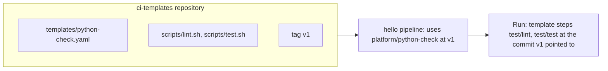

# Templates from a library

Share lint and test steps between repositories: put a template and its scripts in a library
repository, release it with a Git tag, and use it from a pipeline. For developers and platform
teams. Takes about 20 minutes.

> **Verified** on 2026-11-19 against commit f717337: the steps below with a local server, a
> Station (runner) on the same machine and Podman. **Not verified:** a library on a Git host behind
> credentials (it is fetched exactly as Flights (codebase) are).

## What you need

- The repository and server from [First pipeline in 10 minutes](first-pipeline.md), and the tests
  from [Tests and reports](tests-and-reports.md).
- Network access from steps, to install pytest.

## How libraries work



A library is an ordinary Git repository. The server's configuration lists which repositories may
be libraries; a pipeline names one of them and a version (tag, branch or commit). When a Sortie (run) is
created, the version is resolved to a commit and recorded, and the template and its scripts both
come from that commit.

## 1 Make the library

```sh
mkdir -p ~/ci-templates && cd ~/ci-templates
git init -b main
mkdir -p templates scripts
```

`templates/python-check.yaml`:

```yaml
template: python-check
description: Lint and test a Python project, the same way in every repository
params:
  python:     { type: string, default: "3.13", options: ["3.12", "3.13"], description: Python version }
  test_path:  { type: string, default: tests, description: Where the tests are }
containers:
  py: { image: { param: python, format: "python:%s-slim" } }
steps:
  lint:
    container: py
    run: "$LAUNCHWAY_LIB/scripts/lint.sh"
  test:
    container: py
    needs: lint
    run: "$LAUNCHWAY_LIB/scripts/test.sh"
    reports:
      tests: reports/*.xml
outputs:
  passed: { from: test.passed }
```

`scripts/lint.sh`:

```sh
#!/bin/sh
set -e
echo "linting with Python $(python --version 2>&1 | cut -d' ' -f2)"
python -m py_compile $(find . -name '*.py' -not -path './.launchway/*')
```

`scripts/test.sh`:

```sh
#!/bin/sh
set -e
pip install --quiet pytest
mkdir -p reports
python -m pytest "$PARAM_TEST_PATH" --junitxml=reports/unit.xml
echo "passed=yes" >> "$LAUNCHWAY_OUTPUTS"
```

Parameters reach the template as `PARAM_<NAME>` variables and as `{ param: name }` values; there is
no expression language. `$LAUNCHWAY_LIB` is where the library's files are in the workspace.

Commit and release it:

```sh
chmod +x scripts/*.sh
git add -A
git commit -m "python-check template"
git tag v1
```

## 2 Let the server use it

Add the library to `~/launchway-server/launchway.yaml` (replace `/home/you`):

```yaml
libraries:
  - name: ci-templates
    repo: /home/you/ci-templates
```

Stop the server (Ctrl+C) and start it again with `launchway server --config launchway.yaml`. A
pipeline can name only libraries listed here, never an address of its own.

## 3 Use the template

In `~/hello-launchway/.launchway/pipeline.yaml`, name the library at the top level and replace the
`test` step with one that uses the template:

```yaml
libraries:
  platform: { repo: ci-templates, version: v1 }
```

```yaml
  test:
    needs: lint
    uses: platform/python-check
    retry: 1
    with: { python: "3.12" }
```

- `platform` is this pipeline's name for the library; `repo` is the server's name for it.
- `with` gives values for the parameters, checked against their types and options, with line numbers.
- `retry` (like `when` and `timeout`) on the `uses` step applies to every step of the template.

`launchway validate` checks the pipeline but cannot expand templates, which live on the server:

```text
.launchway/pipeline.yaml: pipeline "hello" is valid, 8 step(s) in 4 level(s)
Steps that use templates are not expanded here: check the pipeline in a server's editor to see them.
```

The server's editor (**Flights → hello → Edit pipeline**) shows the expanded graph as you type.
Commit:

```sh
git add -A
git commit -m "Use the platform team's python-check template"
```

## 4 Look at the Sortie {#4-look-at-the-run}

The `test` step became `test/lint` and `test/test`, drawn as one group on the graph. The log of
`test/lint` shows the parameter at work:

```text
Image python:3.12-slim
linting with Python 3.12.16
```

The Sortie's header lists the libraries it used and the commit `v1` pointed to. Every Station uses
that commit, and resuming or re-running the Sortie never resolves the tag again.

## 5 Try an unreleased library change

In `~/ci-templates`, allow Python 3.14 and commit without tagging:

```sh
cd ~/ci-templates
sed -i 's/options: \["3.12", "3.13"\]/options: ["3.12", "3.13", "3.14"]/' templates/python-check.yaml
git commit -am "Allow Python 3.14"
```

Start a run of `hello` with **Start a Sortie → Advanced → library override** `platform` = `main`, or:

```sh
curl -X POST -H 'X-Launchway-CSRF: 1' -H 'Content-Type: application/json' \
  -d '{"ref":"main","libraries":{"platform":"main"}}' \
  http://127.0.0.1:8080/api/v1/projects/hello/runs
```

The Sortie is marked *Library override* and records both versions. When the change is good, tag it
`v2` and move pipelines to `version: v2`.

> [!WARNING]
> Whoever can push to a library, or move its tags, changes what every pipeline using it runs.
> Protect its branches and tags on the Git host, and pin important pipelines to tags or commits.
> A [policy](../reference/policy-rules.md) can require that (`library_versions: { pinned: tag }`).

## What you learned

- A template and its scripts live in one Git repository and are versioned with tags.
- Pipelines use a template like a step, with typed parameters; each Sortie records the exact commit.
- A Sortie can try an unreleased version with an override.

## What next

- [Policy gates and waivers](policy-gates.md): require templates and pinned versions.
- [Shared libraries guide](../guide/libraries.md): one pipeline for many repositories, security.
