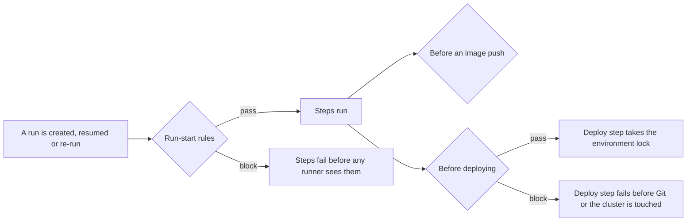

# Policy gates and waivers

Set a rule that every pipeline of a project must follow, watch it in report mode, enforce it, and
let one run through with a waiver that has a reason and an expiry. For platform engineers and
security reviewers. Takes about 15 minutes.

> **Verified** on 2026-11-19 against commit f717337: the steps below with a local server, using
> the `hello` project from the earlier tutorials (it uses a library template). **Not verified
> here:** the gates before deploying and before an image push; they are judged the same way and
> are shown in [Deploy with approval and rollback](deploy-with-approval.md).

## What you need

- The server and `hello` project from the earlier tutorials, ideally with the library from
  [Templates from a library](library-templates.md).

## Where policies are judged



Policies live in the server's configuration (or a Git repository pinned by tag), never in the
pipeline file, so a pipeline's authors cannot switch them off. Each rule comes from a fixed
[catalog](../reference/policy-rules.md); there is no policy language.

## 1 Add a policy in report mode

Add to `~/launchway-server/launchway.yaml`:

```yaml
policy:
  policies:
    - name: pinned-images
      description: Steps run in images pinned by digest, and libraries are pinned to tags.
      mode: report
      scope: { projects: [hello] }
      rules:
        step_images: { digest: true }
        library_versions: { pinned: tag }
```

Restart the server. A mistake in a policy stops the server from starting, with the file and line.

Start a run of `hello` (**Start a run**, or the `curl` command from the
[first tutorial](first-pipeline.md#6-start-a-run-by-hand)). It runs as before, but its **Policy**
tab shows a warning, rule by rule:

```text
library_versions  pass  1 libraries, all pinned
                        platform (ci-templates) at v1, a tag, commit 44e31e5f5bf2
step_images       fail  step lint: alpine:3.22 (not pinned by digest); ...
                  want: every step and container image pinned by digest (name@sha256:…)
```

Report mode records and shows verdicts but never changes an outcome. The **Policy** page lists
the policies in force and recent verdicts. Start new policies this way, see what they would
stop, then enforce them.

## 2 Enforce it

Change `mode: report` to `mode: enforce` and restart the server. Start another run. It fails at
once, and every step says why:

```text
the run was refused when it started: blocked by policy: policy pinned-images (enforce), rule
step_images: container test-py: python:3.12-slim (not pinned by digest); step lint: alpine:3.22
(not pinned by digest); ...
```

The decision is a `policy.evaluated` event in the run's log, with the policy as judged, the facts
and the time, so it can be checked later.

## 3 Waive the rule for this run

The right fix is to pin the images (`alpine:3.22@sha256:...`). When that has to wait, an admin of
the project can grant a **waiver**: one rule of one policy, for a project, optionally only for one
run or environment, with a reason and an expiry. In the web UI press **Waive…** beside the rule on the run's Policy
tab, or the API (replace the run id):

```sh
curl -X POST -H 'X-Launchway-CSRF: 1' -H 'Content-Type: application/json' \
  -d '{"policy":"pinned-images","rule":"step_images","reason":"Pinning the tutorial images by digest next week","expires_in_hours":72,"run":"<run-id>"}' \
  http://127.0.0.1:8080/api/v1/projects/hello/waivers
```

```json
{
  "id": "wvr_06gzdp4g9958tmnn2w7g",
  "policy": "pinned-images",
  "rule": "step_images",
  "reason": "Pinning the tutorial images by digest next week",
  "granted_by": "dana",
  "state": "active"
}
```

A rule is judged again when a run is resumed. Press **Resume** on the run (or
`POST /api/v1/runs/<run-id>/resume` with the same header). The run passes the gate and succeeds,
and the Policy tab shows both decisions: the block, then the pass with `step_images` **waived**
and the waiver's reason. Waivers are recorded in the audit trail (`policy.waive`) and expire on
their own; at most `policy.waivers.max_days` (default 30) ahead.

> [!TIP]
> With sign-in on, the command line does the same:
> `launchway waivers grant hello --policy pinned-images --rule step_images --reason "..." --expires 72h --run <run-id>`.

## 4 Gates before deploying

The rules that matter most for production are judged just before a deploy step takes its
environment's lock: `tests`, `findings`, `sbom`, `deployed_images`, `approvals` and `refs`. For
example:

```yaml
    - name: prod-evidence
      mode: enforce
      scope: { environments: [prod] }
      rules:
        tests: { min: 1 }
        findings: { max_severity: medium }
        sbom: {}
        approvals: { min: 1 }
        refs: { branches: [main] }
```

See [Deploy with approval and rollback](deploy-with-approval.md) for deploy steps, and the
[policy rules reference](../reference/policy-rules.md) for every rule.

## What you learned

- Policies are typed rules in the server's configuration, judged at fixed points, never in the pipeline.
- Report mode shows what a policy would do; enforce mode stops the run or step, saying why.
- A waiver lets one rule pass, with a reason and an expiry, recorded and shown with the verdict.

## What next

- [Policies guide](../guide/policies.md): policies from Git, failing closed, limits.
- [Controls and compliance](../security/controls-and-compliance.md).
