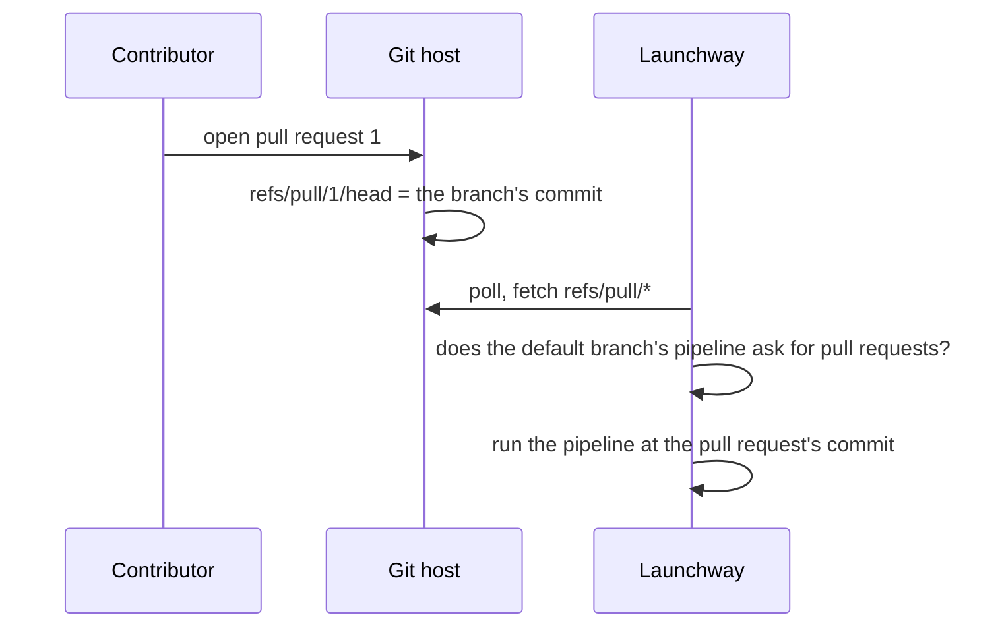

# Pull-request runs

Run your pipeline for pull requests, keep some steps out of them, and see how Launchway keeps
secrets away from code that anyone could have written. For developers. Takes about 15 minutes.

> **Verified** on 2026-11-19 against commit f717337: the steps below with a local server and
> Podman, using a local repository in which the pull-request ref is made by hand.
> **Not verified:** a real pull request on a Git host (the server reads the same ref there).

## What you need

- The repository and server from [First pipeline in 10 minutes](first-pipeline.md), with the
  server running.

## How Launchway sees pull requests

Launchway has no Git host integration to install: it polls. Git hosts such as GitHub, Gitea and
Forgejo publish each pull request's head commit as the ref `refs/pull/<number>/head`. The server's
mirror fetches those refs, and a Sortie (run) starts when one appears or moves. A webhook from the Git host
only makes the server look at once; see [Triggers](../guide/triggers.md#webhooks).



## 1 Ask for pull-request runs on the default branch

Edit `.launchway/pipeline.yaml` on `main`:

```yaml
pipeline: hello
on:
  push: { branches: [main] }
  pull_request: {}
supersede: true
```

- `pull_request: {}` asks for pull-request runs. The **default branch decides**: a pull request
  runs only if the pipeline on the default branch asks for it (and so does the pipeline at the
  pull request's head), so a pull request cannot turn runs on for itself.
- `supersede: true` cancels an older run of the same pull request (or branch) when a newer one
  starts.

Add two steps, one only for pull requests and one only for `main`:

```yaml
  pr-comment:
    image: alpine:3.22
    needs: build
    when: { event: pull_request }
    run: echo "pull request $LAUNCHWAY_PULL_REQUEST would get version $LAUNCHWAY_NEEDS_BUILD_VERSION"

  publish:
    image: alpine:3.22
    needs: build
    when: { branch: main }
    run: echo "publishing from main"
```

A pull-request run has no branch, so `when: { branch: main }` never matches it. Commit on `main`:

```sh
launchway validate
git add -A
git commit -m "Run for pull requests"
```

## 2 Open a pull request

On a Git host you would push a branch and open a pull request. Here, make the branch and the ref
the Git host would make:

```sh
git switch -c feature/greeting
echo "# Hello again" >> README.md
git commit -am "Change the greeting"
git update-ref refs/pull/1/head feature/greeting
git switch main
```

Within a few seconds run *pull request #1* starts. Its event is `pull_request`, its steps get
`LAUNCHWAY_EVENT=pull_request`, `LAUNCHWAY_REF=refs/pull/1/head` and `LAUNCHWAY_PULL_REQUEST=1`,
and `LAUNCHWAY_BRANCH` is empty. `pr-comment` prints:

```text
pull request 1 would get version 1.0.11
```

and `publish` is skipped. *Recent pushes* on the project page says why each ref did or did not
start a Sortie:

```text
refs/pull/1/head             started run #11
refs/heads/feature/greeting  the pipeline's push trigger does not match refs/heads/feature/greeting
```

> [!NOTE]
> Pull requests that already existed when the server first looked at a project do not run. Only
> new pull requests, and ones pushed to, run.

## 3 See secrets refused

A pull request's code may come from anyone who can open one. By default, a step of a
pull-request run that declares `secrets` fails before any Station (runner) sees it. Add a step that asks
for a secret, on the pull request's branch:

```sh
git switch feature/greeting
```

```yaml
  notify:
    image: alpine:3.22
    needs: build
    secrets:
      CHAT_TOKEN: { store: env, key: CHAT_TOKEN }
    run: echo "would notify the team"
```

```sh
git commit -am "Notify the team"
git update-ref refs/pull/1/head feature/greeting
git switch main
```

The new run of pull request #1 fails at `notify`, and says why:

```text
not run: this run is for a pull request, whose code may come from anyone who can open one, and
pull-request runs of hello may not read secrets (the step asks for CHAT_TOKEN). Guard the step with
when: { event: [push, manual] }, or ask an administrator to set pull_requests.secrets: true for the project
```

Do what it says: add `when: { event: [push, manual] }` to `notify`. An administrator can allow
secrets for a project's pull requests with `pull_requests: { secrets: true }` in the server's
configuration, if only trusted people can open pull requests there.

## What you learned

- `on.pull_request` on the default branch turns pull-request runs on; Launchway polls
  `refs/pull/*`.
- `when: { event: ... }` keeps steps in or out of pull-request runs; branch conditions never match them.
- Pull-request runs cannot read secrets unless the project allows it.

## What next

- [Templates from a library](library-templates.md).
- [Triggers guide](../guide/triggers.md): schedules and webhooks too.
- Reporting a Sortie's result back to the pull request as a commit status is not available yet.
